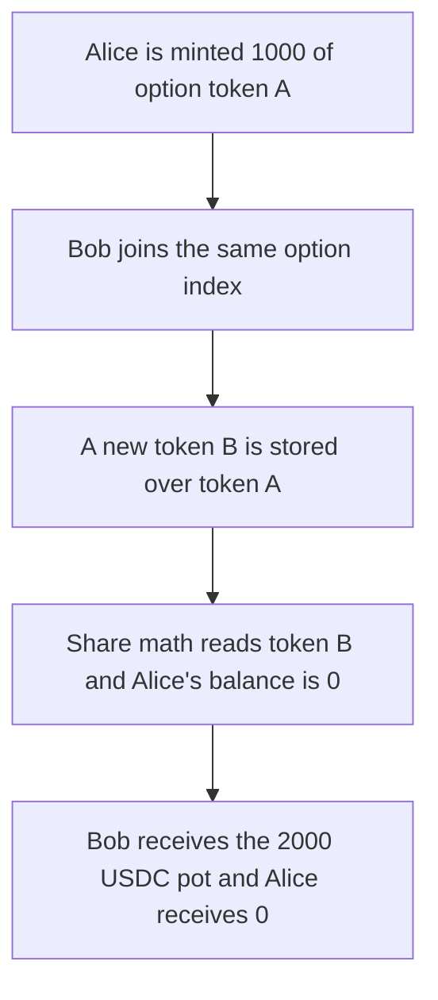

# Filament: a second joiner replaces the option token, so the first winner is paid nothing

> **Vulnerability classes:** `vuln/logic/state-update`

<!-- non-defihacklabs -->
<!-- source-auditvault: https://github.com/Auditware/AuditVault/blob/main/findings/45831-users-can-lose-all-their-rewards-even-if-their-option-won-th.md -->
<!-- date: 2024-11 -->

## Key info

| Field | Value |
|---|---|
| **Loss** | Alice wagered 1000 USDC on the winning option and receives 0. Bob nets +1000 USDC |
| **Vulnerable contract** | `Duel.joinDuel` |
| **Attacker EOA** | `0x1111111111111111111111111111111111111111` |
| **Attack contract** | `Exploit` (Bob) |
| **Attack tx** | `Exploit.run()` |
| **Chain / block / date** | Local synthetic · 2024-11 |
| **Compiler** | solc 0.8.27, cancun, via IR |
| **Bug class** | Option token is redeployed per joiner and the mapping is overwritten |

## TL;DR

`joinDuel` deploys a new `OptionToken` for every join and stores that address at `optionIndexToOptionToken[duelId][optionIndex]`. Alice joins first and is minted 1000 tokens. Bob joins the same duel, the same option string, and the same index. His token replaces Alice's in the mapping. Payout uses `_getUserDuelOptionShare` on whatever address is stored now. Alice's balance of that token is 0, so her share is 0. Bob receives the whole 2000 USDC pot.

## The vulnerable code

```solidity
OptionToken newOptionToken = new OptionToken(_option, _option); // @> VULN
optionIndexToOptionToken[_duelId][_optionsIndex] = address(newOptionToken);
```

```solidity
address optionToken = optionIndexToOptionToken[_duelId][_optionIndex];
uint256 optionTokenBalance = IERC20(optionToken).balanceOf(_user);
uint256 totalOptionTokenSupply = IERC20(optionToken).totalSupply();
optionShare = (optionTokenBalance * 1e18) / totalOptionTokenSupply;
```

`joinDuelFixed` mints the token already stored for that index. Both bettors then hold 1000 of the same token, each share is one half, and each receives 1000 USDC back.

## Root cause

The option index is supposed to identify one token for every bettor on that outcome. Deploying a new token on every join means only the last bettor's balance is visible at settlement.

## Preconditions

- Two users join the same `duelId` and the same option index.
- The option wins, so settlement pays that index's token balances.
- The first user has not been migrated onto the replacement token.

## Attack walkthrough

1. Alice deposits 1000 USDC. Her option token is stored for duel `"1"`, index 0.
2. Bob calls `joinDuel` with the same ids and deposits 1000 USDC. A second token is deployed and stored over the first.
3. `distribute` reads Bob's token. Alice's share is 0. Bob's share is 1e18.
4. The 2000 USDC pot is transferred to Bob. Alice's balance stays 0. Bob started the call with 1000 USDC, so the measured profit is 1000.

## Diagrams



## Impact

A user who backed the winning option loses the entire stake and any share of the pot. Here that is Alice's 1000 USDC, taken by the later joiner.

## How to reproduce

```bash
cd 45831-users-can-lose-all-their-rewards-even-if-their-option-won-th_exp
forge test -vv
```

## Sources

- AuditVault finding: https://github.com/Auditware/AuditVault/blob/main/findings/45831-users-can-lose-all-their-rewards-even-if-their-option-won-th.md
- Report: https://github.com/solodit/solodit_content/blob/main/reports/Zokyo/2024-11-21-Filament.md
- Blamed logic: `joinDuel` option-token deploy and `_getUserDuelOptionShare`, as quoted by Zokyo
