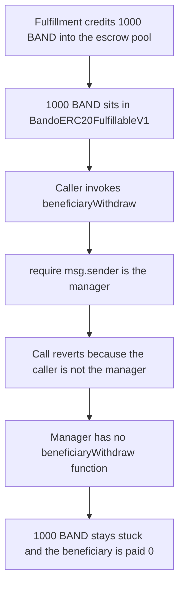

# Bando — fulfilled beneficiary balances cannot be withdrawn

> **Vulnerability classes:** vuln/dos/frozen-funds · vuln/logic/missing-check
>
> The finding file has no `vuln/` tag. Genome on the finding is frozen-funds and locked-funds. `fix/use-reentrancy-guard` is also present and is not this bug.

> **Reproduction:** self-contained Foundry PoC with **only `forge-std`** — no fork, no RPC. Full trace: [output.txt](output.txt).

<!-- non-defihacklabs -->
<!-- source-auditvault: https://github.com/Auditware/AuditVault/blob/main/findings/45848-lack-of-an-implementation-for-withdrawing-beneficiaries-bala.md -->
<!-- date: 2024-11 -->

---

## Key info

| | |
|---|---|
| **Impact** | **HIGH** — 1,000 BAND credited to a beneficiary's releaseable pool stays in the escrow. The withdraw reverts, and the manager has no withdraw to call. |
| **Protocol** | [Bando](https://github.com/bandohq/evm-fulfillment-protocol) fulfillment escrow |
| **Vulnerable code** | `BandoERC20FulfillableV1.beneficiaryWithdraw` — `require(_manager == msg.sender)` with no manager wrapper |
| **Bug class** | Missing withdraw. Funds locked after a successful fulfillment. |
| **Finding** | Zokyo — Bando, 2024-11-25 · #45848 |
| **Report** | [Zokyo/2024-11-25-Bando.md](https://github.com/solodit/solodit_content/blob/main/reports/Zokyo/2024-11-25-Bando.md) |
| **Source** | [AuditVault](https://github.com/Auditware/AuditVault/blob/main/findings/45848-lack-of-an-implementation-for-withdrawing-beneficiaries-bala.md) |
| **Compiler** | solc 0.8.27, cancun, via_ir |

---

## TL;DR

1. A fulfilled service credits 1,000 BAND into the escrow's releaseable pool. The tokens sit in `BandoERC20FulfillableV1`.
2. `beneficiaryWithdraw(uint256,address)` pays that pool out only when `msg.sender` is the manager. The line is the one the report quotes.
3. The audited `BandoFulfillmentManagerV1` implements `registerFulfillment` and does **not** implement `beneficiaryWithdraw`.
4. A direct withdraw reverts. A call to the missing manager selector reverts. The beneficiary's balance stays 0.
5. Adding the manager withdraw (the control) pays the beneficiary the same 1,000 BAND.

---

## The vulnerable code

Quoted from the report, and present at `bandohq/evm-fulfillment-protocol@b901030` in `BandoERC20FulfillableV1.beneficiaryWithdraw`. The manager file at that commit has `registerFulfillment` / `withdrawRefund` and no `beneficiaryWithdraw`.

```solidity
function beneficiaryWithdraw(uint256 serviceID, address token) public virtual nonReentrant {
    // @> VULN: only the manager may withdraw, and BandoFulfillmentManagerV1 never calls this
    require(_manager == msg.sender, "Caller is not the manager");
    // FIX: add manager.beneficiaryWithdraw that the beneficiary can call, which calls this
    address payable beneficiary = _registryContract.beneficiaryOf(serviceID);
    require(_releaseablePools[token] > 0, "There is no balance to release.");
    uint256 amount = _releaseablePools[token];
    _releaseablePools[token] = 0;
    MockToken(token).transfer(beneficiary, amount);
}
```

The payout snapshots `amount` before clearing the pool, matching the native `BandoFulfillableV1.beneficiaryWithdraw` at the same commit. A separate zero-after-clear in the ERC20 sibling is not this finding and is not reproduced. The only difference between the failing run and the control is the added manager function.

## Root cause

The escrow will not pay a beneficiary unless the caller is the manager. The manager is the only contract supposed to expose that action to the beneficiary, and the audited manager does not. After `registerFulfillment` the tokens are in the escrow and the accounting says they are releasable, but no caller can complete the release.

## Preconditions

- A service whose beneficiary is set.
- A successful fulfillment that credits the releaseable pool and leaves the tokens in the escrow.
- The deployed manager is the pre-fix `BandoFulfillmentManagerV1` (no `beneficiaryWithdraw`).

## Attack walkthrough

1. Mint 1,000 BAND and `registerFulfillment` through the manager. The escrow balance becomes 1,000 BAND and `_releaseablePools[token]` becomes 1,000 BAND.
2. Call `escrow.beneficiaryWithdraw`. `msg.sender` is not the manager, so the require reverts. The tokens do not move.
3. Call `manager.beneficiaryWithdraw`. The selector is not implemented. The call reverts.
4. Escrow balance is still 1,000 BAND. Beneficiary balance is still 0.

## Diagrams



## Impact

The beneficiary loses access to 1,000 BAND that the protocol has already marked releasable. The same gate applies to every fulfilled service whose escrow only accepts the manager and whose manager never forwards the call. The control, which only adds `beneficiaryWithdraw` on the manager, pays that beneficiary the full 1,000 BAND and leaves the escrow at 0.

## PoC

```bash
cd 45848-lack-of-an-implementation-for-withdrawing-beneficiaries-bala_exp
forge test -vv
```

`test_exploit_beneficiary_balance_stuck` asserts the escrow still holds 1,000 BAND, the beneficiary holds 0, the direct withdraw reverted, and the manager call reverted. `test_control_added_withdraw_pays_beneficiary` deploys the same escrow with the added manager withdraw and asserts the beneficiary receives 1,000 BAND.

## Remediation

Add `beneficiaryWithdraw` on `BandoFulfillmentManagerV1` that checks the caller is the service beneficiary and then calls the escrow. That is what the later manager does, and what the control implements.

```diff
+ function beneficiaryWithdraw(uint256 serviceID, address token) external {
+     require(registry.beneficiaryOf(serviceID) == msg.sender, "Only the beneficiary can withdraw");
+     BandoERC20FulfillableV1(_escrow).beneficiaryWithdraw(serviceID, token);
+ }
```

## Sources

- AuditVault finding: https://github.com/Auditware/AuditVault/blob/main/findings/45848-lack-of-an-implementation-for-withdrawing-beneficiaries-bala.md
- Zokyo report (2024-11-25): https://github.com/solodit/solodit_content/blob/main/reports/Zokyo/2024-11-25-Bando.md
- Vulnerable tree: https://github.com/bandohq/evm-fulfillment-protocol/blob/b901030059506d7701096a33e9845a4687a16f9e/contracts/BandoERC20FulfillableV1.sol
- Manager without the withdraw: https://github.com/bandohq/evm-fulfillment-protocol/blob/b901030059506d7701096a33e9845a4687a16f9e/contracts/BandoFulfillmentManagerV1.sol
