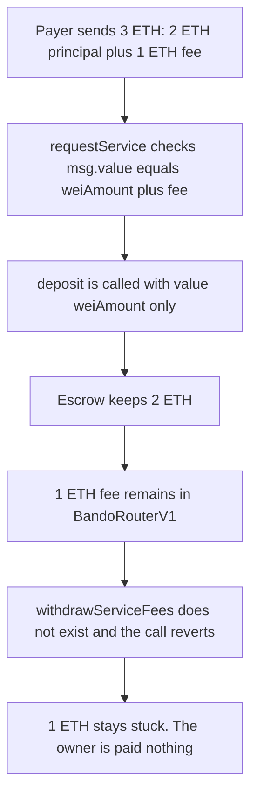

# Bando — service fees locked in the router

> **Vulnerability classes:** vuln/dos/frozen-funds
>
> That is the only `vuln/` tag on the finding. The finding also tags `impact/loss-of-funds/locked-funds`.

> **Reproduction:** self-contained Foundry PoC with **only `forge-std`** — no fork, no RPC. Full trace: [output.txt](output.txt).

<!-- non-defihacklabs -->
<!-- source-auditvault: https://github.com/Auditware/AuditVault/blob/main/findings/45849-fund-locked-due-to-lack-of-an-implementation-for-withdrawing.md -->
<!-- date: 2024-11 -->

---

## Key info

| | |
|---|---|
| **Impact** | **HIGH** — a 1 ETH service fee paid with a native request stays in `BandoRouterV1`. There is no function that pays it to the owner. |
| **Protocol** | [Bando](https://github.com/bandohq/evm-fulfillment-protocol) router |
| **Vulnerable code** | `BandoRouterV1.requestService` — `deposit{value: request.weiAmount}` after requiring `msg.value == weiAmount + feeAmount` |
| **Bug class** | Fee collected, then not forwarded and not withdrawable |
| **Finding** | Zokyo — Bando, 2024-11-25 · #45849 |
| **Report** | [Zokyo/2024-11-25-Bando.md](https://github.com/solodit/solodit_content/blob/main/reports/Zokyo/2024-11-25-Bando.md) |
| **Source** | [AuditVault](https://github.com/Auditware/AuditVault/blob/main/findings/45849-fund-locked-due-to-lack-of-an-implementation-for-withdrawing.md) |
| **Compiler** | solc 0.8.27, cancun, via_ir |

This is not the missing beneficiary withdraw. That bug is on `BandoFulfillmentManagerV1`. This one is the service-fee balance left inside `BandoRouterV1`.

---

## TL;DR

1. `requestService` requires `msg.value == request.weiAmount + service.feeAmount`.
2. It then calls `escrow.deposit` with value `request.weiAmount` only.
3. The fee (here 1 ETH, on a 2 ETH principal) remains in the router.
4. The audited router has no fee withdraw. Calling `withdrawServiceFees` reverts.
5. The control adds that withdraw. The owner receives the 1 ETH fee. The escrow still holds the 2 ETH principal.

---

## The vulnerable code

The report quotes both pieces. At `bandohq/evm-fulfillment-protocol@a1e3aa2abb472d618bf479a76acf9855f760b145` the sum check lives in `FulfillmentRequestLib.validateRequest` and the deposit lives in `BandoRouterV1.requestService`. Both run on every native request. The reduction inlines the check into `requestService` so the executed lines are the ones the report shows.

```solidity
(bool success, uint256 total_amount) = request.weiAmount.tryAdd(service.feeAmount);
if (!success) {
    revert OverflowError();
}
if (msg.value != total_amount) {
    revert AmountMismatch();
}
// @> VULN: only weiAmount is forwarded, so service.feeAmount is locked here with no withdraw
BandoFulfillableV1(_escrow).deposit{value: request.weiAmount}(serviceID, request);
// FIX: add withdrawServiceFees() that pays address(this).balance to the owner
```

## Root cause

The router is willing to accept the fee (the `msg.value` check fails unless the fee is included) but the only outbound value is `request.weiAmount`. Nothing else in `BandoRouterV1` sends the residual balance to the owner, the beneficiary, or the escrow.

## Preconditions

- A service whose `feeAmount` is non-zero. The PoC uses 1 ETH.
- A caller who pays `weiAmount + feeAmount` in the same transaction. The PoC uses 2 ETH + 1 ETH.
- The deployed router is the pre-fix `BandoRouterV1`, which has `requestService` and does not have a fee withdraw.

## Attack walkthrough

1. Set the service fee to 1 ETH.
2. Call `requestService` with `msg.value` of 3 ETH and `weiAmount` of 2 ETH. The sum check passes.
3. `deposit{value: 2 ETH}` funds the escrow with the principal only.
4. The router balance is 1 ETH. `withdrawServiceFees()` does not exist, so the call reverts.
5. The 1 ETH fee is still in the router.

## Diagrams



## Impact

Every native `requestService` with a non-zero fee strands that fee in the router. In this run the stranded amount is 1 ETH. The principal is not lost: the escrow holds the 2 ETH. The owner cannot recover the fee until a withdraw is added. The control calls that withdraw and the owner receives exactly 1 ETH.

## PoC

```bash
cd 45849-fund-locked-due-to-lack-of-an-implementation-for-withdrawing_exp
forge test -vv
```

`test_exploit_service_fee_stuck_in_router` asserts the router holds 1 ETH, the escrow holds 2 ETH, and the withdraw selector reverts. `test_control_added_withdraw_pays_owner_the_fee` uses the same `requestService` and then `withdrawServiceFees`. The owner wallet's balance increases by 1 ETH and the router ends at 0.

## Remediation

Add a withdraw that pays the accumulated service-fee balance to the owner. Do not change the deposit amount in order to "fix" this: the report's recommendation is the missing withdraw.

```diff
+ function withdrawServiceFees() external {
+     require(msg.sender == owner, "only owner");
+     uint256 amount = address(this).balance;
+     (bool ok,) = owner.call{value: amount}("");
+     require(ok, "fee transfer failed");
+ }
```

## Sources

- AuditVault finding: https://github.com/Auditware/AuditVault/blob/main/findings/45849-fund-locked-due-to-lack-of-an-implementation-for-withdrawing.md
- Zokyo report (2024-11-25): https://github.com/solodit/solodit_content/blob/main/reports/Zokyo/2024-11-25-Bando.md
- Fee check: https://github.com/bandohq/evm-fulfillment-protocol/blob/a1e3aa2abb472d618bf479a76acf9855f760b145/contracts/libraries/FulfillmentRequestLib.sol
- Deposit of weiAmount only: https://github.com/bandohq/evm-fulfillment-protocol/blob/a1e3aa2abb472d618bf479a76acf9855f760b145/contracts/BandoRouterV1.sol
