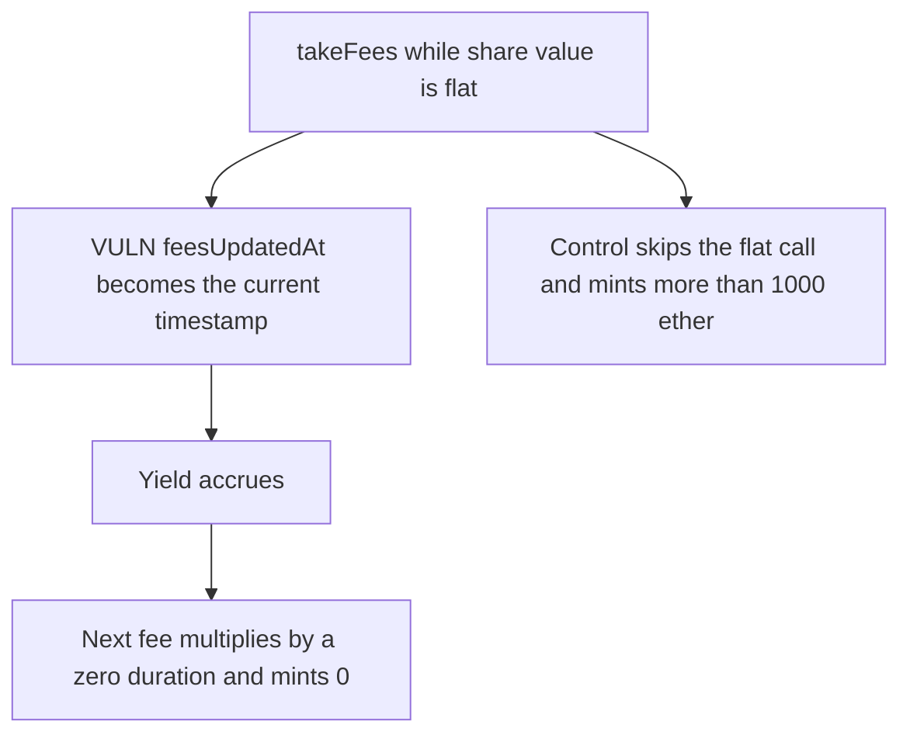

# A flat takeFees call zeroes the next management fee

> **Vulnerability classes:** `vuln/logic/fee-calculation` · `vuln/dos/griefing`

<!-- non-defihacklabs -->
<!-- source-auditvault: https://github.com/Auditware/AuditVault/blob/main/findings/45888-attacker-can-grief-the-management-fee-to-be-lesser-than-expe.md -->
<!-- date: 2024-12 -->

## Key info

| Field | Value |
|---|---|
| **Loss** | The fee recipient is minted 0 shares instead of more than 1000 ether |
| **Vulnerable contract** | `FeeVault.takeFees` |
| **Attacker EOA** | `0x1111111111111111111111111111111111111111` |
| **Attack contract** | `Exploit` |
| **Attack tx** | `Exploit.run()` |
| **Chain / block / date** | Ethereum model · block 0 · 2024-12 |
| **Compiler** | solc 0.8.27, cancun, via IR |
| **Bug class** | Management-fee clock updates with no accrual |

## TL;DR

Anyone can call `takeFees` while the share value is still equal to the high water mark. No shares are minted, but `feesUpdatedAt` becomes the current timestamp. After the vault accrues yield, the management fee for that elapsed second is 0. A second vault that does not get the flat call mints more than 1000 ether of fee shares for the same second.

## Background

Zokyo's December 2024 VaultCraft review. The report shows `fees.feesUpdatedAt = uint64(block.timestamp)` running even when the call minted nothing. Management fee is `managementFee` times assets times the time since `feesUpdatedAt`, divided by a 365.25 day year.

## The vulnerable code

```solidity
feesUpdatedAt = uint64(block.timestamp); // @> VULN: clock moves even when share value did not and no fee was minted
// FIX: if (fee == 0) return; do not write feesUpdatedAt
```

The change that removes the harm:

```diff
- feesUpdatedAt = uint64(block.timestamp);
+ if (fee > 0) feesUpdatedAt = uint64(block.timestamp);
```

## Root cause

The fee formula's only time input is `block.timestamp - feesUpdatedAt`. Writing the timestamp on a zero-fee call deletes the elapsed time. The next call, even after assets increase, multiplies by zero.

## Preconditions

- Both vaults start with assets and supply equal to `31557600 * 1000 ether`, a 100 percent management fee, and `feesUpdatedAt` of 0.
- The block timestamp is 1.
- The griefed vault is called once before the yield and once after. The control vault is called only after the yield.

## Attack walkthrough

1. Flat `takeFees` mints 0 and sets `feesUpdatedAt` to 1.
2. Assets increase by 1 ether.
3. The second `takeFees` computes a zero duration and mints 0.
4. The control vault's single `takeFees` uses a one-second duration and mints more than 1000 ether of shares to the fee recipient.

## Diagrams



## Impact

The fee recipient of the griefed vault receives no shares for that second of assets under management. The control recipient receives more than 1000 ether of shares. A caller can repeat the flat call and keep the management fee at 0.

## Remediation

Write `feesUpdatedAt` only when a nonzero fee was minted, which is the report's recommendation not to update the clock when share value did not increase.

## How to reproduce

```bash
cd 45888-attacker-can-grief-the-management-fee-to-be-lesser-than-expe_exp
forge test -vv
```

`test_exploit` is the harm. The control test is the guarded path. Captured output is `output.txt`.

## Sources

- AuditVault finding: https://github.com/Auditware/AuditVault/blob/main/findings/45888-attacker-can-grief-the-management-fee-to-be-lesser-than-expe.md
- Zokyo report: https://github.com/solodit/solodit_content/blob/main/reports/Zokyo/2024-12-31-VaultCraft.md
