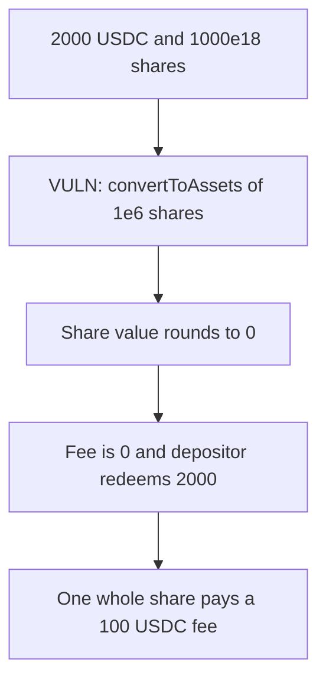

# Vaultcraft — performance fee prices 1e6 shares instead of one 18-decimal share

> **Vulnerability classes:** `vuln/arithmetic/decimal-mismatch` · `vuln/logic/fee-calculation`

<!-- non-defihacklabs -->
<!-- source-auditvault: https://github.com/Auditware/AuditVault/blob/main/findings/45889-converttoassets-is-receiving-assets-decimals-instead-of-shar.md -->
<!-- date: 2024-12 -->

## Key info

| | |
|---|---|
| **Protocol** | Vaultcraft |
| **Finding** | Zokyo, AuditVault 45889 |
| **Vulnerable code** | `_accruedPerformanceFee` calls `convertToAssets` |
| **Harm** | Fee taken is 0 and the depositor redeems 2000 USDC. The control pays the fee recipient 100 USDC. |
| **Chain** | local synthetic |

## TL;DR

The performance fee asks `convertToAssets` for the assets behind `10 ** asset.decimals()` shares. USDC has 6 decimals, so that is 1e6 shares, not one 18-decimal share. On a vault with 2000 USDC and 1000e18 shares, that unit rounds to 0 and sits under the high-water mark of 1 USDC per share. No fee is taken. The depositor redeems all 2000 USDC. Pricing `1e18` shares yields 2 USDC, and 10 percent of the profit is 100 USDC to the fee recipient.

## The vulnerable code

```solidity
uint256 shareValue = convertToAssets(10 ** asset.decimals());
```

The finding's recommendation is to pass one share, `10 ** 18`, not one asset unit.

## Root cause

`convertToAssets` expects a share amount. The call passes an asset decimal scale. For a 6-decimal asset and 18-decimal shares the two units differ by 1e12, and the fee math compares the result with a high-water mark stored per 1e18 shares.

## Preconditions

`totalAssets` is 2000e6. `totalSupply` is 1000e18. `highWaterMark` is 1e6, meaning 1 USDC per whole share. The performance fee is 10 percent of the per-share profit. One whole share is worth 2 USDC.

## Attack walkthrough

1. `takeFee` calls `_accruedPerformanceFee`.
2. `convertToAssets(1e6)` returns 0. `convertToAssets(1e18)` returns 2e6.
3. 0 is not above the high-water mark, so the fee is 0 and the fee recipient is not paid.
4. The depositor redeems and receives 2000e6 USDC.
5. The control vault prices `1e18` shares, transfers 100e6 USDC to the fee recipient, and leaves 1900e6 for the depositor.

## Diagrams



## Impact

The fee recipient is paid 0 instead of 100 USDC. The depositor redeems 2000 USDC, which includes that unpaid fee. The control pays the recipient 100 USDC and the depositor 1900 USDC.

## Remediation

Pass `10 ** 18`, or the vault's own share decimals, into `convertToAssets`. Keep the high-water mark in that same unit.

## How to reproduce

```bash
cd 45889-converttoassets-is-receiving-assets-decimals-instead-of-shar_exp
forge test -vv
```

## Sources

- AuditVault finding: https://github.com/Auditware/AuditVault/blob/main/findings/45889-converttoassets-is-receiving-assets-decimals-instead-of-shar.md
- Zokyo report: https://github.com/solodit/solodit_content/blob/main/reports/Zokyo/2024-12-31-VaultCraft.md
