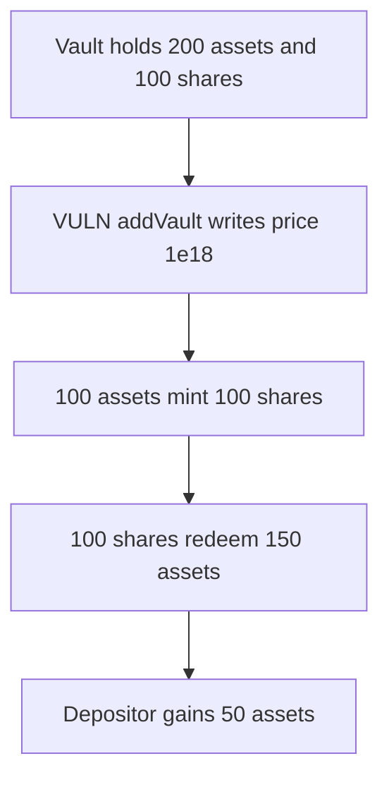

# Vaultcraft: addVault prices a non-empty vault at 1 and a depositor takes 50 assets

> **Vulnerability classes:** `vuln/oracle/price-manipulation`

<!-- non-defihacklabs -->
<!-- source-auditvault: https://github.com/Auditware/AuditVault/blob/main/findings/45890-a-vault-can-be-added-to-oraclevaultcontroller-after-receivin.md -->
<!-- date: 2024-12 -->

## Key info

| Field | Value |
|---|---|
| **Loss** | 50 assets taken from the depositor who funded the vault before it was registered |
| **Vulnerable contract** | `OracleVaultController.addVault` |
| **Attacker EOA** | `0x1111111111111111111111111111111111111111` |
| **Attack contract** | `Exploit` |
| **Attack tx** | `Exploit.run()` |
| **Chain / block / date** | Ethereum model · block 0 · 2024-12 |
| **Compiler** | solc 0.8.27, cancun, via IR |
| **Bug class** | Share price forced to 1 after deposits |

## TL;DR

`addVault` sets the oracle price to 1e18 so the first update does not pause the vault. It does not require the vault to be empty. A vault with 200 assets and 100 shares is priced at 1. A deposit of 100 assets mints 100 shares instead of 50 and redeems 150. The new depositor gains 50 assets.

## The vulnerable code

```solidity
function addVault(address vault) external {
    highWaterMarks[vault] = 1e18;
    oracle.setPrice(vault, address(ERC4626(vault).asset()), 1e18, 1e18); // @> VULN: price is forced to 1e18 even when the vault already holds assets
}
```

The review says to revert when the vault already holds assets.

## Root cause

The price write is a constant. It is not `totalAssets * 1e18 / totalShares`, and it is not guarded by `totalAssets == 0`.

## Preconditions

- The vault already holds 200 assets against 100 shares.
- The owner calls `addVault` after that seed.
- A later depositor mints against the oracle price and redeems against the real asset ratio.

## Attack walkthrough

1. The vault is seeded at 2 assets per share.
2. `addVault` writes 1e18.
3. 100 assets mint 100 shares.
4. Redeeming those shares returns 150 assets.

## Diagrams



## Impact

The depositor who funded the vault before registration loses 50 assets to the next depositor. Any vault added after it has a non-1 exchange rate is mispriced the same way.

## Remediation

Revert in `addVault` when `totalAssets` is not zero, or set the price from the current exchange rate instead of the constant 1e18.

## How to reproduce

```bash
cd 45890-a-vault-can-be-added-to-oraclevaultcontroller-after-receivin_exp
forge test -vv
```

Captured output is `output.txt`.

## Sources

- AuditVault finding: https://github.com/Auditware/AuditVault/blob/main/findings/45890-a-vault-can-be-added-to-oraclevaultcontroller-after-receivin.md

- Zokyo Vaultcraft report: https://github.com/solodit/solodit_content/blob/main/reports/Zokyo/2024-12-31-VaultCraft.md
- The finding file has no genome frontmatter. The report marks the issue High and Acknowledged.
