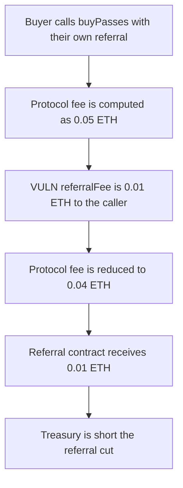

# Berally Pass: the buyer picks the referral paid from the protocol fee

> **Vulnerability classes:** `vuln/defi/fee-manipulation` · `vuln/logic/fee-calculation`

<!-- non-defihacklabs -->
<!-- source-auditvault: https://github.com/Auditware/AuditVault/blob/main/findings/45971-h-01-users-can-steal-part-of-protocol-fees-through-referrals.md -->
<!-- date: 2025-01 -->

## Key info

| Field | Value |
|---|---|
| **Loss** | 0.01 ETH of a 0.05 ETH protocol fee paid to the buyer's own referral |
| **Vulnerable contract** | `Passes.buyPasses` |
| **Attacker EOA** | `0x1111111111111111111111111111111111111111` |
| **Attack contract** | `Exploit` |
| **Attack tx** | `Exploit.run()` with 1 ETH |
| **Chain / block / date** | Ethereum model · block 0 · 2025-01 |
| **Compiler** | solc 0.8.27, cancun, via IR |
| **Bug class** | Caller-selected referral paid out of the protocol fee |

## TL;DR

`initialize` sets `protocolFeePercentage` to 5e16, `managerFeePercentage` to 5e16, and `referralFeePercent` to 1e16. `buyPasses` and `sellPasses` let the caller choose `referral`. On a 1 ETH pass the referral fee is 0.01 ETH, subtracted from the 0.05 ETH protocol fee, and sent to that address. The treasury receives 0.04 ETH. Passing `address(0)` leaves the treasury with the full 0.05 ETH.

## Background

Shieldify's Berally Pass review, finding H-01. The fee split is in `Passes.sol` at commit `73ec1b6ee0b2d9d8fc645529cf3ce10d00792422`. The team said the referral would be set by an admin.

## The vulnerable code

```solidity
uint256 referralFee = 0;
if (referral != address(0)) {
    referralFee = price * referralFeePercent / 1 ether; // @> VULN
    protocolFee -= referralFee;
}
(bool success3,) = referral.call{value: referralFee}("");
```

`price` is the 1 ETH pass. `referralFeePercent / 1 ether` is 1 percent.

The fix is an admin-set referral. A zero referral pays no referral fee.

## Root cause

The fee recipient is an argument of the trade. The protocol fee is reduced by whatever the caller assigns to themselves.

## Preconditions

- `referralFeePercent` is 1e16 and `protocolFeePercentage` is 5e16, the values from `initialize`.
- The caller sends exactly 1 ETH and passes a contract they control as `referral`.

## Attack walkthrough

1. `buyPasses` prices one pass at 1 ETH. The protocol fee is 0.05 ETH and the manager fee is 0.05 ETH.
2. The non-zero referral sets `referralFee` to 0.01 ETH and subtracts it from the protocol fee.
3. The referral contract receives 0.01 ETH. The treasury receives 0.04 ETH.
4. The control uses `address(0)`. The treasury receives 0.05 ETH and the referral receives nothing.

## Diagrams



## Impact

Of the 0.05 ETH protocol fee on this pass, 0.01 ETH is paid to the buyer. The treasury balance is 0.04 ETH. Every buy or sell with a self-referral repeats the split. A zero referral pays the treasury the full 0.05 ETH.

## How to reproduce

```bash
cd 45971-h-01-users-can-steal-part-of-protocol-fees-through-referrals_exp
forge test -vv
```

`test_exploit_self_referral_takes_protocol_cut` asserts 0.01 ETH on the referral and 0.04 ETH on the treasury. `test_control_no_referral_pays_full_protocol_fee` asserts 0.05 ETH. Output is `output.txt`.

## Sources

- AuditVault finding: https://github.com/Auditware/AuditVault/blob/main/findings/45971-h-01-users-can-steal-part-of-protocol-fees-through-referrals.md
- Report: https://github.com/shieldify-security/audits-portfolio-md/blob/main/Berally-Pass-Security-Review.md
- Passes.sol: https://github.com/berally/smartcontract/blob/73ec1b6ee0b2d9d8fc645529cf3ce10d00792422/passes/contracts/Passes.sol
