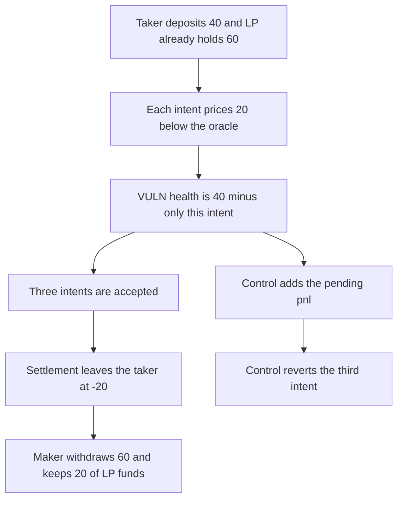

# Three intents each pass a 40 collateral check and the maker withdraws 20 of LP funds

> **Vulnerability classes:** vuln/logic/missing-check · vuln/logic/price-calculation

<!-- non-defihacklabs -->
<!-- source-auditvault: https://github.com/Auditware/AuditVault/blob/main/findings/45976-h-1-anyone-can-steal-all-funds-from-the-market-due-to-incorr.md -->
<!-- date: 2025-01 -->

## Key info

| Field | Value |
|---|---|
| **Loss** | 20 collateral withdrawn above the attacker's 40 deposit. The taker account ends at -20. The LP is left with 40 of 60 |
| **Vulnerable contract** | `Market.validate` |
| **Attacker EOA** | `0x1111111111111111111111111111111111111111` |
| **Attack contract** | `Exploit` |
| **Attack tx** | `Exploit.run()` |
| **Chain / block / date** | Ethereum model · block 0 · 2025-01 |
| **Compiler** | solc 0.8.27, cancun, via IR |
| **Bug class** | Health adds only the current intent's price gap |

## TL;DR

`validate` sets health to `collateral + amount * (oraclePrice - intentPrice)`. It does not add pnl from intents already pending on that account. A taker with 40 collateral can submit three size-1 intents at 120 while the oracle is 100. Each check sees `40 - 20`. Settlement applies all three and the taker goes to -20. The maker, the same attacker, withdraws 60. Net gain is 20, taken from the LP's 60. Summing pending pnl makes the third intent revert.

## Background

Sherlock's January 2025 Perennial V2 update contest, issue 28 (H-1), reported by panprog. Opening a position from an intent realizes pnl from the difference between the user-chosen intent price and the oracle. `InvariantLib.validate` adjusts collateral for the current guarantee only. The report's trace shows the taker collateral going negative while the counterparty collateral exceeds the deposits.

## The vulnerable code

```solidity
int256 pnl = amount * (oraclePrice - price) / 1 ether;
// @> VULN: health adds only this intent's price gap and ignores every other pending intent
health = collateral[account] + pnl;
require(health >= 0, "health");
```

`submit` calls this before pushing the intent. `settle` later applies every pending intent.

## Root cause

Pending intents are invisible to the health check. The collateral word still shows the deposit, so each new intent is judged as if it were the only one.

## Preconditions

- Oracle price is 100. Each intent is size 1 at price 120, so each taker pnl is -20.
- The taker deposits 40. An LP already has 60 in the market.
- The maker is a second account controlled by the attacker. All three submits happen before settlement.

## Attack walkthrough

1. The taker deposits 40.
2. `validate` returns 20 for one intent. The same check passes for the second and third.
3. `settle` adds `-20` three times. Taker collateral is -20. Maker collateral is 60.
4. `withdraw` pays the maker 60. The attacker started the call with 40 and ends with 60.

## Diagrams



## Impact

The attacker deposits 40 and withdraws 60 in the same call. The extra 20 is the LP's collateral. The taker account is -20 and is not required to cover it before the maker is paid. The fixed health check adds the pending gaps, so the third intent reverts and the market still holds 100.

## Remediation

Sum the price adjustments of every pending intent on the account and add that sum to collateral inside `validate`, which is the mitigation in the report.

## How to reproduce

```bash
cd 45976-h-1-anyone-can-steal-all-funds-from-the-market-due-to-incorr_exp
forge test -vv
```

`test_exploit_three_intents_withdraw_20_of_lp_collateral` asserts a 60 withdrawal, a -20 taker, and 40 left of the LP's 60. `test_control_third_intent_fails_the_summed_health_check` asserts the third submit reverts and the market still holds 100. Captured output is `output.txt`.

## Sources

- AuditVault finding: https://github.com/Auditware/AuditVault/blob/main/findings/45976-h-1-anyone-can-steal-all-funds-from-the-market-due-to-incorr.md
- Sherlock judging issue 28: https://github.com/sherlock-audit/2025-01-perennial-v2-4-update-judging/issues/28
- Fix: https://github.com/equilibria-xyz/perennial-v2/pull/553
