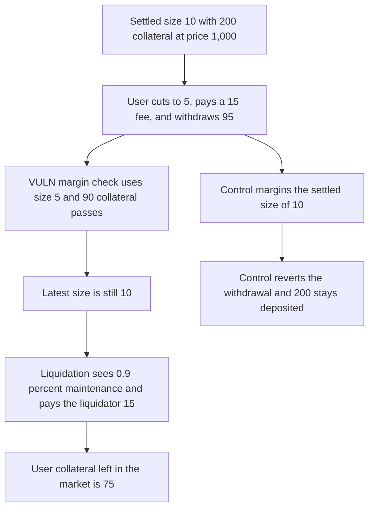

# A position cut from 10 to 5 passes the margin check and is liquidated for 15 DSU

> **Vulnerability classes:** vuln/logic/liquidation-logic · vuln/logic/wrong-condition

<!-- non-defihacklabs -->
<!-- source-auditvault: https://github.com/Auditware/AuditVault/blob/main/findings/45977-h-2-invariantlib-uses-current-position-for-margin-check-allo.md -->
<!-- date: 2025-01 -->

## Key info

| Field | Value |
|---|---|
| **Loss** | 15 DSU paid to the liquidator. 90 collateral was a healthy 1.8% on the pending size of 5 and a liquidatable 0.9% on the settled size of 10 |
| **Vulnerable contract** | `Market.update` |
| **Attacker EOA** | `0xc5ba80e0035e6fe7266a059978626a53e771330c` (the liquidator) |
| **Attack contract** | `Exploit` |
| **Attack tx** | `Exploit.run()` |
| **Chain / block / date** | Ethereum model · block 0 · 2025-01 |
| **Compiler** | solc 0.8.27, cancun, via IR |
| **Bug class** | The margin check uses the pending current size while liquidation still uses the latest settled size |

## TL;DR

Price is 1,000. Margin is 1.2%. Maintenance is 1%. A user is settled at size 10 with 200 collateral. They cut the size to 5, pay the 15 trading fee on the 5,000 notional reduction, and withdraw 95. Collateral left is 90. `margined` is called with size 5, and `90 / 5,000 = 1.8%` passes. `latest` is still 10. Liquidation uses that size: `90 / 10,000 = 0.9%`, which is under maintenance. The liquidator is paid 15 DSU and the user's collateral falls to 75. Checking the larger of the old and new size reverts the withdrawal, and the 200 stays in the market.

## Background

Sherlock's January 2025 Perennial V2 update contest, issue 30 (H-2). `InvariantLib.validate` margins `currentPositionLocal`. The liquidation maintenance check uses `latestPositionLocal`. Those are the position at the pending price and the position at the last committed price. This model keeps both numbers on the account and does not need an oracle timestamp. The report's example is the same shape: size 10 to 5, fee 15, withdraw down to 90, then an immediate liquidation.

## The vulnerable code

```solidity
uint256 fee = notional(delta) * 3 / 1000;
coll -= fee;
if (collateralDelta < 0) {
    uint256 withdrawAmount = uint256(-collateralDelta);
    coll -= withdrawAmount;
    require(dsu.transfer(msg.sender, withdrawAmount), "withdraw");
}
require(margined(newSize, coll), "margin");
// @> VULN: margin used the pending size, so the reduced position is stored and the settled size stays liquidatable
p.current = newSize;
```

`liquidate` then requires `!maintained(p.latest, p.collateral)` and transfers a 15 DSU reward.

## Root cause

The update is allowed to treat the pending size as if it were already the risk. Liquidation does not. A user can withdraw the collateral that the new size would justify, while the size that can still be liquidated is the old one. The account is healthy and liquidatable at the same time.

## Preconditions

- A settled long of 10 with 200 collateral. Notional at a price of 1,000 is 10,000.
- The user submits size 5 and a withdrawal of 95 in one update.
- The trading fee is 0.3% of the reduced notional, 15.
- A liquidator calls `liquidate` before the pending size is committed.

## Attack walkthrough

1. Open and settle size 10 with 200 DSU.
2. `90` collateral on size 5 is above the 1.2% margin. The same 90 on size 10 is under the 1% maintenance level.
3. The user updates to size 5 and withdraws 95. The fee is 15. Collateral in the market is 90. `latest` stays 10 and `current` is 5.
4. `margined(5, 90)` passed, which is why the update did not revert.
5. `liquidate` sees size 10, takes a 15 DSU reward, and leaves 75 collateral.
6. The user already received the 95 withdrawal. The liquidator holds 15.
7. The control margins `max(old, new)`. The same withdrawal reverts and the market still holds 200.

## Diagrams



## Impact

The user is liquidated on a position they had already reduced. They paid a 15 trading fee to cut the size, withdrew 95, and then lost another 15 to the liquidator, leaving 75 of the 90 they were entitled to keep on the new size. The liquidator receives 15 DSU for an account that was above the margin requirement on the size the user requested. The report's self-liquidation variant repeats this whenever the liquidation reward exceeds the trading fee.

## Remediation

Margin the position that liquidation will use. That is the latest settled size, or the max of the settled size and the pending size, until the pending update is committed. Use that same size in the maintenance check.

## How to reproduce

```bash
cd 45977-h-2-invariantlib-uses-current-position-for-margin-check-allo_exp
forge test -vv
```

`test_exploit_pending_reduce_pays_liquidator_15` asserts a 15 DSU reward and 75 collateral left on the user. `test_control_latest_size_reverts_the_withdrawal` asserts the withdrawal reverts and 200 DSU stays in the market. Captured output is `output.txt`.

## Sources

- AuditVault finding: https://github.com/Auditware/AuditVault/blob/main/findings/45977-h-2-invariantlib-uses-current-position-for-margin-check-allo.md
- Sherlock issue 30: https://github.com/sherlock-audit/2025-01-perennial-v2-4-update-judging/issues/30
