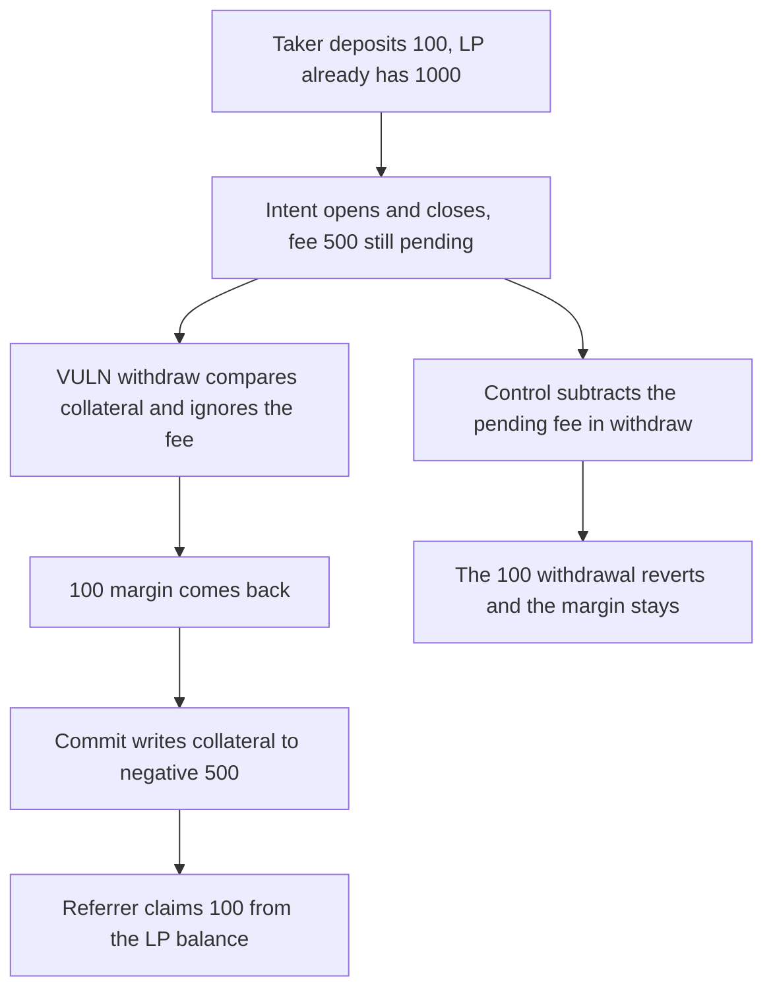

# Perennial intent fees are withdrawn before they hit collateral, and the referrer takes 100 from LPs

> **Vulnerability classes:** vuln/logic/fee-calculation · vuln/logic/missing-check

<!-- non-defihacklabs -->
<!-- source-auditvault: https://github.com/Auditware/AuditVault/blob/main/findings/45978-h-3-intent-orders-are-guaranteed-to-execute-but-fees-from-th.md -->
<!-- date: 2025-01 -->

## Key info

| Field | Value |
|---|---|
| **Loss** | 100 DSU paid to the referrer out of LP collateral. The taker withdrew their 100 margin and left the account 500 in bad debt |
| **Vulnerable contract** | `Market.withdraw` |
| **Attacker EOA** | `0x1111111111111111111111111111111111111111` |
| **Attack contract** | `Exploit` at `0x15452ec016c4dc8c549e7fe6ff4b26324ea8b7a4` |
| **Attack tx** | `Exploit.run()` |
| **Chain / block / date** | Ethereum model · block 0 · 2025-01 |
| **Compiler** | solc 0.8.27, cancun, via IR |
| **Bug class** | Margin uses collateral and ignores the pending intent fee |

## TL;DR

Intent orders are stored with `invalidation = 0`, so the over-close check does not apply, and the margin check does not subtract `pendingFee`. The taker opens and closes a 5000 notional, fee 500, withdraws the entire 100 margin, and only then commits. Collateral becomes -500. The referrer, who is the same taker, claims 20% of the fee, 100, from the LP's 1000. Subtracting the pending fee inside `withdraw` reverts the full withdrawal and leaves the 100 margin in the market.

## Background

Sherlock's January 2025 Perennial V2 update contest, issue 31, reported by panprog. Trade fees are applied when checkpoints advance, after the oracle version is committed. `InvariantLib.validate` skips the over-close revert when `pendingLocal.invalidation == 0`, which is how intents are marked, and the margin check adds collateral without the unpaid fee. The report's trace left the user at collateral -221400 and the referrer with a claimable balance.

## The vulnerable code

```solidity
function withdraw(address user, uint256 amount) external {
    if (invalidation[user] != 0 && amount > 0) revert("MarketOverCloseError");
    int256 collateral = collateralOf[user];
    // @> VULN: pendingFee is not subtracted from collateral, so a guaranteed intent can withdraw the entire deposit
    require(collateral >= int256(amount), "MarketInsufficientMarginError");
    collateralOf[user] = collateral - int256(amount);
    require(token.transfer(user, amount), "pay");
}
```

`openAndCloseIntent` sets `invalidation` to 0, records the referrer, and sets `pendingFee` to 10% of notional. `commit` subtracts that fee afterwards and credits `fee * 20 / 100` to the referrer.

`MarketFixed.withdraw` requires `collateralOf[user] - pendingFee[user] >= amount`. The 100 withdrawal reverts. The 500 fee stays reserved and the 100 margin stays in the market.

## Root cause

Two checks disagree about what an intent has already promised. Position close is guaranteed because `invalidation` is 0. The fee for that close is not guaranteed: it is pending until commit. Withdrawal is allowed against collateral that does not yet include the fee, so the account can be emptied and the fee becomes bad debt that the referral claim pays from other users.

## Preconditions

- The market holds 1000 of LP collateral.
- The taker deposits 100. The intent notional is 5000, so the pending fee is 500 and the referral slice is 100.
- The taker sets themselves as referrer.
- Commit runs in the same transaction after the withdrawal. The bug is the missing fee in the margin check, not the passage of time. The report waits for an oracle commit. This model applies that commit as `Market.commit` without a warp.

## Attack walkthrough

1. The taker deposits 100. An LP already has 1000 in the market.
2. The intent opens and closes. `invalidation` is 0, the referrer is the taker, and `pendingFee` is 500.
3. `withdraw(100)` compares 100 collateral to 100 requested and transfers the margin back.
4. `commit` sets collateral to -500 and `claimable[referrer]` to 100.
5. `claimFee` transfers 100 from the market to the taker.
6. The taker's balance is 200. The market holds 900. The account debt is -500.
7. The fixed withdraw reverts. The market still holds the 100 margin and the 500 fee is still pending.

## Diagrams



## Impact

The referrer receives 100 that the taker never paid. That 100 comes out of the LP's collateral. The taker's own 100 margin was returned in full, and the account is left 500 underwater. The fixed check blocks the withdrawal.

## Remediation

Subtract pending intent fees from collateral inside the margin and maintenance checks, which is the mitigation in the Sherlock report. `MarketFixed.withdraw` does that subtraction and the full withdrawal reverts.

## How to reproduce

```bash
cd 45978-h-3-intent-orders-are-guaranteed-to-execute-but-fees-from-th_exp
forge test -vv
```

`test_exploit_withdraws_margin_and_claims_referral` asserts a 100 claim, debt of -500, a 200 taker balance, and 900 left in the market. `test_control_pending_fee_blocks_the_full_withdraw` asserts the withdrawal reverts and the 100 margin stays, with 500 still pending. Captured output is `output.txt`.

## Sources

- AuditVault finding: https://github.com/Auditware/AuditVault/blob/main/findings/45978-h-3-intent-orders-are-guaranteed-to-execute-but-fees-from-th.md
- Sherlock judging issue 31: https://github.com/sherlock-audit/2025-01-perennial-v2-4-update-judging/issues/31
- InvariantLib: https://github.com/sherlock-audit/2025-01-perennial-v2-4-update/blob/main/perennial-v2/packages/core/contracts/libs/InvariantLib.sol
