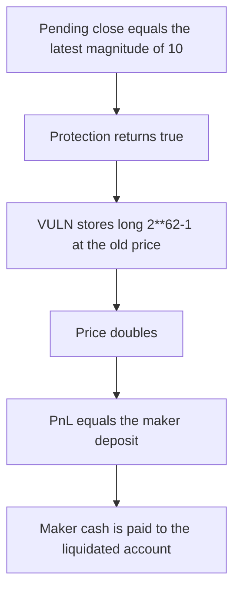

# Perennial: a protected liquidation stores a 2**62-1 long and takes the maker cash

> **Vulnerability classes:** vuln/logic/wrong-condition · vuln/logic/liquidation-logic

<!-- non-defihacklabs -->
<!-- source-auditvault: https://github.com/Auditware/AuditVault/blob/main/findings/45979-h-4-when-account-is-liquidated-protected-liquidator-can-incr.md -->
<!-- date: 2025-01 -->

## Key info

| Field | Value |
|---|---|
| **Loss** | 2**62-1 units of maker cash paid to the liquidated account |
| **Vulnerable contract** | `Market.liquidate` / `_validateProtection` |
| **Attacker EOA** | `0x4597900000000000000000000000000000000001` |
| **Attack contract** | `Exploit` |
| **Attack tx** | `Exploit.run()` |
| **Chain / block / date** | Ethereum model · block 0 · 2025-01 |
| **Compiler** | solc 0.8.27, cancun, via IR |
| **Bug class** | Pending full close passes protection, and the new long is not required to shrink |

## TL;DR

`_validateProtection` returns true when `pending.negative` equals the latest magnitude. The old "position may only decrease" check is gone, so a liquidator replaces a size-10 pending close with a long of `2**62-1`. Doubling the price marks that notional for the entire maker deposit. Settlement pays it out. The fixed path rejects any larger long and the cash stays in the market.

## Background

Sherlock's January 2025 Perennial V2 update contest, issue 32, reported by panprog. A pending full close used to be liquidated by closing. The audited check only asks whether the pending negative equals the latest magnitude, and protected orders skip margin checks. Equilibria restored the decrease requirement in perennial-v2 pull 554.

## The vulnerable code

```solidity
if (!context.pendingLocal.neg().eq(context.latestPositionLocal.magnitude())) return false; // no pending zero-cross, liquidate with full close
if (L.maintained) return false;
// @> VULN: pending.negative == latest magnitude passed the check, so the liquidation stores a larger long
L.latestMagnitude = newLong;
L.entryPrice = price;
```

`newLong` is `2**62-1`. The entry price is still `1e18`. The next commit sets the price to `2e18`, and pnl is the full magnitude.

## Root cause

Equality with the pending close is treated as permission to liquidate, and nothing after that compares the new long with the old one. Collateral and position-size checks are skipped because the order is protected.

## Preconditions

- The account's pending negative equals its latest magnitude. Here both are 10, so the close is fully pending.
- The account is not maintenance-collateralized.
- Makers have already deposited `2**62-1` units of cash.

## Attack walkthrough

1. The liquidator calls `liquidate` with `2**62-1` on the pending close.
2. The equality check returns true. The huge long is stored at price `1e18`.
3. The price is committed at `2e18`.
4. Settlement computes pnl equal to the whole maker balance and transfers it.
5. The fixed market returns false on `newLong > latestMagnitude`. The cash never moves.

## Diagrams


