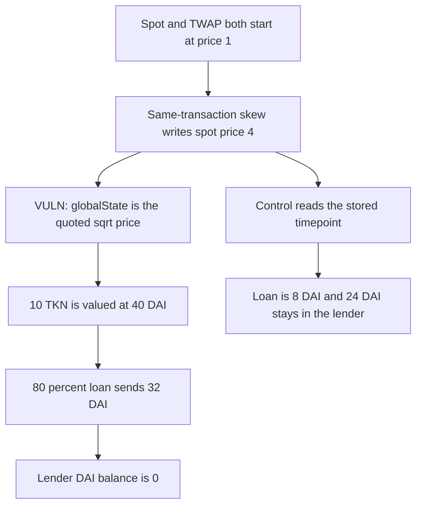

# Peapods: Kim TWAP utility reads the spot price

> **Vulnerability classes:** `vuln/oracle/spot-price` · `vuln/oracle/price-manipulation`

<!-- non-defihacklabs -->
<!-- source-auditvault: https://github.com/Auditware/AuditVault/blob/main/findings/45983-c-01-using-spot-price-can-cause-a-price-manipulation-attack.md -->
<!-- date: 2024-11 -->

## Key info

| Field | Value |
|---|---|
| **Loss** | 10 TKN of collateral, fairly worth 10 DAI, borrows 32 DAI. A stored TWAP at price 1 would have lent 8 |
| **Vulnerable contract** | `V3TwapKimUtilities._sqrtPriceX96FromPoolAndInterval` |
| **Attacker EOA** | `0x1111111111111111111111111111111111111111` |
| **Attack contract** | `Exploit` |
| **Attack tx** | `Exploit.run()` |
| **Chain / block / date** | Ethereum model · block 0 · 2024-11 |
| **Compiler** | solc 0.8.27, cancun, via IR |

## TL;DR

`_sqrtPriceX96FromPoolAndInterval` returns `pool.globalState()`. That word is the spot sqrt price, and a call in the same transaction can overwrite it. The fair sqrt price is `2^96` (price 1). Writing `2^97` makes the spot price 4. A lender that prices 10 TKN of collateral at that spot values it at 40 DAI and sends 32 DAI at an 80% loan factor. The pool's stored timepoint is still `2^96`. Reading that timepoint lends 8 and leaves 24 DAI in the lender.

## The vulnerable code

```solidity
function _sqrtPriceX96FromPoolAndInterval(address _poolAddress) external returns (uint160 sqrtPriceX96) {
    Pool pool = Pool(_poolAddress);
    if (fixedMode) {
        sqrtPriceX96 = pool.twap();
    } else {
        (sqrtPriceX96,,,,,) = pool.globalState(); // @> VULN: spot sqrt price from globalState
    }
    lastSqrt = sqrtPriceX96;
}
```

The review says to take the price from Algebra's `getTimepoints` instead of `globalState`. The audited function is `internal view`. This reduction exposes it so the lender can call it, and it stores `lastSqrt` so the value is visible after the call. The fixed branch reads the timepoint the spot write does not touch.

## Root cause

`globalState` is the pool's current sqrt price. It moves on every swap. A TWAP interval is what stops a one-transaction skew from becoming the price a lender, a pod, or a dex adapter uses. The function ignores the interval argument in the reviewed snippet and returns the spot directly. Price is `(sqrtPriceX96)^2 / 2^192`. Doubling the sqrt price quadruples the price.

## Preconditions

- The pool's fair sqrt price and its stored TWAP are both `2^96`.
- The borrower holds 10 TKN. The lender holds 32 DAI, which is exactly the manipulated loan.
- The loan is 80% of collateral value.

## Attack walkthrough

1. `skew` writes `2^97` into the spot slot. The TWAP slot stays `2^96`.
2. The borrower approves 10 TKN and calls `borrow`.
3. The utility's unfixed branch reads `globalState` and returns `2^97`.
4. Price 4 times 10 collateral is 40. Eighty percent is 32. `lastLent` is 32.
5. The lender transfers its entire 32 DAI. The borrower holds 32 DAI and the lender holds 0.
6. The control reads the TWAP, lends 8, and leaves 24 DAI in the lender.

## Diagrams



## Impact

The borrower posts collateral worth 10 DAI at the untouched timepoint and receives 32 DAI. The extra 24 DAI is the lender's inventory. Restoring the spot afterward does not pull the DAI back. Any Peapods consumer of `V3TwapKimUtilities` that sizes a swap, a mint, or a loan from this return value is quoting a price the caller just chose. The reviewed commit is `dccf7ce1df4cff8c3800ffb284afe644813e128f`.

## How to reproduce

```bash
cd 45983-c-01-using-spot-price-can-cause-a-price-manipulation-attack_exp
forge test -vv
```

`test_exploit_spot_skew_borrows_32_against_10` asserts the borrower received 32 DAI, the lender is empty, and the TWAP is still `2^96`. `test_control_twap_lends_eight` asserts the same skew lends 8 DAI when the utility reads the timepoint.

## Sources

- AuditVault finding: https://github.com/Auditware/AuditVault/blob/main/findings/45983-c-01-using-spot-price-can-cause-a-price-manipulation-attack.md
- Pashov review: https://github.com/pashov/audits/blob/master/team/md/Peapods-security-review_2024-11-16.md
- Reviewed contracts: https://github.com/peapodsfinance/contracts/tree/dccf7ce1df4cff8c3800ffb284afe644813e128f
- Recommended reader: https://github.com/cryptoalgebra/Algebra/blob/839ceaa768f987cd5d97c6d3312f8442035f96c4/src/plugin/contracts/AlgebraBasePluginV1.sol#L123
