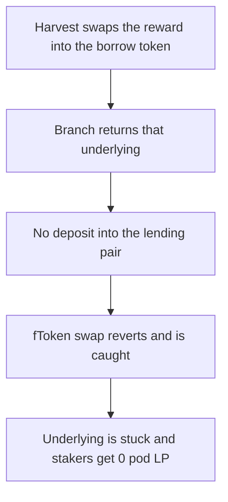

# Peapods — self-lending rewards are swapped to the borrow token and never become fTokens

> **Vulnerability classes:** `vuln/logic/reward-calculation` · `vuln/dos/frozen-funds`

> **Reproduction:** a self-contained Foundry PoC that compiles and runs offline
> with only `forge-std` — no fork and no RPC. Trace: [output.txt](output.txt).
> PoC: [test/45984-c-02-for-self-lending-pairs-rewards-will-be-stuck-pashov-aud_exp.sol](test/45984-c-02-for-self-lending-pairs-rewards-will-be-stuck-pashov-aud_exp.sol).

<!-- non-defihacklabs -->
<!-- source-auditvault: https://github.com/Auditware/AuditVault/blob/main/findings/45984-c-02-for-self-lending-pairs-rewards-will-be-stuck-pashov-aud.md -->
<!-- date: 2024-11 -->

---

## Key info

| | |
|---|---|
| **Impact** | **HIGH** — **1,000** reward tokens become borrow-token underlying and stay stuck; stakers receive **0** pod LP |
| **Protocol** | Peapods `AutoCompoundingPodLp._tokenToPairedLpToken` |
| **Vulnerable code** | the `token != lpRewardsToken` branch returns the swap output and does not deposit into the lending pair |
| **Bug class** | Self-lending compounder never converts underlying into the paired fToken |
| **Finding** | Pashov C-02 — Peapods, 16 Nov 2024 · id 45984 |
| **Report** | [Peapods security review](https://github.com/pashov/audits/blob/master/team/md/Peapods-security-review_2024-11-16.md) |
| **Source** | [AuditVault finding](https://github.com/Auditware/AuditVault/blob/main/findings/45984-c-02-for-self-lending-pairs-rewards-will-be-stuck-pashov-aud.md) |
| **Compiler** | solc 0.8.27, cancun, via IR |

---

## TL;DR

For a self-lending pod the paired LP token is an fToken. `IS_PAIRED_LENDING_PAIR` therefore swaps rewards into the lending pair's borrow token, with the intention of depositing that token for fTokens.

That deposit happens only when the reward token equals `lpRewardsToken`. When it does not, `_tokenToPairedLpToken` returns the underlying amount. The later swap wants fTokens, reverts, and is swallowed by try/catch. The underlying sits in the compounder. `compounded` stays 0.

The fixed path deposits the underlying into the pair and mints 1,000 pod LP to the staker.

## The vulnerable code

```solidity
if (address(token) != address(lpRewardsToken)) {
    amountOut = _swap(token, swapOutput, amountIn);
    return amountOut; // @> VULN: underlying is returned, never deposited for fTokens
}
```

```diff
 if (address(token) != address(lpRewardsToken)) {
     amountOut = _swap(token, swapOutput, amountIn);
-    return amountOut;
+    swapOutput.approve(address(pairedLp), amountOut);
+    return pairedLp.deposit(amountOut, address(this));
 }
```

## Attack walkthrough

1. The compounder holds 1,000 reward tokens. The reward token is not the pod LP reward token, and the pod is self-lending.
2. `processRewards` swaps those tokens 1:1 into the borrow token.
3. The function returns that amount instead of calling `deposit`.
4. `_swapPairedToPod` requires an fToken balance, reverts, and the try/catch keeps going.
5. The compounder holds 1,000 underlying, 0 fToken, and stakers hold 0 pod LP.

## Diagrams



## Impact

Reward value that should have compounded into pod LP is frozen as the lending pair's underlying inside the aspTKN-style compounder. Stakers receive none of it. A later redemption of the pod does not see those tokens.

## Sources

- [AuditVault 45984](https://github.com/Auditware/AuditVault/blob/main/findings/45984-c-02-for-self-lending-pairs-rewards-will-be-stuck-pashov-aud.md)
- [Pashov Peapods review, 2024-11-16](https://github.com/pashov/audits/blob/master/team/md/Peapods-security-review_2024-11-16.md)
- Blamed function: `AutoCompoundingPodLp._tokenToPairedLpToken`, as quoted in that review
