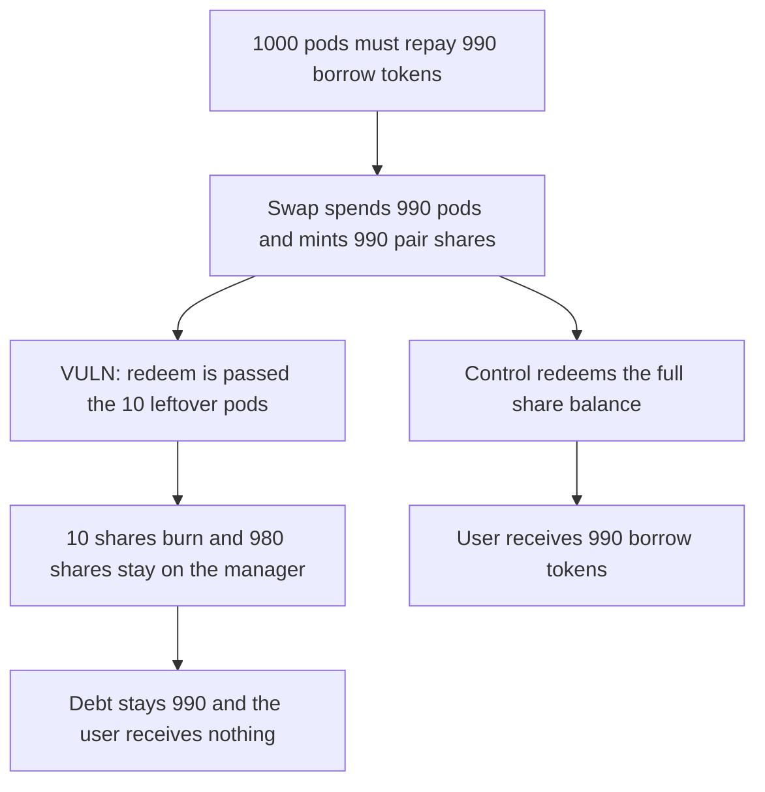

# Self-lending deleverage redeems leftover pods and leaves 980 pair shares unpaid

> **Vulnerability classes:** vuln/logic/state-update · vuln/dos/frozen-funds

<!-- non-defihacklabs -->
<!-- source-auditvault: https://github.com/Auditware/AuditVault/blob/main/findings/45985-c-03-removeleverage-uses-an-incorrect-amount-when-redeeming.md -->
<!-- date: 2024-11 -->

## Key info

| Field | Value |
|---|---|
| **Loss** | 980 lending-pair shares never redeemed. 10 of 990 borrow tokens come back and the debt stays open |
| **Vulnerable contract** | `LeverageManager._acquireBorrowTokenForRepayment` |
| **Attacker EOA** | `0x1111111111111111111111111111111111111111` |
| **Attack contract** | `Exploit` |
| **Attack tx** | `Exploit.run()` |
| **Chain / block / date** | Ethereum model · block 0 · 2024-11 |
| **Compiler** | solc 0.8.27, cancun, via IR |
| **Bug class** | `redeem` is given leftover pods instead of the pair shares the swap minted |

## TL;DR

Removing leverage on a self-lending pod swaps pods for lending-pair shares, then must redeem those shares for the borrow token. `_swapPodForBorrowToken` returns the pods that were not spent. The next line passes that remainder into `LendingPair.redeem`. A 1000 pod position that needs 990 borrow tokens spends 990 pods, mints 990 shares, and redeems 10. 980 shares stay on the manager, 10 borrow tokens come back, and the 990 debt stays open. The user receives nothing. The control redeems `pair.balanceOf` and the user receives 990.

## Background

Pashov Audit Group's 16 November 2024 Peapods review, finding C-03. `_acquireBorrowTokenForRepayment` handles the shortfall when the paired token from an unwind is not enough to repay. For a self-lending pod it swaps the pod into the lending pair and redeems. The return value of the swap is remaining pods, not the shares received, and that value is then overwritten with whatever `redeem` returns.

## The vulnerable code

```solidity
_podAmtRemaining =
    _swapPodForBorrowToken(address(pod), address(pair), _podAmtReceived, _borrowAmtNeededToSwap);
// @> VULN: redeem is given the leftover pod amount, not the lending-pair shares the swap just minted
_podAmtRemaining = pair.redeem(_podAmtRemaining, address(this), address(this));
```

`_swapPodForBorrowToken` computes `_podAmt - (balanceBefore - balanceAfter)`. After spending 990 of 1000 pods, that is 10.

## Root cause

The swap's return value is documented as remaining pod amount. `redeem` expects share amount. Using one as the other redeems a dust quantity, and assigning `redeem`'s borrow-token return back into `_podAmtRemaining` also destroys the remaining-pod figure the caller thought it still had.

## Preconditions

- The position is self-lending, so the swap target is the lending pair.
- The manager holds 1000 pods and needs 990 borrow tokens. The pair can mint 1 share per pod spent and holds at least 990 borrow tokens.

## Attack walkthrough

1. `removeLeverage` pulls 1000 pods and sets the debt to 990.
2. The swap transfers 990 pods to the dex and mints 990 pair shares to the manager. Pods left on the manager: 10.
3. `redeem` is called with 10. The pair burns 10 shares and sends 10 borrow tokens.
4. 980 shares remain on the manager. The pair still holds 990 borrow tokens.
5. 10 is less than the 990 debt, so the debt is not cleared and nothing is forwarded to the user.
6. The control reads `pair.balanceOf`, redeems 990, and transfers 990 borrow tokens to the user. The manager's share balance is 0.

## Diagrams



## Impact

The position owner cannot close the leverage. 980 lending-pair shares, backed by 980 borrow tokens, sit on the manager. Only 10 borrow tokens were redeemed, the 990 debt is unchanged, and the owner's borrow-token balance is 0. The control delivers 990 and leaves no shares behind.

## Remediation

After the swap, redeem `IERC20(lendingPair).balanceOf(address(this))` instead of `_podAmtRemaining`, and do not overwrite `_podAmtRemaining` with the borrow tokens `redeem` returns. That is the diff in the Peapods report.

## How to reproduce

```bash
cd 45985-c-03-removeleverage-uses-an-incorrect-amount-when-redeeming_exp
forge test
```

`test_exploit_redeem_uses_leftover_pods_and_leaves_debt` asserts 980 shares stuck, 10 borrow tokens received, and a debt of 990. `test_control_redeems_share_balance_and_clears_debt` asserts the user receives 990 and the share balance is 0. Captured output is `output.txt`.

## Sources

- AuditVault finding: https://github.com/Auditware/AuditVault/blob/main/findings/45985-c-03-removeleverage-uses-an-incorrect-amount-when-redeeming.md
- Report: https://github.com/pashov/audits/blob/master/team/md/Peapods-security-review_2024-11-16.md
