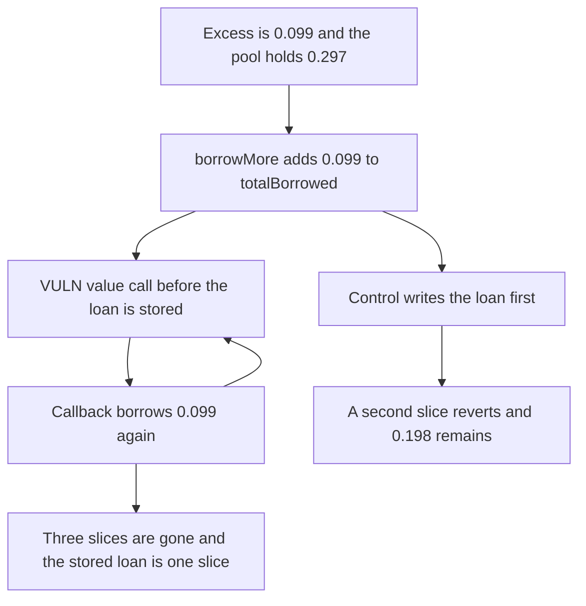

# Eggs: borrowMore sends sonic before the loan is stored and the same excess is borrowed three times

> **Vulnerability classes:** `vuln/reentrancy/single-function` · `vuln/logic/incorrect-order-of-operations`

<!-- non-defihacklabs -->
<!-- source-auditvault: https://github.com/Auditware/AuditVault/blob/main/findings/46029-the-contract-can-be-drained-of-its-sonic-via-reentrancy-cant.md -->
<!-- date: 2025-02 -->

**AuditVault taxonomy:** `severity/high` · `platform/cantina` · `sector/lending`

## Key info

| Field | Value |
|---|---|
| **Loss** | 0.297 sonic drained. The stored loan is 0.099, one slice, while totalBorrowed counts 0.297 |
| **Vulnerable contract** | `Eggs.borrowMore` |
| **Attacker EOA** | `0x1111111111111111111111111111111111111111` |
| **Attack contract** | `Exploit` |
| **Attack tx** | `Exploit.run()` |
| **Chain / block / date** | Ethereum model · block 0 · 2025-02 |
| **Compiler** | solc 0.8.27, cancun, via IR |
| **Bug class** | Value call before `Loans[msg.sender]` is written, with no `nonReentrant` |

## TL;DR

`borrowMore` has no reentrancy guard. It adds the new sonic to `totalBorrowed`, then `call`s the borrower with that value, and only then writes `Loans[msg.sender]`. A position with 0.1 ether of egg collateral has a 0.099 ether excess, so one slice needs no new collateral. The callback borrows 0.099 twice more while the stored loan is still 0. The pool's 0.297 sonic ends in the attacker. The recorded loan is a single 0.099. `safetyCheck` passes because backing is cash plus `totalBorrowed`, and those move together. A version that stores the loan first and reverts when a second slice needs collateral sends only one slice.

## Background

Cantina's February 2025 Eggs Finance review, Kaden. `borrow` and `borrowMore` are the state-changing functions without `nonReentrant`. The overcollateralized branch sets the required extra collateral to 0, then `sendSonic` does `_address.call{value: _value}`. The review says `Loans[msg.sender]` is still the old value inside that call, so the same excess can be borrowed again, while `addLoansByDate` has already increased `totalBorrowed`, which keeps the price check flat. Eggs Finance fixed it in commit `2f02fb77`. The fee in the report is omitted here so backing stays exactly constant. The bug is the ordering, not the fee.

## The vulnerable code

```solidity
totalBorrowed += sonic;
sendSonic(msg.sender, sonic);
loans[msg.sender] = userBorrowed + sonic;
```

`sendSonic` is the value call. The loan write has not run yet:

```solidity
(bool ok,) = to.call{value: value}(""); // @> VULN: value call before Loans[msg.sender] is stored
require(ok, "SONIC Transfer failed.");
```

The report's fix is `nonReentrant` on `borrow` and `borrowMore`, and writing the loan before the call.

## Root cause

The user's debt is the value the excess check reads, and it is updated after the external call. The global borrowed total is updated before the call, which is what makes `getBacking()` and the price check agree while the cash is leaving.

## Preconditions

- The attacker has 0.1 ether of egg collateral and a stored loan of 0. Excess is `0.1 * 99 / 100 = 0.099` ether.
- The contract holds 0.297 ether of sonic, three slices.
- The attacker's fallback calls `borrowMore(0.099 ether)` while `rounds < 2`.

## Attack walkthrough

1. The pool is funded with 0.297 ether before `run`.
2. `borrowMore(0.099 ether)` sees excess 0.099, requires no new collateral, and adds 0.099 to `totalBorrowed`.
3. The value call hits the attacker. The callback borrows 0.099 again, and that call does the same once more.
4. Each frame then writes `loans = 0 + 0.099`. The final stored loan is 0.099. `totalBorrowed` is 0.297. The pool balance is 0. The attacker holds 0.297.
5. The control stores the loan before the call and reverts when another 0.099 would need collateral. One slice leaves, and 0.198 remains.

## Diagrams



## Impact

The contract's sonic balance is 0. The attacker holds 0.297 ether. The books say the user borrowed 0.099 and that totalBorrowed is 0.297. The price check passed because backing counted the borrowed amount as if it were still backing the eggs. Egg holders cannot redeem that 0.297 from the contract.

## Remediation

Add `nonReentrant` to `borrow` and `borrowMore`, and write `Loans[msg.sender]` before `sendSonic`.

## How to reproduce

```bash
cd 46029-the-contract-can-be-drained-of-its-sonic-via-reentrancy-cant_exp
forge test -vv
```

`test_reentrancy_drains_three_slices_records_one` asserts a 0.297 balance on the attacker, an empty pool, and a stored loan of 0.099. `test_control_guard_allows_only_one_slice` asserts the second slice reverts. Captured output is `output.txt`.

## Sources

- AuditVault finding: https://github.com/Auditware/AuditVault/blob/main/findings/46029-the-contract-can-be-drained-of-its-sonic-via-reentrancy-cant.md
- Cantina report: https://cdn.cantina.xyz/reports/cantina_eggs_february2025.pdf
- Fix noted by Eggs Finance: commit `2f02fb77`
