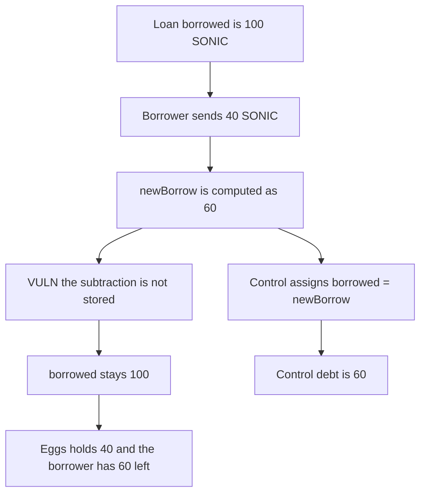

# Eggs: repay takes 40 SONIC and leaves the debt at 100

> **Vulnerability classes:** `vuln/logic/state-update` · `vuln/logic/missing-check`

<!-- non-defihacklabs -->
<!-- source-auditvault: https://github.com/Auditware/AuditVault/blob/main/findings/46030-repay-does-not-decrease-borrowed-amount-as-expected-cantina.md -->
<!-- date: 2025-02 -->

## Key info

| Field | Value |
|---|---|
| **Loss** | 40 SONIC is taken. `borrowed` stays 100. The borrower has 60 SONIC left and still owes 100 |
| **Vulnerable contract** | `Eggs.repay` |
| **Attacker EOA** | `0x1111111111111111111111111111111111111111` |
| **Attack contract** | `Exploit` |
| **Attack tx** | `Exploit.run()` |
| **Chain / block / date** | Ethereum model · block 0 · 2025-02 |
| **Compiler** | solc 0.8.27, cancun, via IR |
| **Bug class** | `borrowed - newBorrow` is not an assignment |

## TL;DR

`repay` computes `newBorrow = borrowed - amount` and then does not store it. The report's line is `Loans[msg.sender].borrowed - newBorrow;`. A borrower who owes 100 SONIC and sends 40 still owes 100. Eggs holds the 40. The borrower has 60 left. Assigning `borrowed = newBorrow` leaves the debt at 60 and Eggs still holds the 40 that was actually paid.

## Background

Cantina's Eggs review, February 2025, the same report as the pre-start leverage finding, reported by Kaden. The line is `Eggs.sol` around L342. Eggs Finance fixed it in commit `2f02fb77` by writing the assignment. The severity in the report is high because the payment is taken and the debt is not.

## The vulnerable code

```solidity
function repay(uint256 amount) external {
    sonic.transferFrom(msg.sender, address(this), amount);
    uint256 borrowed = loans[msg.sender].borrowed;
    uint256 newBorrow = borrowed - amount;
    discarded = loans[msg.sender].borrowed - newBorrow; // @> VULN: not assigned back to loans[msg.sender].borrowed
}
```

`discarded` keeps the subtraction observable. It is not written to `loans[msg.sender].borrowed`. The report's line throws the same result away. The fix:

```diff
- Loans[msg.sender].borrowed - newBorrow;
+ Loans[msg.sender].borrowed = newBorrow;
```

## Root cause

The payment is transferred in, and the only state update the debt needs is an assignment. The expression that looks like that assignment does not write storage, so `borrowed` is unchanged.

## Preconditions

- The caller has a loan with `borrowed == 100` SONIC.
- They call `repay` with 40 SONIC, which they hold.
- No other role is involved. This is the borrower's own call, and it loses their funds.

## Attack walkthrough

1. Eggs is funded with 100 SONIC and lends it. `borrowed` is 100.
2. The borrower approves and calls `repay(40)`.
3. 40 SONIC moves into Eggs. `newBorrow` is 60.
4. The subtraction result is not stored on the loan. `borrowed` is still 100.
5. The borrower holds 60 SONIC and still owes 100.
6. The control stores `newBorrow`. The debt is 60. Eggs holds the same 40 SONIC, which now matches the payment.

## Diagrams



## Impact

The borrower loses 40 SONIC. The debt they were paying down is still 100, so closing the loan later costs the original 100 on top of the 40 already taken. Eggs' balance increases by exactly that 40. The control reduces the debt to 60 for the same payment.

## Remediation

Replace the discarded subtraction with `Loans[msg.sender].borrowed = newBorrow`.

## How to reproduce

```bash
cd 46030-repay-does-not-decrease-borrowed-amount-as-expected-cantina_exp
forge test -vv
```

`test_exploit_repay_keeps_the_debt` asserts the debt is 100, the discarded value is 40, Eggs holds 40, and the borrower holds 60. `test_control_repay_reduces_the_debt` asserts the debt is 60.

## Sources

- AuditVault finding: https://github.com/Auditware/AuditVault/blob/main/findings/46030-repay-does-not-decrease-borrowed-amount-as-expected-cantina.md
- Cantina report: https://cdn.cantina.xyz/reports/cantina_eggs_february2025.pdf
- Fix commit named in the report: `2f02fb77`
