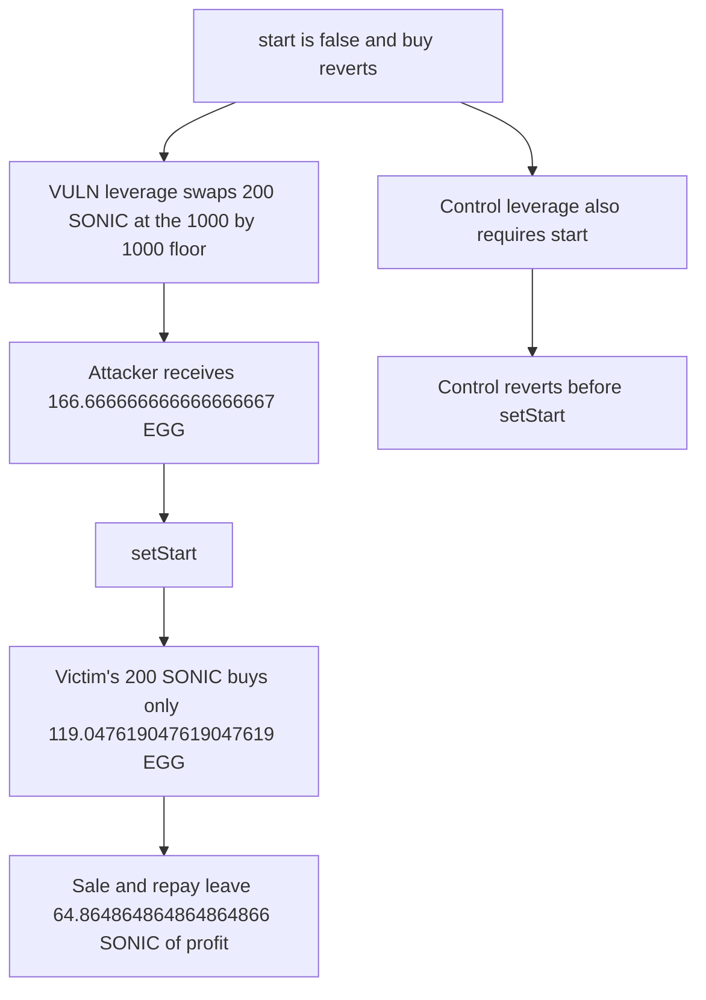

# Eggs: leverage opens at the floor before trading has started

> **Vulnerability classes:** `vuln/logic/missing-check` · `vuln/logic/incorrect-state-transition`

<!-- non-defihacklabs -->
<!-- source-auditvault: https://github.com/Auditware/AuditVault/blob/main/findings/46031-leveraged-positions-can-be-created-before-the-system-start-c.md -->
<!-- date: 2025-02 -->

## Key info

| Field | Value |
|---|---|
| **Loss** | First buyer receives 119.047619047619047619 EGG instead of 166.666666666666666667. Attacker profit is 64.864864864864864866 SONIC |
| **Vulnerable contract** | `Eggs.leverage` |
| **Attacker EOA** | `0x1111111111111111111111111111111111111111` |
| **Attack contract** | `Exploit` |
| **Attack tx** | `Exploit.run()` |
| **Chain / block / date** | Ethereum model · block 0 · 2025-02 |
| **Compiler** | solc 0.8.27, cancun, via IR |
| **Bug class** | `leverage` does not `require(start)`, and `buy` does |

## TL;DR

`setStart` is owner-only and `buy` reverts until it has been called. `leverage` does not check `start`. On a 1,000/1,000 pool, 100 SONIC of collateral plus 100 SONIC borrowed buys `166.666666666666666667` EGG at the floor while `buy` still reverts. After `setStart`, a 200 SONIC buy receives `119.047619047619047619` EGG instead of the `166.666666666666666667` that same buy would have received alone. The attacker sells for `264.864864864864864866` SONIC, repays the 100 SONIC loan, and keeps `64.864864864864864866` SONIC over the 100 SONIC collateral. The fixed `leverage` uses the same `require(start)` and reverts before `setStart`.

## Background

Cantina's Eggs review, February 2025, reported by Kaden. `Eggs.sol` around the `setStart` flag and the `leverage` function. Eggs Finance fixed it in commit `2f02fb77`. The pool in this reduction is a constant-product of SONIC and EGG so the missing check has a price: the first leveraged buy is the only trade that can happen at the 1,000/1,000 reserves.

## The vulnerable code

```solidity
function buy(uint256 sonicIn) external returns (uint256 eggOut) {
    require(start, "Trading must be initialized");
    // ...
}

function leverage(uint256 collateral) external returns (uint256 eggOut) {
    sonic.transferFrom(msg.sender, address(this), collateral); // @> VULN: no require(start), so this opens at the floor while buy reverts
    // borrows collateral again and swaps collateral + loan
}
```

The report's fix is `require(start)` inside `leverage`.

## Root cause

The start flag is enforced on `buy` and not on `leverage`. Leverage only needs SONIC, which the user can hold before any EGG exists, so the floor is available to one caller.

## Preconditions

- `start` is false. The owner has not called `setStart`.
- The pool reserves are the initial 1,000 SONIC and 1,000 EGG.
- The caller has SONIC. No EGG and no role are required.

## Attack walkthrough

1. `buy(1)` reverts with `Trading must be initialized`.
2. `leverage(100)` pulls 100 SONIC, borrows 100 more, and receives `166.666666666666666667` EGG.
3. The owner calls `setStart`.
4. The first public buyer spends 200 SONIC and receives `119.047619047619047619` EGG.
5. The attacker sells the floor EGG for `264.864864864864864866` SONIC and repays the 100 SONIC loan.
6. Profit over the 100 SONIC collateral is `64.864864864864864866` SONIC. The fixed function reverts the same `leverage` call before `setStart`.

## Diagrams



## Impact

The victim's 200 SONIC buys `47.619047619047619048` fewer EGG than the same trade at the untouched floor. The attacker is paid `64.864864864864864866` SONIC above the 100 SONIC they posted, after the loan is repaid. Ending SONIC on the attacker contract is `164.864864864864864866`, which is that collateral plus the profit.

## Remediation

Add `require(start, "Trading must be initialized")` at the top of `leverage`, matching `buy`. That is the change in commit `2f02fb77`.

## How to reproduce

```bash
cd 46031-leveraged-positions-can-be-created-before-the-system-start-c_exp
forge test -vv
```

`test_exploit_leverage_before_start_takes_the_floor` asserts the buy revert, both EGG amounts, the sale, and the profit. `test_control_guarded_leverage_reverts_before_start` asserts the guarded function reverts before `setStart` and succeeds after it.

## Sources

- AuditVault finding: https://github.com/Auditware/AuditVault/blob/main/findings/46031-leveraged-positions-can-be-created-before-the-system-start-c.md
- Cantina report: https://cdn.cantina.xyz/reports/cantina_eggs_february2025.pdf
- Fix commit named in the report: `2f02fb77`
