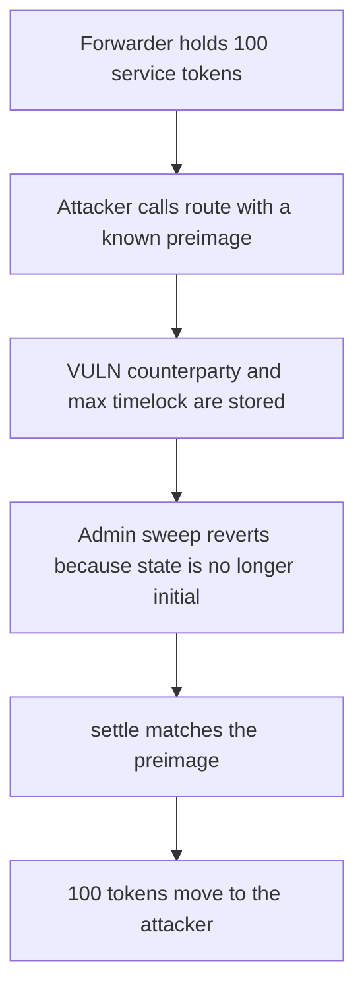

# SatsBridge: anyone can route a forwarder and take its tokens

> **Vulnerability classes:** `vuln/access-control/missing-auth` · `vuln/dos/frozen-funds`

<!-- non-defihacklabs -->
<!-- source-auditvault: https://github.com/Auditware/AuditVault/blob/main/findings/46080-permissionless-route-creation-leads-to-contract-dos-and-toke.md -->
<!-- date: 2025-01 -->

## Key info

| Field | Value |
|---|---|
| **Loss** | 100 service tokens move to the attacker. The admin sweep reverts |
| **Vulnerable contract** | `ForwarderHashedTimelockERC20.route` |
| **Attacker EOA** | `0x1111111111111111111111111111111111111111` |
| **Attack contract** | `Exploit` |
| **Attack tx** | `Exploit.run()` |
| **Chain / block / date** | Ethereum model · local · 2025-01 |
| **Compiler** | solc 0.8.27, cancun |
| **Bug class** | Permissionless route with an unbounded timelock and a known preimage |

## TL;DR

`route()` can be called by anyone while the forwarder is in its initial state. An attacker points the route at themselves, uses a preimage they already know, and sets the timelock to `type(uint256).max`. The admin can no longer sweep. `settle` with the known preimage transfers the forwarder's 100 tokens to the attacker.

## Background

Cantina's January 2025 SatsBridge review, reported by Sujith Somraaj, on `ForwarderHashedTimelockERC20.route` at line 64. The report gives a permanent-DoS scenario and a theft scenario. This run does both: the admin transfer reverts, then `settle` pays the attacker. SatsBridge later required `msg.sender == owner()` for outgoing routes, in commit 05ea0763.

## The vulnerable code

```solidity
counterparty = _counterparty; // @> VULN: any caller can bind the forwarder's tokens
incoming = _incoming;
hashlock = _hashlock;
timelock = _timelock; // no upper bound
```

```diff
+ require(msg.sender == owner, "Only owner can set outgoing transfers");
+ require(_timelock <= block.timestamp + 2 days);
+ require(_hashlock != bytes32(0));
```

## Root cause

`route` changes the forwarder out of the initial state with no caller check and no bound on the lock. `transfer` refuses to run once that state has changed. `settle` pays whoever the route named, as long as the preimage matches a hash the attacker chose.

## Preconditions

- The forwarder holds 100 service tokens and `counterparty` is unset.
- The attacker calls `route` with `incoming = false`, so they do not have to deposit.
- The hashlock is `sha256` of a preimage the attacker knows.

## Attack walkthrough

1. The attacker calls `route` with themselves as counterparty, timelock `uint256` max, and a known hashlock.
2. The admin calls `transfer`. It reverts because the state is no longer initial.
3. The attacker calls `settle` with the preimage.
4. The forwarder transfers 100 tokens to the attacker and its balance is 0.

## Diagrams



## Impact

The project cannot recover the 100 tokens through the admin `transfer`. The attacker receives all 100. A forwarder that nobody has routed can still be swept by the admin, which the control test shows.

## Remediation

Require the owner for an outgoing route, cap the timelock, reject a zero hashlock, and sweep leftover service tokens to a treasury when a route is reset.

## How to reproduce

```bash
cd 46080-permissionless-route-creation-leads-to-contract-dos-and-toke_exp
forge test -vv
```

`test_exploit_attacker_steals_100_and_blocks_admin` asserts the admin is blocked and the attacker holds 100 ether of the token. `test_control_owner_only_route_keeps_admin_sweep` asserts an unrouted forwarder can still be swept. Captured output is `output.txt`.

## Sources

- AuditVault finding: https://github.com/Auditware/AuditVault/blob/main/findings/46080-permissionless-route-creation-leads-to-contract-dos-and-toke.md
- Cantina report: https://cdn.cantina.xyz/reports/cantina_satsbridge_january2025.pdf
