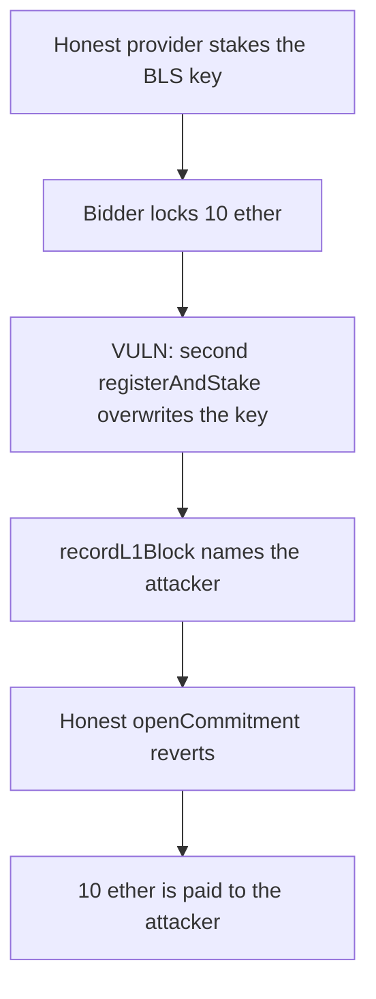

# Primev: a second registerAndStake overwrites a BLS key and takes the 10 ether bid

> **Vulnerability classes:** `vuln/logic/missing-check` · `vuln/logic/state-update`

<!-- non-defihacklabs -->
<!-- source-auditvault: https://github.com/Auditware/AuditVault/blob/main/findings/46245-blockbuilderblskeytoaddress-can-be-overwritten-in-providerre.md -->
<!-- date: 2024-10 -->

## Key info

| Field | Value |
|---|---|
| **Loss** | Honest provider is not paid. Attacker receives the 10 ether bid locked for that BLS key |
| **Vulnerable contract** | `ProviderRegistry._registerAndStake` |
| **Attacker EOA** | `0x1111111111111111111111111111111111111111` |
| **Attack contract** | `Exploit` |
| **Attack tx** | `Exploit.run()` with 0.2 ether |
| **Chain / block / date** | Ethereum model · block 0 · 2024-10 |
| **Compiler** | solc 0.8.27, cancun, optimizer 200 |
| **Bug class** | Mapping write does not reject an occupied BLS key |

## TL;DR

`_registerAndStake` writes `blockBuilderBLSKeyToAddress[key] = provider` for every 48-byte key. It does not revert when that key is already mapped. The honest provider registers first. The attacker registers the same key. `recordL1Block` reads the mapping and names the attacker as the winner. `openCommitment` pays the 10 ether escrow to the attacker. The honest provider's open reverts.

## Background

Cantina's Primev competition, October 2024, reported by amaron. The new `blockBuilderBLSKeyToAddress` mapping was added so `BlockTracker.recordL1Block` could resolve a block winner from a BLS key. The write has no occupancy check. The report's first attack path is a second registrant taking the winner slot so the original provider cannot open the commitment.

## The vulnerable code

```solidity
require(key.length == 48, "len");
blockBuilderBLSKeyToAddress[key] = provider; // @> VULN: an existing BLS key is overwritten
```

The report's fix is to revert when the key is already populated.

```diff
- blockBuilderBLSKeyToAddress[key] = provider;
+ require(blockBuilderBLSKeyToAddress[key] == address(0), "key taken");
+ blockBuilderBLSKeyToAddress[key] = provider;
```

## Root cause

Registration is unique per provider address, not per BLS key. Two providers can pass the same 48 bytes. The later write wins, and the oracle trusts the mapping.

## Preconditions

- An honest provider has staked `minStake` (0.1 ether) on a 48-byte key.
- A bid is escrowed against the block that key will win.
- The attacker can stake another 0.1 ether and register a different address with that key before `recordL1Block`.

## Attack walkthrough

1. Honest provider registers the key and stakes 0.1 ether.
2. Bidder locks 10 ether on block 1.
3. Attacker calls `registerAndStake` with the same key.
4. Oracle records the winner. The mapping returns the attacker.
5. Honest provider's `openCommitment` reverts.
6. Attacker opens the commitment and receives 10 ether.

## Diagrams



## Impact

The honest provider's bid-token balance stays 0. The attacker holds 10 ether. The key now resolves to the attacker, so any later reward or slash aimed at that key hits the wrong account. The report rates this high because the original provider loses the payment and the bidder's escrow goes to someone who did not build the block.

## Remediation

Revert in `_registerAndStake` when `blockBuilderBLSKeyToAddress[key]` is already non-zero. The report notes a front-run of the honest registration remains a separate discussion.

## How to reproduce

```bash
cd 46245-blockbuilderblskeytoaddress-can-be-overwritten-in-providerre_exp
forge test -vv
```

`test_overwrite_pays_bid_to_the_second_registrant` sends 0.2 ether, asserts the honest open was blocked, the attacker received 10 ether, and `winnerOf(1)` is the attacker.

## Sources

- AuditVault finding: https://github.com/Auditware/AuditVault/blob/main/findings/46245-blockbuilderblskeytoaddress-can-be-overwritten-in-providerre.md
- Report PDF: https://cdn.cantina.xyz/reports/cantina_competition_private_primev.pdf
- Cantina Primev competition, 1 October 2024 to 22 October 2024: https://cantina.xyz/portfolio/026e6835-510f-4245-a031-e067e6652e4a
- Quoted from `ProviderRegistry._registerAndStake` and `BlockTracker.recordL1Block` in that report. Repo context: https://github.com/primev/mev-commit
