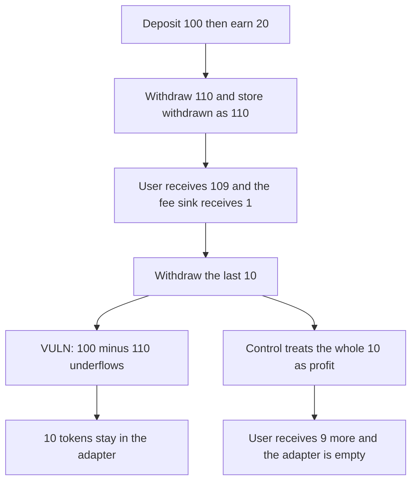

# Clave: withdrawing the rest of a profitable position underflows the fee

> **Vulnerability classes:** `vuln/arithmetic/underflow` · `vuln/dos/frozen-funds`

<!-- non-defihacklabs -->
<!-- source-auditvault: https://github.com/Auditware/AuditVault/blob/main/findings/46277-claggbaseadapter-handlefee-incorrectly-calculates-the-user-s.md -->
<!-- date: 2024-12 -->

## Key info

| Field | Value |
|---|---|
| **Loss** | The last 10 tokens stay in the adapter. The second withdraw reverts |
| **Vulnerable contract** | `ClaggBaseAdapter.withdraw` |
| **Attacker EOA** | `0x1111111111111111111111111111111111111111` |
| **Attack contract** | `Exploit` |
| **Attack tx** | `Exploit.run()` |
| **Chain / block / date** | Ethereum model · block 0 · 2024-12 |
| **Compiler** | solc 0.8.27, cancun, via IR |
| **Bug class** | Gain subtracts deposited minus withdrawn after withdrawn has passed deposited |

## TL;DR

`_handleFee` charges a performance fee when `withdrawn + amount > deposited`, and computes the gain as `amount - (deposited - withdrawn)`. After a user deposits 100, earns 20, and withdraws 110, `withdrawn` is 110. The next 10-token withdraw still enters the fee branch and then underflows `100 - 110`. Those 10 tokens cannot be withdrawn.

## The vulnerable code

```solidity
if (fee > 0 && userInfo.withdrawn + amount > userInfo.deposited) {
    uint256 gain = amount - (userInfo.deposited - userInfo.withdrawn); // @> VULN: deposited - withdrawn underflows once withdrawn exceeds deposited, so the rest of the position cannot be withdrawn
    perfFee = (gain * fee) / 10000;
}
```

The fee is 1000 bps. The first withdraw's gain is 10, so the fee is 1 and the user receives 109. The recommended split is: no profit while `withdrawn + amount <= deposited`; the whole amount is profit once `deposited <= withdrawn`; otherwise the profit is `withdrawn + amount - deposited`.

## Preconditions

- Performance fee is 10 percent. The user is treated as a Clave holder, so the extra non-Clave fee is 0.
- The user deposits 100. The adapter later holds 120.
- The user withdraws 110, which books `withdrawn = 110`, then tries to withdraw the remaining 10.

## Attack walkthrough

1. Deposit 100. `deposited` is 100.
2. Yield of 20 is added. The adapter holds 120.
3. Withdraw 110. Gain is 10, fee is 1, the user receives 109, and `withdrawn` becomes 110.
4. Withdraw 10. `withdrawn + amount` is 120, which is still above `deposited`, so the fee branch runs.
5. `deposited - withdrawn` is `100 - 110` and reverts. The adapter still holds 10.
6. The control treats the whole remainder as profit, charges 1, and pays the user 9. The adapter ends empty.

## Diagrams



## Impact

The depositor cannot take the last 10 tokens of a position that has already paid a fee on an earlier profitable withdraw. The adapter balance stays 10, the user balance stays 109, and the fee sink has the 1 token from the first withdraw only.

## How to reproduce

```bash
cd 46277-claggbaseadapter-handlefee-incorrectly-calculates-the-user-s_exp
forge test -vv
```

`test_exploit_second_withdraw_reverts_and_locks_10` asserts the revert and the stuck 10. `test_control_entire_remainder_is_profit` asserts the adapter is empty and the user received 118 across both withdraws.

## Sources

- AuditVault finding: https://github.com/Auditware/AuditVault/blob/main/findings/46277-claggbaseadapter-handlefee-incorrectly-calculates-the-user-s.md
- Cantina report: https://cdn.cantina.xyz/reports/cantina_clave_december2024.pdf
- Fix commit noted by Cantina: `46aece01`
