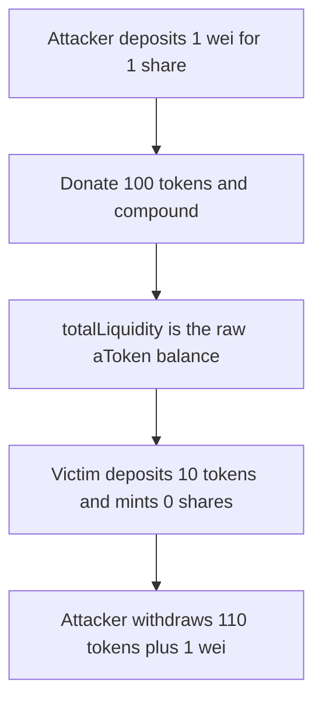

# Clave Clagg: an aToken donation inflates the vault and the next depositor mints 0 shares

> **Vulnerability classes:** `vuln/logic/price-calculation` · `vuln/arithmetic/precision-loss`

<!-- non-defihacklabs -->
<!-- source-auditvault: https://github.com/Auditware/AuditVault/blob/main/findings/46278-using-atokenbalanceof-in-claggaaveadapter-compoundaccounting.md -->
<!-- date: 2024-12 -->

## Key info

| Field | Value |
|---|---|
| **Loss** | Victim's 10 tokens are absorbed; attacker ends with 110 tokens plus 1 wei |
| **Vulnerable contract** | `ClaggAaveAdapter._compoundAccounting` |
| **Attacker EOA** | `0x1111111111111111111111111111111111111111` |
| **Attack contract** | `Exploit` |
| **Attack tx** | `Exploit.run()` |
| **Chain / block / date** | Local synthetic · 2024-12 |
| **Compiler** | solc 0.8.27, cancun, via IR |
| **Bug class** | totalLiquidity is set from aToken.balanceOf |

## TL;DR

`_compoundAccounting` sets `totalLiquidity` to `aToken.balanceOf`. The attacker deposits 1 wei, donates 100 tokens, and compounds. The next 10 token deposit rounds to 0 shares. The attacker's 1 share then withdraws the donation and the victim's deposit. The attacker ends holding 110 tokens plus 1 wei. The victim holds 0 shares and 0 tokens.

## The vulnerable code

```solidity
function compound() external {
    poolInfo.totalLiquidity = token.balanceOf(address(this));
}
```

Share minting divides the deposit by `totalLiquidity / totalShares`. A direct aToken balance includes donations, so a 1 wei share can be priced above the next deposit.

## Root cause

Accounting uses the raw aToken balance. A donation changes the share price without minting shares.

## Preconditions

- The vault is empty.
- The attacker can donate aTokens to the vault and call compound.
- A later depositor adds 10 tokens.

## Attack walkthrough

1. The attacker deposits 1 wei and receives 1 share.
2. The attacker donates 100 tokens and compound sets total liquidity to the aToken balance.
3. The victim deposits 10 tokens and receives 0 shares.
4. The attacker withdraws. The victim's balance and share count are 0. The attacker holds 110 tokens plus 1 wei.

## Diagrams



## Impact

The first share can be inflated until later deposits mint nothing and can be withdrawn by the first depositor. This run takes the victim's 10 tokens on top of the donated 100, which the attacker supplied.

## How to reproduce

```bash
cd 46278-using-atokenbalanceof-in-claggaaveadapter-compoundaccounting_exp
forge test -vv
```

## Sources

- AuditVault finding: https://github.com/Auditware/AuditVault/blob/main/findings/46278-using-atokenbalanceof-in-claggaaveadapter-compoundaccounting.md
- Cantina report: https://cdn.cantina.xyz/reports/cantina_clave_december2024.pdf
