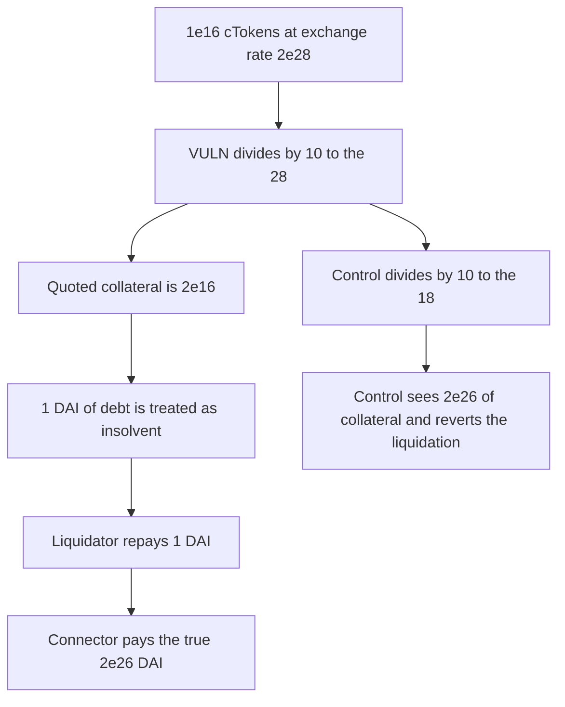

# Balmy: cToken collateral is priced 1e10 too low and 1 DAI seizes 2e8 DAI

> **Vulnerability classes:** vuln/arithmetic/decimal-mismatch · vuln/logic/price-calculation

<!-- non-defihacklabs -->
<!-- source-auditvault: https://github.com/Auditware/AuditVault/blob/main/findings/46430-compoundv2connector-convertsharestoassets-magnitude-scalar-c.md -->
<!-- date: 2024-11 -->

## Key info

| Field | Value |
|---|---|
| **Loss** | Liquidator pays 1 DAI and receives 2e26 wei of DAI. Net gain is 1.99999999e8 DAI |
| **Vulnerable contract** | `CompoundV2Connector._convertSharesToAssets` |
| **Attacker EOA** | `0x0000000000000000000000000000000000046430` |
| **Attack contract** | `Exploit` |
| **Attack tx** | `Exploit.run()` |
| **Chain / block / date** | Ethereum model · block 0 · 2024-11 |
| **Compiler** | solc 0.8.27, cancun, via IR |
| **Bug class** | Magnitude is `10 + decimals` instead of 18 |

## TL;DR

`_convertSharesToAssets` divides `shares * exchangeRateStored` by `10 ** (10 + underlyingDecimals)`. For DAI that denominator is `10**28`. The Compound exchange rate is already scaled so the true redeem value divides by `10**18`. The position is priced at `2e16` instead of `2e26`. A 1 DAI debt is above the buggy price, so `liquidate` repays 1 DAI and transfers the true `2e26` of collateral.

## Background

Cantina's November 2024 Balmy review, `CompoundV2Connector.sol` lines 378-383. The report's fork PoC on cDAI shows a computed redeem amount that is 10 digits below the DAI actually returned by `cToken.redeem`. cTokens have 8 decimals. The exchange-rate mantissa is `18 + underlyingDecimals - 8`, which is 28 for an 18-decimal underlying, and the share conversion must still divide by `10**18` after multiplying by that rate, not by `10**28`.

## The vulnerable code

```solidity
uint256 underlyingTokenDecimals = _max(assetDecimals, 8);
uint256 magnitude = (10 + underlyingTokenDecimals);
// @> VULN: magnitude is 10 + decimals (28 for DAI) instead of 18, so the cToken is worth 1e10 too little
return shares * exchangeRate / (10 ** magnitude);
```

With `shares = 1e16` and `exchangeRate = 2e28`, the function returns `2e16`. `shares * exchangeRate / 1e18` is `2e26`. The ratio is exactly `1e10`.

## Root cause

The magnitude adds a fixed 10 to the underlying decimals. That double-counts the 8 cToken decimals plus an extra 2. The division is too large by `10**10` for every 18-decimal underlying, which is the gap the cDAI fork PoC prints.

## Preconditions

- The connector's asset is DAI, 18 decimals, so `magnitude` is 28.
- The position holds `1e16` cTokens at exchange rate `2e28`. The connector's DAI balance is the true redeem value, `2e26`.
- Debt is 1 ether, which is greater than the buggy price `2e16` and far below the true value.

## Attack walkthrough

1. `run` asks `_convertSharesToAssets` for the position. The result is `2e16`.
2. `liquidate` requires `debt > priced`. 1 ether is greater than `2e16`, so the position is treated as underwater.
3. The attacker transfers 1 DAI into the connector.
4. The connector pays `cBalance * exchangeRate / 1e18`, which is `2e26` DAI.
5. The attacker's DAI balance is `2e26`. It started the call holding 1 DAI.

## Diagrams



## Impact

The liquidator spends 1 DAI and receives 200000000000000000000000000 wei. The net gain during `run` is 199999999000000000000000000 wei. That DAI was the collateral backing the position. The control uses magnitude 18, prices the same position at `2e26`, and `liquidate` reverts with `solvent`. The caller's 1 DAI is untouched.

## Remediation

Divide by `10**18`. The review's note is that cTokens have 8 decimals, so the extra `10 + decimals` term is the wrong scale. The same fix has to be applied anywhere `exchangeRateStored` is turned into an underlying amount.

## How to reproduce

```bash
cd 46430-compoundv2connector-convertsharestoassets-magnitude-scalar-c_exp
forge test -vv
```

`test_exploit_undervalued_ctoken_is_liquidated_for_1_dai` asserts the `1e10` gap and the DAI gain. `test_control_magnitude_18_is_not_liquidatable` expects `solvent`. Captured output is `output.txt`.

## Sources

- AuditVault finding: https://github.com/Auditware/AuditVault/blob/main/findings/46430-compoundv2connector-convertsharestoassets-magnitude-scalar-c.md
- Report: Cantina Balmy, November 2024, `CompoundV2Connector.sol` L378-L383
