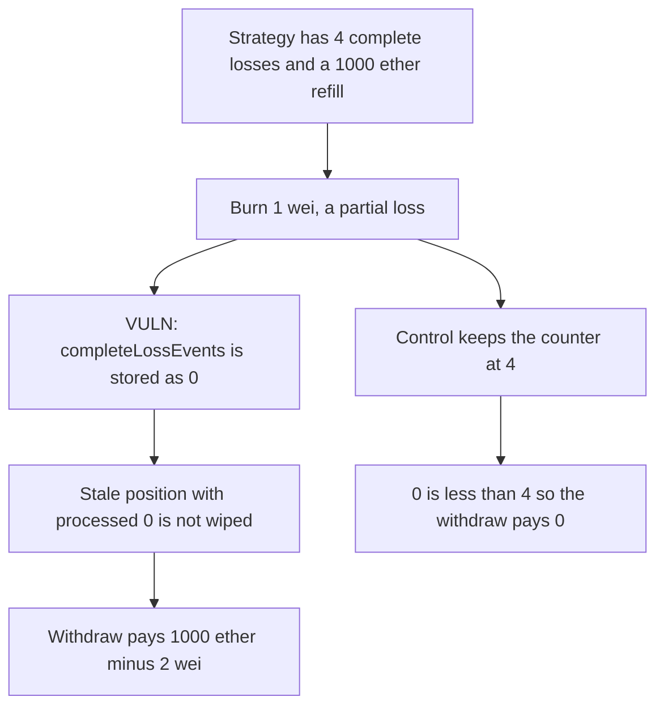

# A partial loss resets the complete-loss counter and a stale position takes the refill

> **Vulnerability classes:** vuln/logic/state-update · vuln/logic/wrong-condition

<!-- non-defihacklabs -->
<!-- source-auditvault: https://github.com/Auditware/AuditVault/blob/main/findings/46431-complete-loss-event-counter-resets-to-0-on-partial-loss-cant.md -->
<!-- date: 2024-11 -->

## Key info

| Field | Value |
|---|---|
| **Loss** | 999.999999999999999998 ether taken from a refilled strategy |
| **Vulnerable contract** | `YieldVault.calculateAccum` |
| **Attacker EOA** | `0x1111111111111111111111111111111111111111` |
| **Attack contract** | `Exploit` |
| **Attack tx** | `Exploit.run()` |
| **Chain / block / date** | Ethereum model · block 0 · 2024-11 |
| **Compiler** | solc 0.8.27, cancun, via IR |
| **Bug class** | Partial loss leaves `newStrategyCompleteLossEvents` at 0 |

## TL;DR

`calculateAccum` updates the loss accumulator on a partial loss and never assigns the complete-loss counter, so the named return stays 0. A strategy that had recorded 4 complete losses is stored as 0 after a 1 wei burn. A position that still has the pre-loss snapshot, processed events 0 and balance 1000 ether, is no longer wiped. It withdraws 1000 ether minus 2 wei of the refill. The control keeps the counter at 4, the same snapshot fails `0 < 4`, and the refill stays in the vault.

## Background

Cantina's November 2024 Balmy review, the same YieldMath library as the overflow finding. `calculateBalance` zeros a position when `positionProcessedCompleteLossEvents < strategyCompleteLossEvents`. Positions are updated lazily, on the next interaction. The partial-loss branch in the vulnerable revision did not set `newStrategyCompleteLossEvents`. Balmy fixed it in earn-core PR 74 by assigning the previous counter.

## The vulnerable code

```solidity
} else if (currentBalance < previousBalance) {
    newLoss = lossAccum.mulDiv(currentBalance, previousBalance);
    // @> VULN: partial loss never assigns newStrategyCompleteLossEvents, so the counter is stored as 0
    newYield = yieldAccum.mulDiv(newLoss, lossAccum);
}
```

`newEvents` is a named return and stays 0. `notifyPartialLoss` writes that 0 into `completeLossEvents`.

## Root cause

The partial-loss branch updates yield and loss and forgets the counter. Solidity zeros the unset return. The next `calculateBalance` comparison, which is what wipes positions that missed a complete loss, no longer sees the 4 events the strategy had recorded.

## Preconditions

- The strategy's `completeLossEvents` is 4 and the loss accumulator is `type(uint248).max`.
- A position still stores the pre-loss snapshot: processed events 0, balance 1000 ether, loss accumulator at the initial max.
- The vault holds 1000 ether, which is the refill from depositors who arrived after the wipes.
- A partial loss occurs. This run burns 1 wei.

## Attack walkthrough

1. One wei is burned. The balance is 1000 ether minus 1 wei. The counter is still 4.
2. `notifyPartialLoss` takes the partial-loss branch. The loss accumulator is scaled. The event counter is stored as 0.
3. The stale position calls `withdraw`. `0 < 0` is false, so the wipe does not apply.
4. The 1000 ether snapshot is scaled by the 1 wei loss and 999.999999999999999998 ether is transferred out.
5. One wei remains in the vault.
6. The control keeps `completeLossEvents` at 4. The same withdraw hits `0 < 4`, returns 0, and leaves 1000 ether minus 1 wei in the vault.

## Diagrams



## Impact

The holder of the stale snapshot receives 999.999999999999999998 ether that belongs to the depositors who refilled the strategy after the four wipes. The vault is left with 1 wei. The control pays that position nothing.

## Remediation

In the partial-loss branch set `newStrategyCompleteLossEvents = previousStrategyCompleteLossEvents`, which is the one-line fix in earn-core PR 74.

## How to reproduce

```bash
cd 46431-complete-loss-event-counter-resets-to-0-on-partial-loss-cant_exp
forge test
```

`test_exploit_partial_loss_resets_counter_and_pays_stale_position` asserts a stored counter of 0 and a payout of `999999999999999999998` wei. `test_control_keeps_complete_loss_counter_and_pays_zero` asserts a counter of 4 and a zero payout. Captured output is `output.txt`.

## Sources

- AuditVault finding: https://github.com/Auditware/AuditVault/blob/main/findings/46431-complete-loss-event-counter-resets-to-0-on-partial-loss-cant.md
- Report: https://cdn.cantina.xyz/reports/antina_balmy_november2024.pdf
- Fix: https://github.com/Balmy-protocol/earn-core/commit/c7169a4766b88b70c87e9e5f6267d1e005fdf9a2
