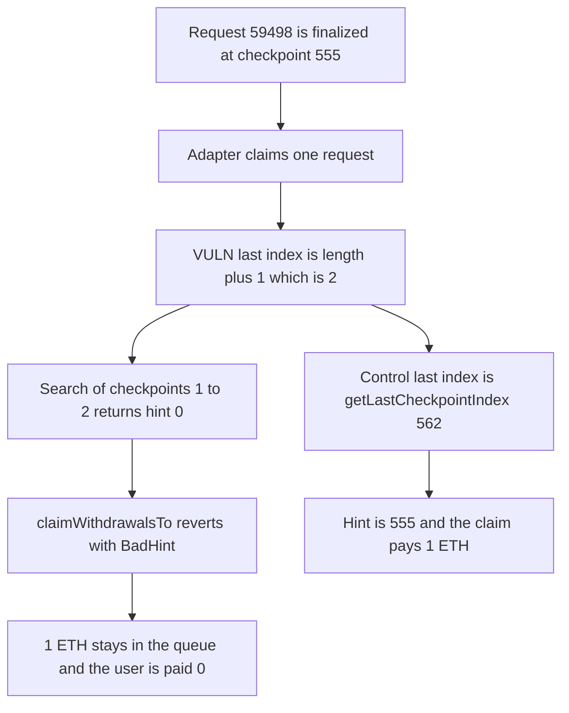

# Balmy: Lido withdrawal hints are searched up to the request count, so the claim reverts

> **Vulnerability classes:** `vuln/dos/frozen-funds` · `vuln/logic/missing-validation`

<!-- non-defihacklabs -->
<!-- source-auditvault: https://github.com/Auditware/AuditVault/blob/main/findings/46432-the-hint-is-not-fetched-properly-from-lido-withdrawal-queue.md -->
<!-- date: 2024-11 -->

## Key info

| Field | Value |
|---|---|
| **Loss** | 1 ETH for request 59498 stays in the queue. The claim reverts on hint 0 |
| **Vulnerable contract** | `LidoAdapter.withdraw` |
| **Attacker EOA** | `0x1111111111111111111111111111111111111111` |
| **Attack contract** | `Exploit` |
| **Attack tx** | `Exploit.run()` |
| **Chain / block / date** | Ethereum model · block 0 · 2024-11 |
| **Compiler** | solc 0.8.27, cancun, via IR |
| **Bug class** | `findCheckpointHints` last index is `requestsToClaim.length + 1` |

## TL;DR

The adapter loads hints with `findCheckpointHints(requestsToClaim, 1, requestsToClaim.length + 1)`. Lido requires the last index to be `getLastCheckpointIndex()`, and it returns 0 when the request's checkpoint is outside the range. Request 59498 was finalized at checkpoint 555. The queue's last checkpoint is 562. One request makes the last index 2, so the hint is 0. `claimWithdrawalsTo` reverts. The 1 ETH stays in the queue and the user is paid 0. Passing last index 562 returns hint 555 and pays the 1 ETH.

## Background

Cantina, Balmy, November 2024. The blamed line in `LidoSTETHDelayedWithdrawalAdapter` before pull 113 was:

```solidity
uint256[] memory hints = _queue.findCheckpointHints(requestsToClaim, 1, requestsToClaim.length + 1);
```

The report's mainnet example is request 59498, hint 555, and `getLastCheckpointIndex()` 562. Searching only to index 2 returns 0. Searching to 562 returns 555. Searching past 562 reverts. Balmy applied the `getLastCheckpointIndex()` change in earn-periphery pull 113.

## The vulnerable code

```solidity
uint256[] memory requestsToClaim = pending;
// @> VULN: last index is requestsToClaim.length + 1, not getLastCheckpointIndex()
uint256[] memory hints = queue.findCheckpointHints(requestsToClaim, 1, requestsToClaim.length + 1);
// FIX: queue.findCheckpointHints(requestsToClaim, 1, queue.getLastCheckpointIndex())
queue.claimWithdrawalsTo(requestsToClaim, hints, recipient);
```

The queue returns hint 555 only when checkpoint 555 is inside `[first, last]`. `claimWithdrawalsTo` reverts unless the hint is 555.

## Root cause

The last index is the length of the request array. It is not the checkpoint list's last index. For any real Lido queue the checkpoint index is far above the number of requests in one claim, so the hint is 0 and the claim reverts.

## Preconditions

- One pending request, id 59498, finalized at checkpoint 555.
- `getLastCheckpointIndex()` is 562.
- The queue holds 1 ETH for that request.
- Hint 0 is not a valid claim hint.

## Attack walkthrough

1. The user asks the adapter to withdraw the pending request.
2. `requestsToClaim.length + 1` is 2.
3. `findCheckpointHints` accepts the range because 2 is below 562, then returns 0 because 555 is not in `[1, 2]`.
4. `claimWithdrawalsTo` reverts with `BadHint`.
5. The queue still holds 1 ETH. The user holds 0. The request is unclaimed.
6. The control calls `findCheckpointHints` with last index 562, gets hint 555, and the claim pays 1 ETH to the caller. The queue balance is then 0.

## Diagrams



## Impact

The user's finalized withdrawal does not pay. The 1 ETH remains in the queue and `claimed` stays false. Every claim that uses this adapter hits the same short range, which is the report's "all Lido delayed withdrawals revert" case when the checkpoint index is above the request count. The control pays the 1 ETH once the last index is 562.

## Remediation

Pass `getLastCheckpointIndex()` as the last index, which is the change in Balmy pull 113. Do not use `requestsToClaim.length + 1`.

## How to reproduce

```bash
cd 46432-the-hint-is-not-fetched-properly-from-lido-withdrawal-queue_exp
forge test -vv
```

`test_exploit_short_hint_range_locks_the_eth` asserts the queue still holds 1 ETH and the user holds 0. `test_control_last_checkpoint_index_pays_the_eth` asserts hint 555 and a 1 ETH payout. Captured output is `output.txt`.

## Sources

- AuditVault finding: https://github.com/Auditware/AuditVault/blob/main/findings/46432-the-hint-is-not-fetched-properly-from-lido-withdrawal-queue.md
- Pre-fix adapter: https://github.com/Balmy-protocol/earn-periphery/blob/eb7d249c3a/src/strategies/layers/connector/lido/LidoSTETHDelayedWithdrawalAdapter.sol
- Fix pull 113: https://github.com/Balmy-protocol/earn-periphery/pull/113
