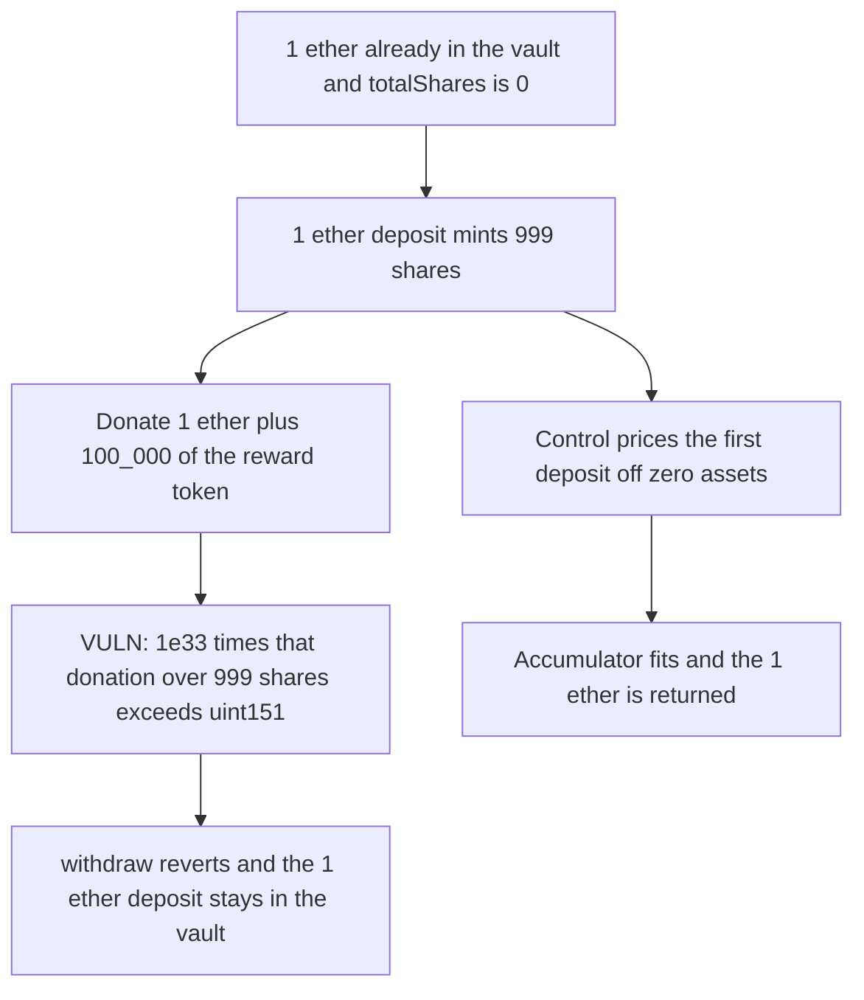

# A donated reward overflows the uint151 yield accumulator and locks the deposit

> **Vulnerability classes:** vuln/arithmetic/overflow · vuln/dos/frozen-funds

<!-- non-defihacklabs -->
<!-- source-auditvault: https://github.com/Auditware/AuditVault/blob/main/findings/46433-donated-reward-token-can-overflow-the-yieldaccumulator-and-r.md -->
<!-- date: 2024-11 -->

## Key info

| Field | Value |
|---|---|
| **Loss** | 1 ether deposit stuck. Withdraw reverts on the reported uint151 overflow |
| **Vulnerable contract** | `EarnVault._encode` |
| **Attacker EOA** | `0x1111111111111111111111111111111111111111` |
| **Attack contract** | `Exploit` |
| **Attack tx** | `Exploit.run()` |
| **Chain / block / date** | Ethereum model · block 0 · 2024-11 |
| **Compiler** | solc 0.8.27, cancun, via IR |
| **Bug class** | Donated reward times 1e33 over 999 shares does not fit in uint151 |

## TL;DR

One ether is donated before the first deposit, so a 1 ether deposit mints 999 shares instead of a full offset mint. Donating 1 ether plus 100_000 of the reward token then sets the yield accumulator to `1001001001001101101101101101101101101101101101101`, the exact value in the Cantina trace. `_encode` reverts because that integer does not fit in uint151. The depositor's ether stays in the vault. The control ignores donated assets on an empty vault, the accumulator fits, and the 1 ether comes back.

## Background

Cantina's November 2024 Balmy review. `YieldDataForToken._encode` packs the yield accumulator into 151 bits. `YieldMath` scales yield per share by `ACCUM_PRECISION` of 1e33. Balmy's later first-deposit guard, which treats `totalAssets` as 0 when `totalShares` is 0, also stops this overflow. Without that guard the donated balance prices the first deposit.

## The vulnerable code

```solidity
// @> VULN: the donated reward pushes yieldAccumulator past uint151 and this check reverts the withdrawal
if (yieldAccumulator > 2 ** 151 - 1) revert CustomUintSizeChecks.UintOverflowed(yieldAccumulator, 2 ** 151 - 1);
```

The accumulator is `1e33 * (1 ether + 100_000) / 999`. uint151 max is `2**151 - 1`, about 2.85e45.

## Root cause

Share math is `assets * (totalShares + 1000) / (totalAssets + 1)`. A donation of 1 ether with zero shares makes a 1 ether deposit worth 999 shares. The reward donation is then multiplied by 1e33 and divided by those 999 shares, which crosses the 151-bit pack used by every withdrawal.

## Preconditions

- The vault already holds 1 ether of the deposit asset and has zero shares.
- The user deposits 1 ether and receives 999 shares.
- Anyone donates 1 ether plus 100_000 of the reward token. No deposit was made in that token, so the whole balance is yield.

## Attack walkthrough

1. The user deposits 1 ether. `convertToShares` returns 999.
2. The reward donation of 1 ether plus 100_000 is minted to the vault.
3. `previewRewardAccum` returns the integer from the Cantina log.
4. `withdraw` hits the uint151 check and reverts.
5. The user still has 0 asset. The vault holds 2 ether: the donation and the deposit.
6. The control zeros `totalAssets` when `totalShares` is 0, mints 1000 ether shares, and the same donation produces an accumulator that fits. Withdrawal returns the 1 ether.

## Diagrams



## Impact

The depositor cannot withdraw the 1 ether they just sent. The transaction that tries to withdraw reverts with `UintOverflowed`, and the vault still holds both the donated ether and the deposit. The control returns the deposit.

## Remediation

Price the first deposit as if `totalAssets` were 0 when `totalShares` is 0, which is the donation fix Balmy applied in PR 76 and which also keeps this accumulator inside uint151. A direct cap or wider accumulator field is the other half.

## How to reproduce

```bash
cd 46433-donated-reward-token-can-overflow-the-yieldaccumulator-and-r_exp
forge test
```

`test_exploit_donated_reward_overflows_uint151_and_locks_deposit` asserts 999 shares, the reported accumulator, a reverted withdraw, and 2 ether left in the vault. `test_control_first_deposit_ignores_donation_and_withdraws` asserts the 1 ether comes back. Captured output is `output.txt`.

## Sources

- AuditVault finding: https://github.com/Auditware/AuditVault/blob/main/findings/46433-donated-reward-token-can-overflow-the-yieldaccumulator-and-r.md
- Report: https://cdn.cantina.xyz/reports/antina_balmy_november2024.pdf
- YieldMath: https://github.com/Balmy-protocol/earn-core/blob/main/src/vault/libraries/YieldMath.sol
