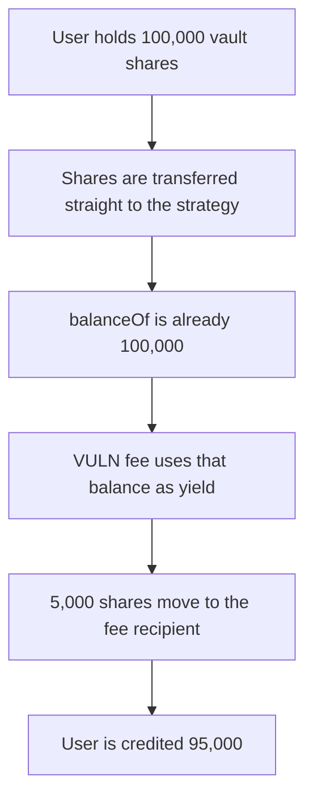

# Balmy: a direct vault-share deposit is charged a performance fee

> **Vulnerability classes:** `vuln/logic/fee-calculation`

<!-- non-defihacklabs -->
<!-- source-auditvault: https://github.com/Auditware/AuditVault/blob/main/findings/46434-externalfee-contract-treats-newly-deposit-vault-share-as-yie.md -->
<!-- date: 2024-11 -->

## Key info

| Field | Value |
|---|---|
| **Loss** | 5,000 of a 100,000 share deposit is skimmed before any yield |
| **Vulnerable contract** | `ExternalFeeStrategy._fees_deposited` |
| **Attacker EOA** | `0x1111111111111111111111111111111111111111` |
| **Attack contract** | `Exploit` |
| **Attack tx** | `Exploit.run()` |
| **Chain / block / date** | Ethereum model · local · 2024-11 |
| **Compiler** | solc 0.8.27, cancun |
| **Bug class** | Deposit included in the performance-fee snapshot |

## TL;DR

The user transfers ERC-4626 shares straight to the strategy, then the strategy is told about the deposit. `_fees_deposited` reads `balanceOf` after that transfer, compares it with a zero `lastBalance`, and charges the 500 bps performance fee on the deposit itself. The user is credited 95,000. The fee recipient receives 5,000.

## Background

Cantina review of Balmy, November 2024, reported by Blockdev. The report's assumption is an empty strategy and a 500 bps performance fee. Depositing the underlying asset snapshots a zero share balance. Depositing the share token itself does not.

## The vulnerable code

```solidity
uint256 currentBalance = shares.balanceOf(address(this)); // deposit already included
uint256 performanceFee = _calculateFees(currentBalance, performanceFeeBps); // @> VULN: deposit counted as yield
```

The fix is to snapshot before the user's transfer, or to stop sending shares directly to the strategy. Balmy described that change across PR 77 and PR 133.

## Root cause

The fee baseline is updated only inside `_fees_deposited`, but the tokens are already on the contract when that function reads the balance. The whole deposit looks like yield.

## Preconditions

- Performance fee is 500 bps and the strategy share balance starts at 0.
- The user deposits the vault share token, not the underlying asset.
- No reward has been paid into the strategy.

## Attack walkthrough

1. The user approves and deposits 100,000 shares.
2. `transferFrom` delivers them before the fee math.
3. `currentBalance` is 100,000.
4. The fee is `(100,000 - 0) * 500 / 10,000 = 5,000`.
5. Those 5,000 shares are transferred to the fee recipient.
6. The credited amount is 95,000.

## Diagrams



## Impact

The depositor loses 5 percent of the deposit on the same call that delivers it. The fee recipient's share balance increases by 5,000 ether units. An underlying deposit on an empty strategy, which snapshots before shares exist, credits the full 100,000 and charges 0.

## Remediation

Do not count shares that just arrived as yield. Snapshot the balance before the transfer, or pull the tokens only after the strategy has recorded the baseline.

## How to reproduce

```bash
cd 46434-externalfee-contract-treats-newly-deposit-vault-share-as-yie_exp
forge test -vv
```

`test_exploit_share_deposit_pays_five_percent_immediately` asserts a 95,000 credit and a 5,000 fee. `test_control_underlying_deposit_charges_no_yield_fee` asserts a full credit. Captured output is `output.txt`.

## Sources

- AuditVault finding: https://github.com/Auditware/AuditVault/blob/main/findings/46434-externalfee-contract-treats-newly-deposit-vault-share-as-yie.md
- Cantina report: https://cdn.cantina.xyz/reports/antina_balmy_november2024.pdf
