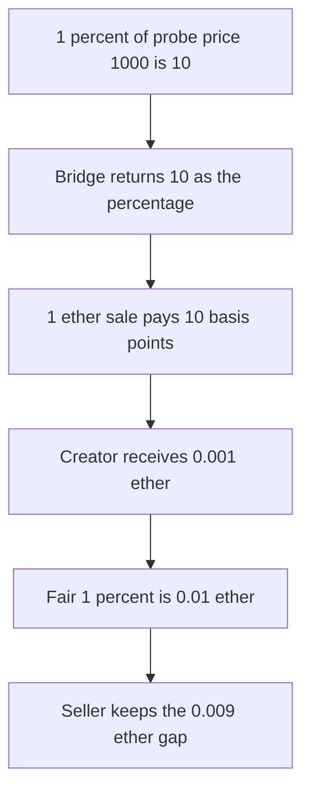

# Sweep n Flip — probe royalty amount is used as the percentage

> **Vulnerability classes:** vuln/logic/fee-calculation · vuln/input-validation/wrong-type

<!-- non-defihacklabs -->
<!-- source-auditvault: https://github.com/Auditware/AuditVault/blob/main/findings/46495-incorrect-casting-in-bridge-getroyaltypercentage-leads-to-mi.md -->
<!-- date: 2024-11 -->

## Key info

| | |
|---|---|
| **Protocol** | Sweep n Flip bridge |
| **Finding** | Cantina, November 2024, AuditVault 46495 |
| **Vulnerable code** | `_getRoyaltyPercentage` returns the `royaltyInfo` amount |
| **Harm** | On a 1 ether sale the creator receives 0.001 ether instead of 0.01 ether. The seller keeps the 0.009 ether. |
| **Chain** | local synthetic (audited Ethereum contracts) |

## TL;DR

`_getRoyaltyPercentage` calls `royaltyInfo(0, 1000)`. A 1% royalty returns 10, which is 1% of the probe price, and that 10 is used as basis points. The callback sale then pays `salePrice * 10 / 10000`.

For a 1 ether sale that is `1e15` (0.001 ether), the figure in the report. The fair percentage is `10 * 10000 / 1000 = 100` bps, and 1% of 1 ether is `1e16`. The creator is short `9e15`. The seller receives `1 ether - 1e15`.

## The vulnerable code

```solidity
function _getRoyaltyPercentage(RoyaltyNft nft) internal view returns (uint256) {
    (, uint256 royaltyAmount) = nft.royaltyInfo(0, PROBE);
    // @> VULN: the absolute royalty for the probe price is returned as the percentage.
    return royaltyAmount;
}
```

`PROBE` is 1000. The sale applies the returned value as basis points:

```solidity
royaltyPaid = salePrice * pct / BPS;
```

## Root cause

`royaltyInfo` returns an absolute amount for the sale price it was given. The bridge treats that amount as a percentage and applies it to a different, much larger sale. A small probe price makes a 1% royalty look like 10 bps.

## Preconditions

The NFT reports a 1% royalty. The bridge probes at price 1000. The settled sale is 1 ether. The buyer has approved that amount. No second block.

## Attack walkthrough

1. `royaltyInfo(0, 1000)` returns 10.
2. The bridge settles a 1 ether sale and uses 10 as the percentage.
3. The creator receives `1e18 * 10 / 10000 = 1e15`.
4. The seller receives `1e18 - 1e15`.
5. The fair royalty is `1e16`. The creator is short `9e15`.

## Diagrams



## Impact

The creator is paid 0.001 ether on a 1 ether sale. The royalty they set is 0.01 ether. The seller keeps the 0.009 ether difference.

## Remediation

Convert the probe result back into basis points: `royaltyAmount * 10000 / probePrice`. Apply that percentage to the real sale price.

## How to reproduce

```bash
cd 46495-incorrect-casting-in-bridge-getroyaltypercentage-leads-to-mi_exp
forge test -vv
```

## Sources

- AuditVault finding: https://github.com/Auditware/AuditVault/blob/main/findings/46495-incorrect-casting-in-bridge-getroyaltypercentage-leads-to-mi.md
- Cantina report: https://cdn.cantina.xyz/reports/cantina_sweepnflip_bridge_november2024.pdf
