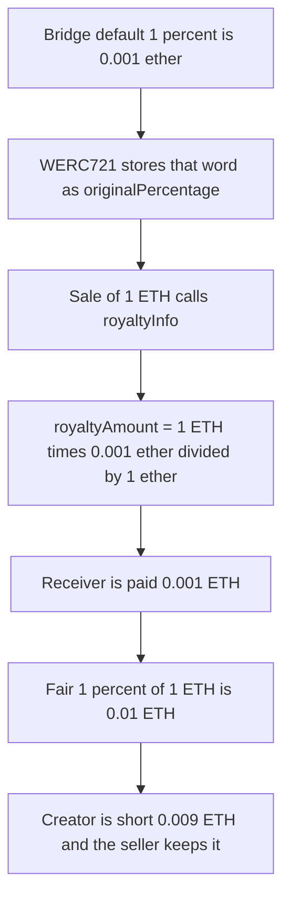

# Sweep n' Flip — WERC721.royaltyInfo pays 0.1% when the bridge stored 1%

> **Vulnerability classes:** vuln/logic/fee-calculation · vuln/arithmetic/precision-loss
>
> The finding file has no `vuln/` tag. Genome on the finding is fee-calculation, fee-theft, and royalty-edge-cases.

> **Reproduction:** self-contained Foundry PoC with **only `forge-std`** — no fork, no RPC. Full trace: [output.txt](output.txt).

<!-- non-defihacklabs -->
<!-- source-auditvault: https://github.com/Auditware/AuditVault/blob/main/findings/46496-inaccurate-royalty-calculation-in-werc721royaltyinfo-functio.md -->
<!-- date: 2024-11 -->

---

## Key info

| | |
|---|---|
| **Impact** | **HIGH** — a 1 ETH sale pays 0.001 ETH of royalty instead of the fair 0.01 ETH. The creator is short 0.009 ETH. The seller keeps it. |
| **Protocol** | [Sweep n' Flip](https://www.sweepnflip.io/) bridge / WERC721 |
| **Vulnerable code** | `WERC721.royaltyInfo` — `salePrice * percentage / 1 ether` |
| **Bug class** | Percentage unit mismatch between Bridge and the wrapper |
| **Finding** | Cantina — Sweep n' Flip bridge, November 2024 · #46496 · slowfi |
| **Report** | [cantina_sweepnflip_bridge_november2024.pdf](https://cdn.cantina.xyz/reports/cantina_sweepnflip_bridge_november2024.pdf) |
| **Source** | [AuditVault](https://github.com/Auditware/AuditVault/blob/main/findings/46496-inaccurate-royalty-calculation-in-werc721royaltyinfo-functio.md) |
| **Compiler** | solc 0.8.27, cancun, via_ir |

---

## TL;DR

1. Bridge's default 1% is `0.001 ether`.
2. `WERC721.royaltyInfo` does `salePrice * percentage / 1 ether`, which only yields 1% when `percentage` is `0.01 ether`.
3. A collection with no royalty is stored at the bridge's 1% unit, `0.001 ether`.
4. A 1 ETH sale pays the receiver **0.001 ETH**. The fair 1% is **0.01 ETH**.
5. The control stores 1% as `100` and divides by `10_000`. The same sale pays 0.01 ETH.

The report's `console.log` is a debug print and is not part of the arithmetic. It is omitted here.

---

## The vulnerable code

```solidity
function _getRoyaltyPercentage(address nftContract) public view returns (uint256) {
    try IERC2981(nftContract).royaltyInfo(0, 10000) returns (address, uint256 royaltyAmount) {
        return royaltyAmount > 0 ? royaltyAmount : 0.001 ether; // 1% if undefined
    } catch {
        return 0.001 ether; // 1% default
    }
}

function royaltyInfo(uint256 tokenId_, uint256 salePrice_) public view returns (address receiver, uint256 royaltyAmount) {
    uint256 percentage = s_royaltyInfo.originalPercentage + s_royaltyInfo.wrapperPercentage;
    // @> VULN: / 1 ether treats the bridge's 1% (0.001 ether) as 0.1%
    royaltyAmount = salePrice_ * percentage / 1 ether;
    // FIX: store 1% as 100 and return salePrice_ * percentage / 10_000
    receiver = s_royaltyInfo.receiver;
}
```

On the report's own example, `salePrice = 1 ether` and `percentage = 0.001 ether`:

- paid: `1 ether * 0.001 ether / 1 ether = 0.001 ether` (0.1%)
- fair: `1 ether * 1 / 100 = 0.01 ether` (1%)

## Root cause

Two contracts disagree on what the percentage word means. Bridge writes `0.001 ether` and calls it 1%. The wrapper divides by `1 ether`, so that same word is 0.1% of the sale. The later fix changed the 1% constant to `100` and made the division match that unit.

## Preconditions

- A wrapped collection whose royalty percentage was taken from the bridge default (undefined ERC-2981, so `0.001 ether`).
- A sale whose price is passed into `royaltyInfo`. The PoC uses 1 ETH, the number in the report.

## Attack walkthrough

1. `_getRoyaltyPercentage` on a collection that returns 0 reads the `0.001 ether` default.
2. That value is stored as `originalPercentage`. `wrapperPercentage` is 0.
3. `buy` calls `royaltyInfo(1, 1 ether)`.
4. The division returns 0.001 ETH. The sale transfers 0.001 ETH to the receiver and 0.999 ETH to the seller.
5. The fair 1% computed beside the sale is 0.01 ETH. The two numbers are not equal.

## Diagrams



## Impact

The royalty receiver is underpaid by 10x on every sale that uses the bridge's 1% unit. On this 1 ETH sale the receiver gets 0.001 ETH and the seller keeps 0.999 ETH. The missing 0.009 ETH is the creator's royalty. The control, with 1% stored as 100 and a divisor of 10_000, pays the receiver 0.01 ETH and the seller 0.99 ETH.

## PoC

```bash
cd 46496-inaccurate-royalty-calculation-in-werc721royaltyinfo-functio_exp
forge test -vv
```

`test_exploit_sale_pays_wrong_royalty` asserts paid is 0.001 ETH, fair is 0.01 ETH, the receiver balance is 0.001 ETH, and the seller balance is 0.999 ETH. `test_control_fixed_royalty_pays_one_percent` asserts the fixed `royaltyInfo` pays 0.01 ETH.

## Remediation

Use one unit in both contracts. The fix described in the report stores 1% as 100 and divides by 10_000:

```diff
- uint256 percentage = s_royaltyInfo.originalPercentage + s_royaltyInfo.wrapperPercentage;
- royaltyAmount = salePrice_ * percentage / 1 ether;
+ uint256 percentage = 100; // 1%, same constant the bridge now writes
+ royaltyAmount = salePrice_ * percentage / 10_000;
```

The stored percentage and the divisor have to move together. Changing only the constant, or only the divisor, pays a different wrong amount.

## Sources

- AuditVault finding: https://github.com/Auditware/AuditVault/blob/main/findings/46496-inaccurate-royalty-calculation-in-werc721royaltyinfo-functio.md
- Cantina report (November 2024): https://cdn.cantina.xyz/reports/cantina_sweepnflip_bridge_november2024.pdf
- The quoted `royaltyInfo` and `_getRoyaltyPercentage` are the report's own snippets. The bridge repository was not public at the audited commit; the arithmetic above is those snippets.
