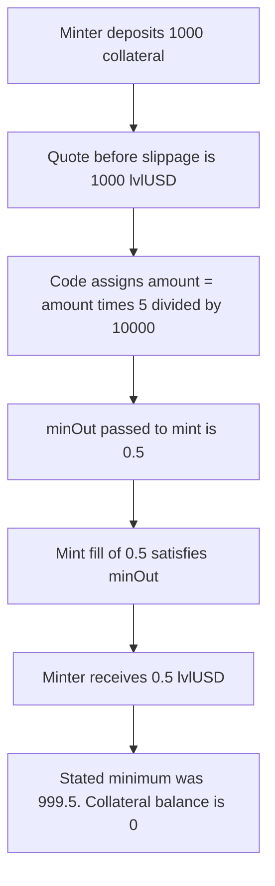

# Level — mintlvlUSD replaces the slippage floor with the slippage itself

> **Vulnerability classes:** vuln/defi/slippage · vuln/arithmetic/precision-loss · vuln/defi/sandwich-attack
>
> The finding file has no `vuln/` tag. Genome on the finding is precision-loss, sandwich, fot-slippage, and integer-bounds.

> **Reproduction:** self-contained Foundry PoC with **only `forge-std`** — no fork, no RPC. Full trace: [output.txt](output.txt).

<!-- non-defihacklabs -->
<!-- source-auditvault: https://github.com/Auditware/AuditVault/blob/main/findings/46584-insufficient-slippage-protection-in-mintlvlusd-cantina-none.md -->
<!-- date: 2024-10 -->

---

## Key info

| | |
|---|---|
| **Impact** | **HIGH** — 1,000 collateral is taken and the minter receives 0.5 lvlUSD. The stated minimum, after 5 bps of slippage, is 999.5 lvlUSD. |
| **Protocol** | [Level](https://level-money.gitbook.io/) `LevelBaseReserveManager.mintlvlUSD` |
| **Vulnerable code** | `lvlUSDAmount = lvlUSDAmount.mulDiv(maxSlippageThresholdBasisPoints, MAX_BASIS_POINTS)` |
| **Bug class** | Slippage floor overwritten by the allowed-slippage slice |
| **Finding** | Cantina — Level Money, October 2024 · #46584 · Mario Poneder |
| **Report** | [cantina_level_money_october_2024.pdf](https://cdn.cantina.xyz/reports/cantina_level_money_october_2024.pdf) |
| **Source** | [AuditVault](https://github.com/Auditware/AuditVault/blob/main/findings/46584-insufficient-slippage-protection-in-mintlvlusd-cantina-none.md) |
| **Compiler** | solc 0.8.27, cancun, via_ir |

---

## TL;DR

1. `maxSlippageThresholdBasisPoints` is 5. `MAX_BASIS_POINTS` is 10_000. That is 5 bps, 0.05%.
2. On a 1,000 quote the intended minimum is `1000 - 1000 * 5 / 10_000 = 999.5`.
3. The code assigns `lvlUSDAmount = lvlUSDAmount * 5 / 10_000`, so the minimum becomes **0.5**.
4. A mint fill of 0.5 satisfies that floor. The minter receives **0.5 lvlUSD**. The 1,000 collateral is taken.
5. The control subtracts the slice. The same 0.5 fill is below 999.5 and reverts with `minOut`. The collateral stays with the minter.

viaIR does not give the pure `mulDiv` assignment its own step. The executed line is the `mint` call that submits the overwritten minimum.

---

## The vulnerable code

```solidity
uint256 lvlUSDAmount = collateralAmount;
// Apply max slippage threshold
lvlUSDAmount = lvlUSDAmount.mulDiv(
    maxSlippageThresholdBasisPoints,
    MAX_BASIS_POINTS
);
minOutPassed = lvlUSDAmount;
// FIX: lvlUSDAmount -= lvlUSDAmount.mulDiv(maxSlippageThresholdBasisPoints, MAX_BASIS_POINTS);
// @> VULN: mint is called with the 5 bps slice (0.5) as minOut, not the quote minus that slice (999.5)
return levelMinting.mint(msg.sender, minOutPassed);
```

The report's recommended change is the `-=` form, which is what the fixed manager uses.

## Root cause

`mulDiv(amount, 5, 10_000)` is the slippage *budget*, not the minimum output. Assigning it over the quote deletes the quote. Subtracting it from the quote leaves a real floor. With the initial parameter of 5 bps, every mint is willing to accept 0.05% of the fair amount.

## Preconditions

- `maxSlippageThresholdBasisPoints` is 5 and `MAX_BASIS_POINTS` is 10_000, the values in the report.
- Collateral and lvlUSD use the same decimals, so the pre-slippage quote is the collateral amount. The PoC uses 1,000.
- The minting contract fills at 0.5, which is exactly the overwritten floor, and reverts if `minOut` is higher than that.

## Attack walkthrough

1. Minter is funded with 1,000 collateral and approves the reserve manager.
2. The stated minimum is recorded as 999.5.
3. `mintlvlUSD` pulls the 1,000 collateral into the minting contract.
4. The quote is replaced by `1000 * 5 / 10_000 = 0.5`, and `mint` is called with that `minOut`.
5. `ATTACK_FILL >= minOut` passes. 0.5 lvlUSD is minted to the minter.
6. The minter's lvlUSD balance is 0.5, which is less than 999.5, and their collateral balance is 0.

## Diagrams



## Impact

The collateral provider is filled at 0.05% of the quote instead of at least 99.95% of it. On this mint that is 0.5 lvlUSD against a stated minimum of 999.5, after 1,000 collateral has already been transferred. The same numbers scale with size: 5 bps of whatever the quote was, not the quote minus 5 bps. The control rejects the 0.5 fill because its `minOut` is 999.5, and the collateral is not taken.

## PoC

```bash
cd 46584-insufficient-slippage-protection-in-mintlvlusd-cantina-none_exp
forge test -vv
```

`test_exploit_minter_receives_less_than_stated_minimum` asserts `minOutPassed` is 0.5, `received` is 0.5, `statedMin` is 999.5, `received < statedMin`, the lvlUSD balance is 0.5, and the minting contract holds the 1,000 collateral. `test_control_minOut_reverts_the_dust_fill` expects revert `minOut` and asserts the minter still holds the 1,000 collateral and 0 lvlUSD.

## Remediation

Subtract the slippage budget from the quote. That is the diff in the report:

```diff
- lvlUSDAmount = lvlUSDAmount.mulDiv(
+ lvlUSDAmount -= lvlUSDAmount.mulDiv(
      maxSlippageThresholdBasisPoints,
      MAX_BASIS_POINTS
  );
```

## Sources

- AuditVault finding: https://github.com/Auditware/AuditVault/blob/main/findings/46584-insufficient-slippage-protection-in-mintlvlusd-cantina-none.md
- Cantina report (October 2024): https://cdn.cantina.xyz/reports/cantina_level_money_october_2024.pdf
- The quoted assignment is the report's snippet from `LevelBaseReserveManager.mintlvlUSD`. The post-fix form on the deployed reserve managers uses `-=` with `mulDivDown`.
