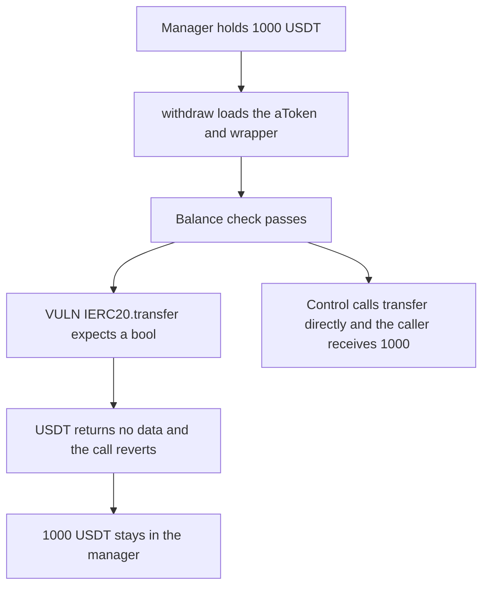

# Level Money: USDT withdraw from AaveV3YieldManager reverts and leaves 1000 USDT stuck

> **Vulnerability classes:** `vuln/dependency/unsafe-external-call` · `vuln/dos/frozen-funds`

<!-- non-defihacklabs -->
<!-- source-auditvault: https://github.com/Auditware/AuditVault/blob/main/findings/46585-usdt-cannot-be-withdrawn-from-aavev3yieldmanager-cantina-non.md -->
<!-- date: 2024-10 -->

## Key info

| Field | Value |
|---|---|
| **Loss** | 1000 USDT cannot leave AaveV3YieldManager |
| **Vulnerable contract** | `AaveV3YieldManager.withdraw` |
| **Attacker EOA** | `0x1111111111111111111111111111111111111111` (any withdrawer) |
| **Attack contract** | `Exploit` |
| **Attack tx** | `Exploit.run()` |
| **Chain / block / date** | Ethereum model · block 0 · 2024-10 |
| **Compiler** | solc 0.8.27, cancun, via IR |
| **Bug class** | `IERC20.transfer` expects a bool and USDT's `transfer` returns nothing |

## TL;DR

USDT is a configured asset of `AaveV3YieldManager`. `withdraw` calls `IERC20.transfer`, which ABI-decodes a bool. USDT's `transfer` returns no data, so the call reverts. The manager still holds 1000 USDT and the caller receives 0. Calling the same token's `transfer` directly, without the bool decode, pays the 1000 USDT out.

## Background

Cantina, Level Money, October 2024, Mario Poneder. The yield manager is meant to take USDC and USDT, supply them to Aave, and later return the underlying. The report names three raw ERC-20 calls, including `AaveV3YieldManager.sol` around the withdraw transfer. USDT is not fully ERC-20: `transfer` does not return a bool. Solidity still tries to decode one. The fix landed in PRs 25 and 26 and is to use SafeERC20.

## The vulnerable code

```solidity
uint256 bal = NonReturningUSDT(token).balanceOf(address(this));
require(bal >= amount, "bal");
IERC20(token).transfer(msg.sender, amount); // @> VULN: USDT.transfer returns no bool
```

```diff
- IERC20(token).transfer(msg.sender, amount);
+ IERC20(token).safeTransfer(msg.sender, amount);
```

`safeTransfer` accepts an empty return payload. A direct call on the concrete USDT-shaped token does the same, which is the control.

## Root cause

The high-level call through `IERC20` appends a decode of 32 bytes of returndata. USDT's `transfer` returns nothing, `returndatasize` is 0, and the decoder reverts. The tokens never move. The same pattern breaks `transferFrom` and `approve` wherever the code uses the raw interface on USDT.

## Preconditions

- USDT is the underlying. The manager's `underlyingToaToken` and `tokenToWrapper` entries are set, so this is not a missing-configuration revert.
- The manager already holds 1000 USDT (6 decimals, `1000e6`), which is the balance after a successful Aave unwind.
- The caller asks to withdraw that full balance.

## Attack walkthrough

1. The caller invokes `withdraw(USDT, 1000e6)`.
2. The aToken and wrapper lookups succeed.
3. `balanceOf` is 1000 USDT and the balance check passes.
4. `IERC20.transfer` reverts on the empty return.
5. The low-level call reports failure, so `run()` itself does not revert.
6. The manager still holds 1000 USDT. The caller holds 0.

## Diagrams



## Impact

A user who supplied USDT cannot withdraw it. The 1000 USDT stays in the yield manager. Unwinding the Aave position by hand is the only recovery, which is the break in the intended flow the report describes. The control pays the same 1000 USDT to the caller and leaves the manager empty.

## Remediation

Use SafeERC20 for `transfer`, `transferFrom`, and `approve` on every token the yield manager and the reserve manager touch, including USDT.

## How to reproduce

```bash
cd 46585-usdt-cannot-be-withdrawn-from-aavev3yieldmanager-cantina-non_exp
forge test -vv
```

`test_exploit_usdt_withdraw_reverts_and_locks_1000` asserts the manager still holds 1000 USDT and the caller holds 0. `test_control_direct_usdt_transfer_pays_the_caller` asserts the direct transfer delivers 1000 USDT. Captured output is `output.txt`.

## Sources

- AuditVault finding: https://github.com/Auditware/AuditVault/blob/main/findings/46585-usdt-cannot-be-withdrawn-from-aavev3yieldmanager-cantina-non.md
- Cantina report: https://cdn.cantina.xyz/reports/cantina_level_money_october_2024.pdf
