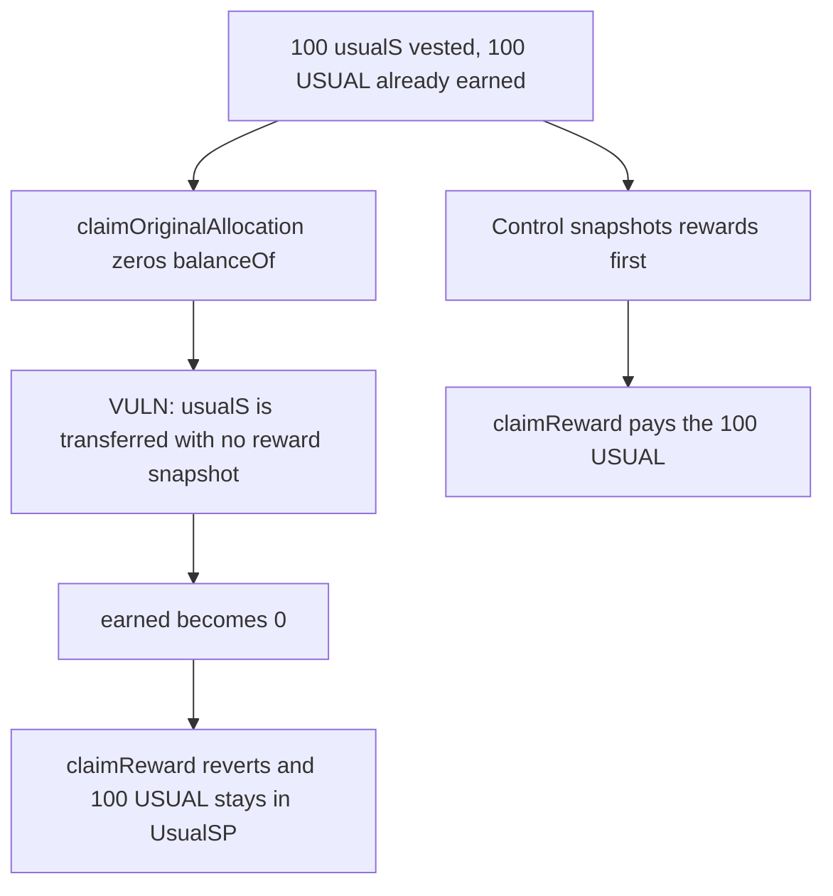

# Claiming the vested usualS balance first makes the accrued USUAL unclaimable

> **Vulnerability classes:** vuln/logic/reward-calculation · vuln/logic/state-update

<!-- non-defihacklabs -->
<!-- source-auditvault: https://github.com/Auditware/AuditVault/blob/main/findings/46636-claiming-original-allocation-without-staking-rewards-can-lea.md -->
<!-- date: 2024-10 -->

## Key info

| Field | Value |
|---|---|
| **Loss** | 100 USUAL stuck in UsualSP after the vest is claimed |
| **Vulnerable contract** | `UsualSP.claimOriginalAllocation` |
| **Attacker EOA** | `0x1111111111111111111111111111111111111111` |
| **Attack contract** | `Exploit` |
| **Attack tx** | `Exploit.run()` |
| **Chain / block / date** | Ethereum model · block 0 · 2024-10 |
| **Compiler** | solc 0.8.27, cancun, via IR |
| **Bug class** | Staking balance cleared without a reward checkpoint |

## TL;DR

Vested usualS is the staking balance and it earns USUAL. `claimOriginalAllocation` transfers that balance and never calls `_updateReward`. `earned()` is `balance * unpaid rewardPerToken`, so the 100 USUAL disappears when the balance hits 0. `claimReward` then reverts on `InsufficientUsualSAllocation`. The 100 USUAL stays in the contract. The control snapshots rewards first and pays all 100.

## Background

Cantina's October 2024 Usual phase 2 review. `UsualSP.balanceOf` treats the vested allocation as staked usualS. Users who claim the vest before rewards, which is the natural order, lose the rewards. The protocol fixed this by calling `_updateReward` inside `claimOriginalAllocation` and by dropping the zero-balance guard in `claimReward`.

## The vulnerable code

```solidity
originalClaimed[msg.sender] += amount;
balanceOf[msg.sender] -= amount;
totalSupply -= amount;
// @> VULN: staking balance is cleared here with no _updateReward, so the accrued reward is never snapshotted
require(usualS.transfer(msg.sender, amount), "usualS");
```

`claimReward` still starts with `if (balanceOf[msg.sender] == 0) revert InsufficientUsualSAllocation()`.

## Root cause

Reward debt is computed from the live balance at checkpoint time. Clearing the balance first makes the owed amount zero, and the balance check then refuses the claim entirely. Nothing writes `rewards[user]` before the balance is gone.

## Preconditions

- The user has a vested allocation that is also their staking balance. This run uses 100 usualS.
- `rewardPerTokenStored` is 1e24 and the user has not been checkpointed, so `earned()` is 100.
- 100 USUAL has been funded to UsualSP.

## Attack walkthrough

1. `earned()` is 100 USUAL while the balance is still 100.
2. 100 USUAL is minted into UsualSP.
3. `claimOriginalAllocation` zeros the staking balance and transfers 100 usualS. `_updateReward` does not run.
4. `earned()` is now 0.
5. `claimReward` hits the zero-balance check and reverts.
6. UsualSP still holds 100 USUAL. The user holds the usualS principal and 0 USUAL.
7. The control calls `_updateReward` before the balance is cleared, then `claimReward` pays 100 and leaves UsualSP empty.

## Diagrams



## Impact

The vester receives the 100 usualS principal and permanently loses the 100 USUAL that had already accrued on it. Those tokens remain in UsualSP with no remaining claim. The control pays the 100 USUAL and still delivers the usualS principal.

## Remediation

Call `_updateReward(msg.sender)` at the start of `claimOriginalAllocation`, and remove the `balanceOf == 0` revert from `claimReward`, which is the patch in the Cantina report.

## How to reproduce

```bash
cd 46636-claiming-original-allocation-without-staking-rewards-can-lea_exp
forge test
```

`test_exploit_claim_allocation_first_locks_rewards` asserts a reverted reward claim and 100 USUAL stuck. `test_control_snapshot_before_allocation_pays_rewards` asserts the user receives 100 USUAL. Captured output is `output.txt`.

## Sources

- AuditVault finding: https://github.com/Auditware/AuditVault/blob/main/findings/46636-claiming-original-allocation-without-staking-rewards-can-lea.md
- Report: https://cdn.cantina.xyz/reports/cantina_usual_phase2_october2024.pdf
