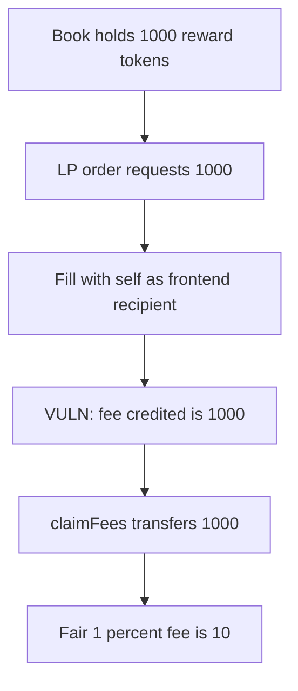

# Royco — fillLPOrder credits the whole requested amount as a fee

> **Vulnerability classes:** vuln/logic/fee-calculation · vuln/logic/reward-calculation

<!-- non-defihacklabs -->
<!-- source-auditvault: https://github.com/Auditware/AuditVault/blob/main/findings/46671-vulnerability-in-filllporder-allows-draining-of-reward-token.md -->
<!-- date: 2024-08 -->

## Key info

| | |
|---|---|
| **Protocol** | Royco |
| **Finding** | Cantina, August 2024, AuditVault 46671 |
| **Vulnerable code** | `fillLPOrder` credits `tokenAmountsRequested` to `frontendRecipient` |
| **Harm** | The caller claims 1000 reward tokens. The 1% fee on that order is 10. |
| **Chain** | local synthetic (audited Ethereum contracts) |

## TL;DR

`fillLPOrder` assigns `order.tokenAmountsRequested` to the frontend fee, not `feePercentage` times the filled fraction. An attacker creates an LP order whose requested amount is the book's current reward balance, fills it, and sets `frontendRecipient` to themselves.

The book holds 1000. The fee account is credited 1000 and `claimFees` transfers it. The market fee used here is 1% (100 bps), so the fair credit is 10. The extra 990 is the inventory.

## The vulnerable code

```solidity
order.filled = true;
// @> VULN: frontendRecipient is credited the entire tokenAmountsRequested.
uint256 fee = order.tokenAmountRequested;
fees[frontendRecipient] += fee;
```

The fair fee on a full fill:

```solidity
return requested * FEE_BPS / BPS; // 1000 * 100 / 10000 = 10
```

## Root cause

The frontend fee is the order's requested token amount. It is not scaled by the market fee or by how much of the order was filled. Pointing the recipient at the filler, and the requested amount at the book's balance, turns the fee ledger into a withdrawal of the inventory.

## Preconditions

The orderbook holds reward tokens, here 1000. The market fee is 1%. The attacker can create and fill their own LP order in one transaction. No second block.

## Attack walkthrough

1. The book holds 1000 reward tokens.
2. Create an LP order with `tokenAmountsRequested = 1000`.
3. Fill it with this contract as `frontendRecipient`.
4. The fee balance is 1000, not 10.
5. `claimFees` transfers 1000. The book balance is 0.
6. `1000 - 10 = 990` is above the fee schedule.

Control `fairFee(1000)` returns 10 and does not move the inventory.

## Diagrams



## Impact

The caller receives all 1000 reward tokens the book was holding. The fee schedule owes them 10. The other 990 is reward inventory.

## Remediation

Credit `tokenAmountsRequested * feePercentage * fillPercentage`, not the raw requested amount.

## How to reproduce

```bash
cd 46671-vulnerability-in-filllporder-allows-draining-of-reward-token_exp
forge test -vv
```

## Sources

- AuditVault finding: https://github.com/Auditware/AuditVault/blob/main/findings/46671-vulnerability-in-filllporder-allows-draining-of-reward-token.md
- Cantina report: https://cdn.cantina.xyz/reports/cantina_royco_august2024.pdf
