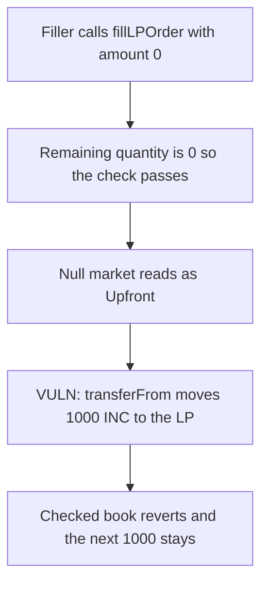

# Royco RecipeOrderbook — a null Weiroll market still pulls incentives

> **Vulnerability classes:** vuln/logic/wrong-condition · vuln/logic/missing-check

<!-- non-defihacklabs -->
<!-- source-auditvault: https://github.com/Auditware/AuditVault/blob/main/findings/46675-unintended-behavior-in-recipe-orderbook-for-null-weiroll-mar.md -->
<!-- date: 2024-08 -->

## Key info

| | |
|---|---|
| **Protocol** | Royco RecipeOrderbook |
| **Finding** | Cantina, Kurt Barry, AuditVault 46675 |
| **Vulnerable code** | `RecipeOrderbook.fillLPOrder` |
| **Harm** | 1000 INC moved from the filler to the LP of an order whose market was never created |
| **Chain** | local synthetic |

## TL;DR

`fillLPOrder` only reverts when `fillAmount` is strictly greater than the remaining quantity. A fill of 0 against an order that was never created therefore passes. A market id that was never created reads as the zero struct, and `RewardStyle.Upfront` is 0, so the function still `transferFrom`s each `tokenAmountsRequested` from the filler to `order.lp`. In this run that moves 1000 INC. The fixed book requires the remaining quantity to be non-zero first, and the same call reverts with the filler's second 1000 left in place.

## The vulnerable code

```solidity
if (fillAmount > orderHashToRemainingQuantity[orderHash]) revert NotEnoughRemainingQuantity();
orderHashToRemainingQuantity[orderHash] -= fillAmount;
WeirollMarket memory market = marketIDToWeirollMarket[order.targetMarketID];
if (market.rewardStyle == RewardStyle.Upfront) {
    // @> VULN: a never-created market is rewardStyle 0 (Upfront), so a zero fill still pulls tokenAmountsRequested
    MockERC20(order.tokensRequested[i]).transferFrom(msg.sender, order.lp, order.tokenAmountsRequested[i]);
}
```

The recommended check is `require(orderHashToRemainingQuantity[orderHash] > 0)` before the transfer.

## Root cause

Two defaults line up. A missing order has remaining quantity 0, and `0 > 0` is false, so a zero fill is not rejected. A missing market has `rewardStyle == 0`, which is `Upfront`, so the incentive pull runs even though no market and no order exist.

## Preconditions

The filler has approved the orderbook for the requested token. No market has to be created and the order does not have to be signed or stored. The caller is the one who pays.

## Attack walkthrough

1. The filler holds 2000 INC. Order hash 999 has remaining quantity 0.
2. `fillLPOrder` is called with `fillAmount` 0, `targetMarketID` 999, and `tokenAmountsRequested` of 1000 INC.
3. The remaining-quantity comparison does not revert. The null market is treated as Upfront.
4. 1000 INC moves from the filler to the order LP.
5. The checked book reverts on the same order. The filler still holds the other 1000.

## Diagrams



## Impact

A filler who submits a zero-amount fill against a market that was never created pays the full requested incentive. Here that is 1000 INC sent to an LP who never posted an order.

## Remediation

Require `orderHashToRemainingQuantity[orderHash] > 0` before adjusting quantity or transferring incentives, and reject a market id that was never created.

## How to reproduce

```bash
cd 46675-unintended-behavior-in-recipe-orderbook-for-null-weiroll-mar_exp
forge test -vv
```

## Sources

- AuditVault finding: https://github.com/Auditware/AuditVault/blob/main/findings/46675-unintended-behavior-in-recipe-orderbook-for-null-weiroll-mar.md
- Cantina report: https://cdn.cantina.xyz/reports/cantina_royco_august2024.pdf
- Royco fixed the zero-quantity fill in commit `8b0d931d` (noted in the finding).
