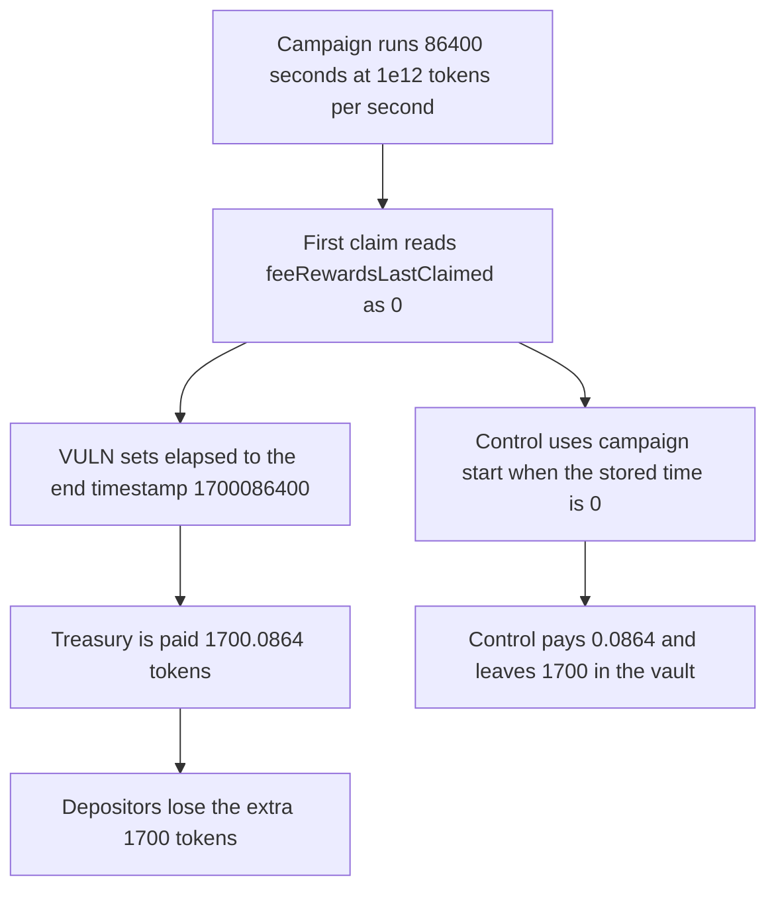

# Royco: the first protocol-fee claim bills the campaign end timestamp

> **Vulnerability classes:** vuln/logic/fee-calculation · vuln/defi/fee-manipulation

<!-- non-defihacklabs -->
<!-- source-auditvault: https://github.com/Auditware/AuditVault/blob/main/findings/46676-amount-of-protocol-fees-owed-will-be-more-than-intended-in-f.md -->
<!-- date: 2024-08 -->

## Key info

| Field | Value |
|---|---|
| **Loss** | Treasury is paid 1,700.0864 tokens. The one-day fee is 0.0864. Depositors fund the extra 1,700 |
| **Vulnerable contract** | `ERC4626i.claimProtocolFees` |
| **Attacker EOA** | `0x1111111111111111111111111111111111111111` |
| **Attack contract** | `Exploit` |
| **Attack tx** | `Exploit.run()` |
| **Chain / block / date** | Ethereum model · block 0 · 2024-08 |
| **Compiler** | solc 0.8.27, cancun, via IR |
| **Bug class** | First claim uses a zero last-claimed timestamp as the start of the fee window |

## TL;DR

`claimProtocolFees` sets `elapsed` to `campaign.end - feeRewardsLastClaimed`. On the first claim that stored value is 0, so elapsed is the absolute end timestamp. A campaign from 1,700,000,000 to 1,700,086,400 at 1e12 tokens per second owes 0.0864 tokens. The first claim pays 1,700.0864 and empties the depositors. Using `start` when the stored timestamp is 0 pays 0.0864 and leaves 1,700 tokens in the vault.

## Background

Cantina's August 2024 Royco review, reported by Kurt Barry. The sponsor acknowledged the finding and said `ERC4626i` was being rewritten rather than patched. The fee is `elapsed * protocolFeeRate`. The missing floor is the campaign start.

## The vulnerable code

```solidity
CampaignData storage _campaignData = campaignIdToData[campaignId];
uint256 lastUpdated = feeRewardsLastClaimed[campaignId];
// @> VULN: lastUpdated is 0 on the first claim, so elapsed is campaign.end instead of end minus start
uint256 elapsed = (_campaignData.end - lastUpdated);
uint256 owed = (elapsed * _campaignData.protocolFeeRate);
```

The recommended change, from the report, is to assign `lastUpdated = campaignData.start` when `feeRewardsLastClaimed` is 0.

## Root cause

`feeRewardsLastClaimed` is unset until the first claim writes it. Subtracting 0 from `end` counts every second from the unix epoch through the campaign end, not the seconds the campaign was actually live.

## Preconditions

- Campaign start is 1,700,000,000 and end is 86,400 seconds later.
- `protocolFeeRate` is 1e12 tokens per second.
- Depositors have funded the vault with the 1,700.0864 tokens the buggy formula will bill.
- No earlier claim has stored a timestamp for this campaign id.

## Attack walkthrough

1. The campaign is configured. The fair window is 86,400 seconds.
2. The vault is funded with 1,700.0864 tokens.
3. The first `claimProtocolFees` reads last-claimed as 0.
4. Elapsed becomes 1,700,086,400. The bill is that number times 1e12.
5. The treasury receives 1,700.0864. The vault is empty.
6. The excess over 0.0864 is 1,700 tokens. The control pays 0.0864 and leaves 1,700 with depositors.

## Diagrams



## Impact

The protocol treasury receives 1,700.0864 campaign tokens on a fee that should have been 0.0864 tokens. The 1,700 token gap is taken from depositors, and the vault balance is 0. The control claim pays 0.0864 and leaves those 1,700 tokens in the vault.

## Remediation

When `feeRewardsLastClaimed[campaignId]` is 0, set `lastUpdated` to `campaignData.start` before computing elapsed.

## How to reproduce

```bash
cd 46676-amount-of-protocol-fees-owed-will-be-more-than-intended-in-f_exp
forge test -vv
```

`test_exploit_first_claim_bills_1700_extra` asserts a 1,700.0864 bill, a 0.0864 fair fee, and an empty vault. `test_control_first_claim_uses_campaign_start` asserts a 0.0864 payment and 1,700 tokens left for depositors. Captured output is `output.txt`.

## Sources

- AuditVault finding: https://github.com/Auditware/AuditVault/blob/main/findings/46676-amount-of-protocol-fees-owed-will-be-more-than-intended-in-f.md
- Cantina Royco report, August 2024: https://cdn.cantina.xyz/reports/cantina_royco_august2024.pdf
