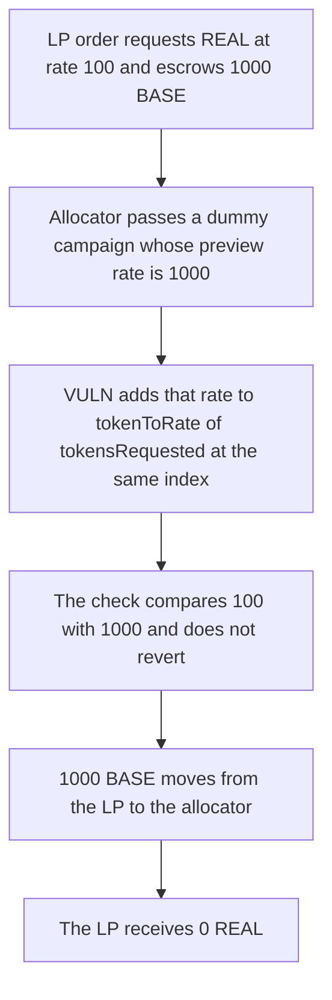

# Royco: a dummy campaign satisfies VaultOrderbook.allocateOrder

> **Vulnerability classes:** `vuln/logic/wrong-condition` · `vuln/logic/state-update`

<!-- non-defihacklabs -->
<!-- source-auditvault: https://github.com/Auditware/AuditVault/blob/main/findings/46677-subversion-of-rate-check-possible-in-vaultorderbookallocateo.md -->
<!-- date: 2024-08 -->

## Key info

| Field | Value |
|---|---|
| **Loss** | The LP's 1,000 BASE is taken. The LP receives 0 of the REAL reward token the order requested |
| **Vulnerable contract** | `VaultOrderbook.allocateOrder` |
| **Attacker EOA** | `0x1111111111111111111111111111111111111111` (the allocator) |
| **Attack contract** | `Exploit` |
| **Attack tx** | `Exploit.run()` |
| **Chain / block / date** | Ethereum model · block 0 · 2024-08 |
| **Compiler** | solc 0.8.27, cancun |
| **Bug class** | Campaign-loop index writes the rate onto `tokensRequested[i]` |

## TL;DR

`allocateOrder` adds `previewRateAfterDeposit(campaignIds[i])` into `tokenToRate[tokensRequested[i]]`. The index walks campaigns, not the LP's requested tokens. A permissionless dummy campaign with a rate of 1,000 is written onto the REAL key, the check `100 > 1000` does not revert, and the book pulls 1,000 BASE from the LP. The LP's REAL balance stays 0. Writing the rate onto `campaignToToken(campaignIds[i])` reverts the same fill.

## The vulnerable code

```solidity
uint256 rate = IVault(order.targetVault).previewRateAfterDeposit(campaignIds[i], quantity);
tokenToRate[order.tokensRequested[i]] += rate; // @> VULN: index i walks campaignIds but the cache key is tokensRequested[i]
```

```diff
- tokenToRate[order.tokensRequested[i]] += rate;
+ tokenToRate[IVault(order.targetVault).campaignToToken(campaignIds[i])] += rate;
```

## Root cause

There is no link between `campaignIds[i]` and `tokensRequested[i]`. The arrays can differ in length and in token. The later comparison reads the corrupted cache, so a worthless campaign satisfies a request for a real reward token.

## Preconditions

- An LP order requests REAL at rate 100 and has approved 1,000 BASE.
- The REAL campaign previews a rate of 0. A dummy campaign the caller controls previews 1,000.
- The caller passes `campaignIds = [dummy]` while `tokensRequested[0]` is still REAL.

## Attack walkthrough

1. The LP approves the book for 1,000 BASE.
2. The allocator calls `allocateOrder` with the dummy campaign id.
3. The dummy rate is added to `tokenToRate[REAL]`.
4. `100 > 1000` is false, so `OrderConditionsNotMet` does not fire.
5. `transferFrom` pulls the 1,000 BASE to the allocator.
6. The LP's REAL balance is 0.

## Diagrams



## Impact

The LP loses 1,000 BASE. None of the requested REAL is delivered. The control, which credits the campaign's own token, reverts with `OrderConditionsNotMet` and leaves the deposit in the LP.

## How to reproduce

```bash
cd 46677-subversion-of-rate-check-possible-in-vaultorderbookallocateo_exp
forge test -vv
```

`test_exploit_dummy_campaign_takes_lp_deposit` asserts the allocator holds 1,000 BASE and the LP holds 0 REAL. `test_control_campaign_token_key_reverts` asserts the fixed cache key reverts.

## Sources

- AuditVault finding: https://github.com/Auditware/AuditVault/blob/main/findings/46677-subversion-of-rate-check-possible-in-vaultorderbookallocateo.md
- Cantina Royco report, August 2024: https://cdn.cantina.xyz/reports/cantina_royco_august2024.pdf
- Royco fix commit cited by the finding: `f455475d`
