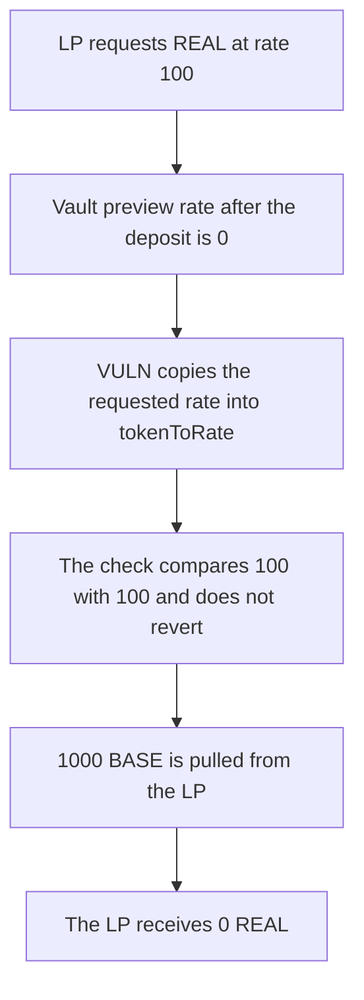

# Royco: VaultOrderbook rate check is seeded with the requested rate

> **Vulnerability classes:** `vuln/logic/state-update` · `vuln/logic/missing-check`

<!-- non-defihacklabs -->
<!-- source-auditvault: https://github.com/Auditware/AuditVault/blob/main/findings/46678-rate-checks-unenforceable-due-to-faulty-cache-value-initiali.md -->
<!-- date: 2024-08 -->

## Key info

| Field | Value |
|---|---|
| **Loss** | The LP's 1,000 BASE is taken while the vault will pay a REAL rate of 0 |
| **Vulnerable contract** | `VaultOrderbook.allocateOrder` |
| **Attacker EOA** | `0x1111111111111111111111111111111111111111` (the allocator) |
| **Attack contract** | `Exploit` |
| **Attack tx** | `Exploit.run()` |
| **Chain / block / date** | Ethereum model · block 0 · 2024-08 |
| **Compiler** | solc 0.8.27, cancun |
| **Bug class** | First loop copies `tokenRatesRequested` into the cache the check reads |

## TL;DR

The first loop in `allocateOrder` sets `tokenToRate[token] = tokenRatesRequested[i]`. The vault rate is only added after that. The comparison `tokenRatesRequested > tokenToRate` can never fail. An order that asks for REAL at 100 is filled when `previewRateAfterDeposit` returns 0, and the LP loses 1,000 BASE. Deleting that loop makes the same fill revert.

## The vulnerable code

```solidity
for (uint256 i; i < order.tokenRatesRequested.length; ++i) {
    tokenToRate[order.tokensRequested[i]] = order.tokenRatesRequested[i]; // @> VULN: cache starts at the requested rate, so the check below cannot fail
}
```

```diff
- for (uint256 i; i < order.tokenRatesRequested.length; ++i) {
-     tokenToRate[order.tokensRequested[i]] = order.tokenRatesRequested[i];
- }
```

## Root cause

The cache is initialized to the value the later loop is supposed to test. Adding a non-negative vault rate cannot make the cached value smaller than the request, so `OrderConditionsNotMet` is dead.

## Preconditions

- The LP requests REAL at rate 100 and has approved 1,000 BASE.
- The matching campaign's `previewRateAfterDeposit` is 0.

## Attack walkthrough

1. The LP approves 1,000 BASE.
2. `allocateOrder` is called with the REAL campaign.
3. The cache for REAL is set to 100 before the vault is read.
4. The vault adds 0. The check is `100 > 100`, which does not revert.
5. The book pulls 1,000 BASE.
6. The LP receives no REAL. The allocator holds the 1,000 BASE.

## Diagrams



## Impact

The LP loses 1,000 BASE on an order the vault cannot pay. The control, which starts the cache at 0, reverts and the deposit stays with the LP.

## How to reproduce

```bash
cd 46678-rate-checks-unenforceable-due-to-faulty-cache-value-initiali_exp
forge test -vv
```

## Sources

- AuditVault finding: https://github.com/Auditware/AuditVault/blob/main/findings/46678-rate-checks-unenforceable-due-to-faulty-cache-value-initiali.md
- Cantina Royco report, August 2024: https://cdn.cantina.xyz/reports/cantina_royco_august2024.pdf
- Royco fix commit cited by the finding: `2129be28` (the seeding loop was removed)
