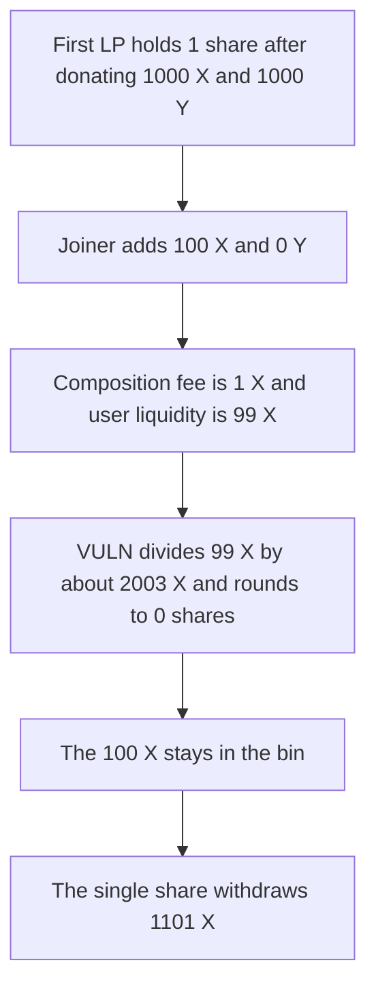

# Pancake BinPool: a donated active bin rounds the next LP's shares to zero and keeps their tokens

> **Vulnerability classes:** `vuln/arithmetic/rounding-direction` · `vuln/arithmetic/precision-loss`

<!-- non-defihacklabs -->
<!-- source-auditvault: https://github.com/Auditware/AuditVault/blob/main/findings/46983-loss-of-input-tokens-due-to-incorrect-rounding-ottersec-none.md -->
<!-- date: 2024-08 -->

## Key info

| Field | Value |
|---|---|
| **Loss** | Joiner's 100 X is absorbed by a 1-share bin. The first LP withdraws 1101 X |
| **Vulnerable contract** | `BinPool.mulDivRoundDown` inside `_updateBin` |
| **Attacker EOA** | `0x1111111111111111111111111111111111111111` |
| **Attack contract** | `Exploit` |
| **Attack tx** | `Exploit.run()` |
| **Chain / block / date** | Ethereum model · block 0 · 2024-08 |
| **Compiler** | solc 0.8.27, cancun, via IR |
| **Bug class** | Active-bin share mint rounds down against reserves inflated by a donation |

## TL;DR

The first LP mints 1 share with 1 X and 1 Y, then donates 1000 of each into the same bin. A joiner adds 100 X and 0 Y. Composition fees are charged because the ratio does not match the bin. `mulDivRoundDown` then divides 99 X of user liquidity by about 2003 X of bin liquidity with supply 1, and the quotient is 0. The 100 X stays in the reserves. The single share withdraws 1101 X. A mint that returns before `transferFrom` when the quotient is 0 leaves the joiner's 100 X untouched.

## Background

OtterSec's review of Pancake Infinity `BinPool._updateBin`, reported by Nicholas R. Putra. Adding liquidity to the active bin at a different ratio charges composition fees and then recomputes shares with `userLiquidity.mulDivRoundDown(supply, binLiquidity)`. The patch in pancake commit `adf9b04` on 2024-08-26 requires a minimum share before a donation can inflate the bin.

## The vulnerable code

```solidity
function mulDivRoundDown(uint256 a, uint256 b, uint256 c) internal pure returns (uint256) {
    // @> VULN: division rounds down, so 99 tokens of liquidity over donated reserves mints 0 shares
    return (a * b) / c;
}
```

`_updateBin` calls this after `getCompositionFeesAmount` when the active-bin fee is nonzero. `a` is user liquidity, `b` is share supply, `c` is bin liquidity including the donation. The deposit is added to reserves whether or not `shares` is 0.

## Root cause

Share supply stays at 1 while a donation increases reserves without minting shares. The round-down division of a modest deposit by that inflated liquidity is 0, but the tokens have already been pulled.

## Preconditions

- One LP holds the only share. Reserves are 1001 X and 1001 Y after a 1 plus 1000 donation on each side.
- The joiner deposits 100 X and 0 Y, which does not match the bin ratio, so the composition-fee branch runs.

## Attack walkthrough

1. The joiner's `mint` pulls 100 X.
2. The composition fee is `ax / 100`, which is 1 X. User liquidity is 99 X.
3. `(a * b) / c` with supply 1 floors to 0 shares.
4. `lastShares` is 0 and `totalSupply` stays 1.
5. `withdraw` pays the whole bin to the first LP: 1101 X.
6. The control computes the same zero quotient and returns before taking the tokens. The joiner still holds 100 X and the reserves stay at the donated 1001 X.

## Diagrams


