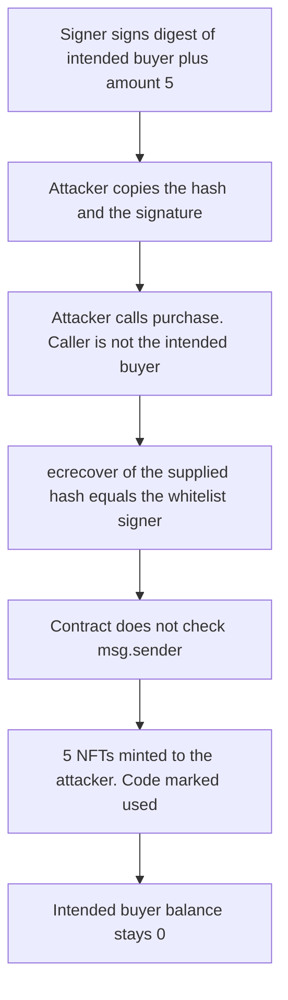

# EthSign Launchpad — a whitelist signature can be front-run by another caller

> **Vulnerability classes:** vuln/auth/signature-replay · vuln/access-control/missing-auth
>
> The finding file has no `vuln/` tag. Genome on the finding is signature-replay, frontrun, and frontrun-exposure. It also tags `impact/mev/frontrun`.

> **Reproduction:** self-contained Foundry PoC with **only `forge-std`** — no fork, no RPC. Full trace: [output.txt](output.txt).

<!-- non-defihacklabs -->
<!-- source-auditvault: https://github.com/Auditware/AuditVault/blob/main/findings/47227-signature-reuse-via-front-running-ottersec-none-ethsign-laun.md -->
<!-- date: 2024-12 -->

The report is copyright 2024 and does not name a month. The marker uses 2024-12 for that copyright year.

---

## Key info

| | |
|---|---|
| **Impact** | **HIGH** — an attacker mints 5 whitelist NFTs with a signature the signer produced for a different buyer. That buyer receives 0, and the code is consumed. |
| **Protocol** | [EthSign Launchpad](https://www.ethsign.xyz/) `NFTSimpleAuction` |
| **Vulnerable code** | `NFTSimpleAuction._checkAndSaveWL` — signature check does not include `msg.sender` |
| **Bug class** | Signature front-run. The digest is not bound to the caller. |
| **Finding** | OtterSec — EthSign Launchpad · #47227 · Robert Chen |
| **Report** | [ethsign.xyz](https://www.ethsign.xyz/) (finding text, copyright 2024) |
| **Source** | [AuditVault](https://github.com/Auditware/AuditVault/blob/main/findings/47227-signature-reuse-via-front-running-ottersec-none-ethsign-laun.md) |
| **Compiler** | solc 0.8.27, cancun, via_ir |

---

## TL;DR

1. The whitelist signer signs `keccak256(abi.encode(intendedBuyer, 5, code))`.
2. `_checkAndSaveWL` checks that signature against a caller-supplied hash. It never checks `msg.sender`.
3. The attacker, who is not the intended buyer, submits the same hash and signature.
4. The auction mints **5** NFTs to the attacker and marks the code used. The intended buyer holds **0**.
5. The control rebuilds the digest as `keccak256(abi.encode(msg.sender, amount, code))`. The same signature reverts for the attacker and still succeeds for the intended buyer.

The signature was produced offline with the public Anvil test key (`0xac09…ff80`, address `0xf39F…2266`) and `cast wallet sign --no-hash`. The playground run does not hold the key. It only submits the signature bytes.

---

## The vulnerable code

```solidity
function _checkAndSaveWL(bytes calldata extraData) internal returns (uint256) {
    (uint256 approvedPurchaseAmount, bytes32 hash, bytes memory signature) =
        abi.decode(extraData, (uint256, bytes32, bytes));
    if (_usedCodes[hash]) revert InvalidCode();
    // @> VULN: the signer is checked, but the hash is not bound to msg.sender
    if (_recover(hash, signature) != authorizedWLSigner) revert InvalidSignature();
    // FIX: recompute hash as keccak256(abi.encode(msg.sender, approvedPurchaseAmount, code))
    _usedCodes[hash] = true;
    return approvedPurchaseAmount;
}
```

`_recover` is the EOA branch of `SignatureChecker.isValidSignatureNow`: `ecrecover` of the supplied hash. The report's later fix hashes `getMessageHash(..., _msgSender())` before that check.

## Root cause

The signed bytes authorize an amount and a code. They do not have to be presented by the account the signer named. Anyone who sees the signature in the mempool can submit it first. The `_usedCodes` write then blocks the intended buyer.

## Preconditions

- `authorizedWLSigner` is the account that produced the signature. Here that is the Anvil test address.
- The digest commits to the intended buyer `0x2222…2222`, amount 5, and code `0x…c0de`.
- The caller of `purchase` is a different account. In the PoC it is the exploit contract.

## Attack walkthrough

1. Recompute `keccak256(abi.encode(intendedBuyer, 5, code))` and check it equals the precomputed digest.
2. Check the caller is not the intended buyer.
3. Call `purchase(5, abi.encode(5, digest, signature))`.
4. `_usedCodes[digest]` is false. `ecrecover` returns the whitelist signer. The code is marked used.
5. 5 WLNFT are minted to the attacker. The intended buyer's balance stays 0.

## Diagrams



## Impact

The 5 NFTs the signer authorized for one buyer are minted to someone else, and the code cannot be reused by the buyer the signature was for. The control, which binds `msg.sender` into the digest, reverts the attacker's call with `InvalidSignature` and still lets the intended buyer mint the 5 NFTs with the same signature.

## PoC

```bash
cd 47227-signature-reuse-via-front-running-ottersec-none-ethsign-laun_exp
forge test -vv
```

`test_exploit_attacker_mints_nfts_signed_for_someone_else` asserts the attacker holds 5 and the intended buyer holds 0. `test_control_binding_msg_sender_reverts_for_attacker` submits the same signature from the attacker and expects `InvalidSignature`, then submits it from the intended buyer and asserts that buyer receives 5.

## Remediation

Put the caller in the signed digest and recompute that digest inside the contract. Do not accept a caller-supplied hash.

```diff
- (uint256 approvedPurchaseAmount, bytes32 hash, bytes memory signature) =
-     abi.decode(extraData, (uint256, bytes32, bytes));
- if (_recover(hash, signature) != authorizedWLSigner) revert InvalidSignature();
+ (uint256 approvedPurchaseAmount, bytes32 code, bytes memory signature) =
+     abi.decode(extraData, (uint256, bytes32, bytes));
+ bytes32 hash = keccak256(abi.encode(msg.sender, approvedPurchaseAmount, code));
+ if (_recover(hash, signature) != authorizedWLSigner) revert InvalidSignature();
```

## Sources

- AuditVault finding: https://github.com/Auditware/AuditVault/blob/main/findings/47227-signature-reuse-via-front-running-ottersec-none-ethsign-laun.md
- Report link on the finding: https://www.ethsign.xyz/
- The fixed shape, which hashes `_msgSender()` into the digest, is the `NFTSimpleAuction._checkAndSaveWL` quoted from the post-fix deployment in the finding discussion. Commit named by the report: `adf0fe6`.
