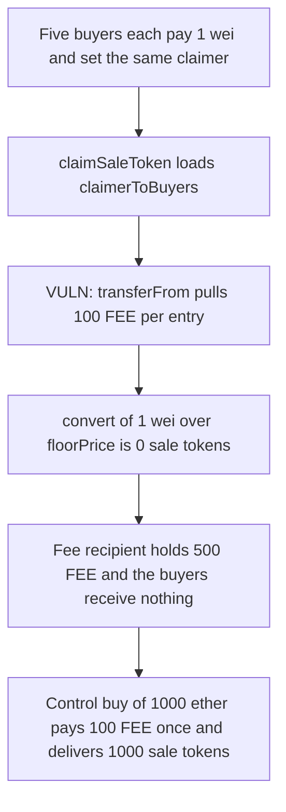

# EthSign Launchpad: a claimer is charged for zero-value claims

> **Vulnerability classes:** vuln/logic/fee-calculation · vuln/dos/griefing

<!-- non-defihacklabs -->
<!-- source-auditvault: https://github.com/Auditware/AuditVault/blob/main/findings/47228-claimer-fee-exploitation-ottersec-none-ethsign-launchpad-pdf.md -->
<!-- date: 2024-05 -->

## Key info

| | |
|---|---|
| **Protocol** | EthSign Launchpad DutchAuction |
| **Finding** | OtterSec, AuditVault 47228 |
| **Vulnerable code** | `claimSaleToken` / `_chargeClaimFlatFee` |
| **Harm** | 500 FEE taken from the claimer for 0 sale tokens. A real purchase pays 100 FEE to the fee recipient and delivers 1000 sale tokens |
| **Chain** | local synthetic |

## TL;DR

`claimSaleToken` loads `claimerToBuyers[msg.sender]` and calls `_chargeClaimFlatFee` on every entry before it computes how many sale tokens that entry is worth. A buyer can purchase 1 wei and `setClaimerOnce` to a victim. `convert(1) / floorPrice` is 0, so the sale amount is 0, but the flat fee is still pulled from the claimer. Five such entries take 5 × 100 FEE = 500 FEE and deliver no sale tokens. The same claim with a 1000 FEE-token purchase that meets the minimum pays 100 FEE once, to the fee recipient, and sends 1000 sale tokens to the buyer.

## The vulnerable code

```solidity
address[] memory buyers = claimerToBuyers[_msgSender()];
for (uint256 i = 0; i < buyers.length; i++) {
    address buyer = buyers[i];
    _chargeClaimFlatFee();
    uint256 claimableAmountOfSaleTokens = _min(
        convert(convert(payments[buyer]) / floorPrice),
        totalPaymentTokenCollected == 0
            ? 0
            : payments[buyer] * totalSaleTokenAvailable / totalPaymentTokenCollected
    );
    payments[buyer] = 0;
    emit Claimed(buyer, _msgSender(), claimableAmountOfSaleTokens);
    totalClaimableAmountOfSaleTokens += claimableAmountOfSaleTokens;
}

function _chargeClaimFlatFee() internal {
    // @> VULN: claimFlatFee is pulled from the claimer for this buyer even when the sale-token amount is zero
    fee.transferFrom(msg.sender, feeRecipient, claimFlatFee);
}
```

The recommended fix is a minimum purchase, so a dust buy is never stored on `claimerToBuyers`. Skipping the fee when the claimable amount is 0 closes the same hole.

## Root cause

The fee does not depend on `claimableAmountOfSaleTokens`. The charge runs first. With `floorPrice` of 1 ether, a 1-wei payment converts to 0. `_min(0, proRata)` is 0. `claimFlatFee` is 100 FEE either way. Nothing stops a stranger from appending themselves to someone else's claimer list with `setClaimerOnce`.

## Preconditions

The auction has ended and claims are active. `claimFlatFee` is 100 FEE. `floorPrice` is 1 ether and `totalSaleTokenAvailable` is 1000. The claimer holds 500 FEE and has approved the auction. Five buyers have each paid 1 wei and named that claimer.

## Attack walkthrough

1. Each dust buyer is minted 1 wei of the payment token.
2. `buy(1)` records the payment. `setClaimerOnce` pushes the buyer onto the claimer's array.
3. The claimer is minted 500 FEE and approves the auction.
4. `claimSaleToken` walks the five buyers. Each iteration `transferFrom`s 100 FEE to the fee recipient, then computes a sale amount of 0.
5. The fee recipient holds 500 FEE. `saleTokensDelivered` is 0. `zeroClaims` is 5. The claimer's FEE balance is 0.

The control auction reverts `buy(1)` with `min purchase`. A buy of 1000 ether is accepted. One claim charges 100 FEE to the same fee recipient and transfers 1000 sale tokens to the buyer.

## Diagrams



## Impact

The claimer pays 500 FEE for claims that mint nothing. The intended fee for one real purchase is 100 FEE, paid to the fee recipient together with 1000 sale tokens to the buyer. The same array is also the gas-griefing path in the report: each extra dust entry is another fee and another loop iteration. This reproduction shows the fee, which is the amount that actually moves.

## How to reproduce

```bash
cd 47228-claimer-fee-exploitation-ottersec-none-ethsign-launchpad-pdf_exp
forge test -vv
```

`run()` does not warp. The five dust buys and the claim happen in one call.

## Sources

- AuditVault finding: https://github.com/Auditware/AuditVault/blob/main/findings/47228-claimer-fee-exploitation-ottersec-none-ethsign-launchpad-pdf.md
- OtterSec report (31 May 2024): https://osec.io/reports/86acded6-0dd5-4f15-8b7b-d22e5cbb81d8
- Protocol: https://www.ethsign.xyz/
- Reviewed tree: https://github.com/EthSign/sign-launchpad-contracts (patch noted as commit `0f6`)
