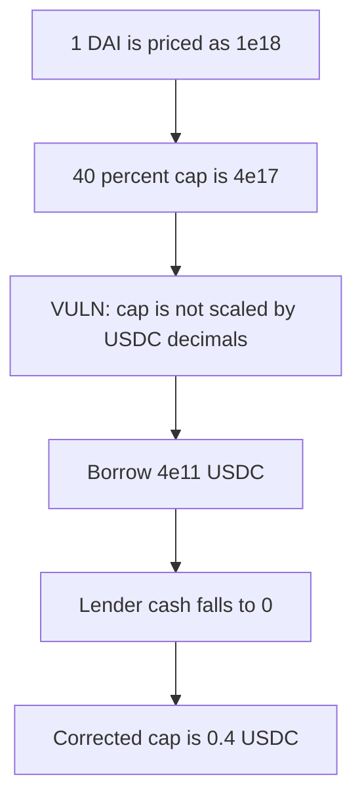

# Folks Finance — collateral value skips token decimals

> **Vulnerability classes:** vuln/arithmetic/decimal-mismatch · vuln/logic/price-calculation

<!-- non-defihacklabs -->
<!-- source-auditvault: https://github.com/Auditware/AuditVault/blob/main/findings/47332-missing-decimal-correction-ottersec-none-folks-finance-x-cha.md -->
<!-- date: 2024-05 -->

## Key info

| | |
|---|---|
| **Protocol** | Folks Finance x-chain |
| **Finding** | OtterSec, May 2024, AuditVault 47332 |
| **Vulnerable code** | price is `amount * price` with no `10**decimals` |
| **Harm** | 1 DAI borrows 4e11 USDC. The decimal-corrected cap is 0.4 USDC. |
| **Chain** | local synthetic (audited Ethereum contracts) |

## TL;DR

DAI has 18 decimals and USDC has 6. The oracle price is 1 USD per whole token, and the value function never divides by `10**decimals`. One DAI is therefore worth `1e18`. At a 40% collateral factor the borrow cap is `4e17`.

That cap is compared to raw USDC units, so it authorizes `4e17` atomic USDC, which is `4e11` whole USDC. The report's identity: `4e11 * 1e6 = 0.4 * 1e18`. The corrected cap is `0.4 * 1e6 = 4e5` atomic USDC, which is 0.4 USDC. The pool was holding exactly the buggy cap, and the borrow empties it.

## The vulnerable code

```solidity
function valueOf(address, uint256 amount) public pure returns (uint256) {
    // @> VULN: amount is not divided by 10**decimals.
    return amount * PRICE;
}
```

`borrowCapacity` is that value times 40 / 100. The corrected capacity divides the DAI amount by `1e18`, applies 40%, and scales back to 6 decimals.

## Root cause

Token amounts and USD values are added in different scales. The high-decimal collateral is treated as a huge USD balance, and the low-decimal debt is drawn in raw units against that balance.

## Preconditions

Collateral factor 40%. Price of both tokens is 1 USD. The pool holds at least `4e17` atomic USDC, which is the lenders' cash in this run. The borrower posts 1 DAI. No second block.

## Attack walkthrough

1. The pool holds `4e17` atomic USDC, credited to the lender.
2. Deposit `1e18` DAI.
3. `valueOf` returns `1e18`. Capacity is `4e17`.
4. The corrected capacity is `4e5` atomic USDC.
5. Borrow `4e17`. The pool's USDC balance is 0.
6. The borrower holds `4e11` whole USDC against 1 DAI of collateral.

## Diagrams



## Impact

The borrower draws `4e11` USDC (`4e17` atomic) against 1 DAI. The fair draw is 0.4 USDC (`4e5` atomic). The lenders' cash in this pool is taken in full.

## Remediation

Divide the price product by `10**decimals` for each token before comparing collateral and debt.

## How to reproduce

```bash
cd 47332-missing-decimal-correction-ottersec-none-folks-finance-x-cha_exp
forge test -vv
```

## Sources

- AuditVault finding: https://github.com/Auditware/AuditVault/blob/main/findings/47332-missing-decimal-correction-ottersec-none-folks-finance-x-cha.md
- OtterSec report: https://github.com/Folks-Finance/audits/blob/main/OtterSec%20-%20Audit%20of%20XChain%20Lending%20-%20May%202024.pdf
