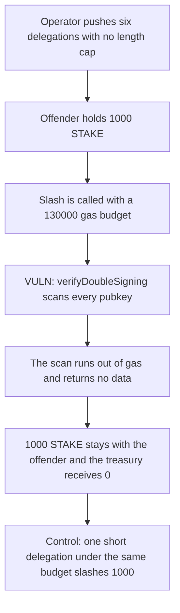

# Ethos: growing delegatedValidators blocks a slash

> **Vulnerability classes:** vuln/dos/griefing · vuln/dos/gas-limit · vuln/dos/unbounded-loop

<!-- non-defihacklabs -->
<!-- source-auditvault: https://github.com/Auditware/AuditVault/blob/main/findings/47343-denial-of-slashing-ottersec-none-ethos-evm-pdf.md -->
<!-- date: 2024-04 -->

## Key info

| | |
|---|---|
| **Protocol** | Ethos ServiceManager |
| **Finding** | OtterSec, AuditVault 47343 |
| **Vulnerable code** | `verifyDoubleSigning` loop over `delegatedValidators` |
| **Harm** | The slash reverts out of gas. 1000 STAKE stays with the offender. A one-entry delegation under the same budget moves 1000 STAKE to the treasury |
| **Chain** | local synthetic |

## TL;DR

`verifyDoubleSigning` walks every entry in `delegatedValidators`. `updateDelegation` pushes another entry for the same operator at constant cost and does not cap the array. Six 320-byte pubkeys make that scan cost more than the 130000 gas slash budget. The inner call reverts with empty return data, `slashedAmount` stays 0, and the offender still holds 1000 STAKE. The same function with one short pubkey, under the same budget, slashes 1000 STAKE into the treasury. A length cap of 8 rejects a further push.

## The vulnerable code

```solidity
function verifyDoubleSigning(address operator, DoubleSigningEvidence memory e) external {
    for (uint256 i = 0; i < delegatedValidators.length; i++) {
        if (compareStrings(delegatedValidators[i].validatorPubkey, e.validatorPubkey) &&
            isDelegationSlashable(delegatedValidators[i].endTimestamp))
        {
            timestampValid = true;
            stake = maxUint96(stake, delegatedValidators[i].stake);
        }
    }
}
```

The marker in the synthetic sits on that `for` loop. `compareStrings` walks the stored pubkey byte by byte, which is the linear cost the report describes. The recommended fix is a length cap. The follow-up in the report stores a percentage instead of an ether amount so a full rescan is not required.

## Root cause

Pushing a delegation does not get more expensive as the array grows. Scanning it does. Nothing stops the operator from calling `updateDelegation` again with the same operator and consumer. Once the scan no longer fits in the gas available to a slash, `verifyDoubleSigning` cannot finish, so the stake transfer never runs.

## Preconditions

The offender has one operator record. Each pushed delegation is slashable (`endTimestamp` is max) and carries stake 1000. The slash is invoked with a 130000 gas stipend. That stipend is enough for one short pubkey and not enough for six 320-byte keys. No time warp is used. `gasleft` only salts the last byte of each key so the compiler cannot delete the scan.

## Attack walkthrough

1. `makeKey` builds a 320-byte pubkey. The last byte depends on `gasleft`.
2. `updateDelegation` pushes it. This repeats six times. `delegatedValidators.length` is 6.
3. 1000 STAKE is minted to the offender.
4. `attemptSlash` calls `verifyDoubleSigning` with 130000 gas.
5. The loop starts comparing keys and runs out of gas. Return data is empty. `slashedAmount` is 0.
6. The offender's balance is still 1000 STAKE. The treasury's balance is 0.

The control deploys the same manager with a cap of 8, pushes one short pubkey, approves 1000 STAKE, and calls `attemptSlash` with the same stipend. The call succeeds. The offender's balance is 0 and the treasury holds 1000 STAKE. A ninth push on that capped manager reverts with `length cap`.

## Diagrams



## Impact

A double-signing operator keeps 1000 STAKE that the slash was supposed to take. The treasury receives nothing. One honest delegation under the same gas budget is slashed in full. On mainnet the same loop is what the report says can be grown past the block gas limit. This run uses a smaller budget so the revert is visible in one call.

## How to reproduce

```bash
cd 47343-denial-of-slashing-ottersec-none-ethos-evm-pdf_exp
forge test -vv
```

`run()` does not warp. The pushes and the reverting slash happen in one call.

## Sources

- AuditVault finding: https://github.com/Auditware/AuditVault/blob/main/findings/47343-denial-of-slashing-ottersec-none-ethos-evm-pdf.md
- OtterSec Ethos EVM review (24 April 2024): https://osec.io/reports/a1b6d78b-c982-421d-b116-eb9d28077075
- Protocol: https://www.ethosstake.com/
- Reviewed tree: https://github.com/Ethos-Works/ethos (patches noted as commits `6795911` and `6120463`)
