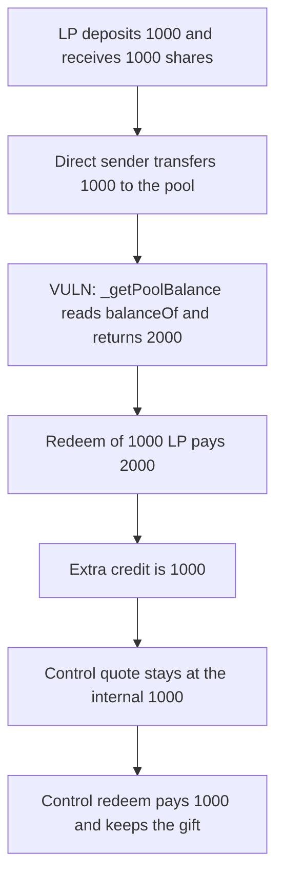

# Stargate V2: `_getPoolBalance` treats a direct transfer as liquidity, so a redeem pays an extra 1000

> **Vulnerability classes:** vuln/logic/fee-calculation · vuln/logic/price-calculation

<!-- non-defihacklabs -->
<!-- source-auditvault: https://github.com/Auditware/AuditVault/blob/main/findings/47356-inflation-of-pool-balances-ottersec-none-stargate-v2-pdf.md -->
<!-- date: 2024-06 -->

## Key info

| | |
|---|---|
| **Protocol** | Stargate V2 |
| **Finding** | OtterSec, AuditVault 47356 |
| **Vulnerable code** | `VulnPool._getPoolBalance` |
| **Harm** | After a 1000 deposit, a 1000 direct transfer makes the pool balance 2000. Redeeming 1000 LP pays 2000, which is 1000 more than the deposit. The control pool still quotes 1000, pays 1000, and keeps the gift |
| **Chain** | local synthetic |

## TL;DR

`_getPoolBalance` returns `IERC20(token).balanceOf(address(this))`. Tokens sent straight to the pool never pass `deposit`, but they raise that balance. A 1000 deposit mints 1000 LP. A later 1000 transfer makes `balanceOf` 2000. Redeeming the 1000 LP pays `1000 * 2000 / 1000 = 2000`. The extra credit is 1000. The control pool returns its internal `accounted` balance, which stays 1000, so the same gift is not paid out.

## The vulnerable code

```solidity
function _getPoolBalance() internal view virtual returns (uint256 balance) {
    // @> VULN: a direct transfer raises balanceOf without a deposit, so this pool balance is inflated.
    balance = IERC20(token).balanceOf(address(this));
}
```

The redeem then does `paid = lpAmount * _getPoolBalance() / totalSupply`. The fix keeps an internal pool balance and changes it only on deposit, redeem, and fee credits.

## Root cause

`balanceOf` is the token contract's view of every token sitting on the pool, including transfers that skipped `deposit`. The LP supply only grows in `deposit`. Dividing the raw balance by that supply prices the direct transfer into the next redeem. OtterSec also notes that `FeeLibV1.applyFeeView` reverts when this inflated balance exceeds LP TVL. This reduction shows the exchange-rate credit, which is the fund movement.

## Preconditions

The pool starts empty. The LP deposits 1000 and receives 1000 shares. `DirectSender` then transfers 1000 of the same token to the pool and does not call `deposit`. The control pool receives the same 1000 deposit and the same 1000 gift. `run()` does not warp.

## Attack walkthrough

1. Deposit 1000. The pool mints 1000 LP and sets `accounted` to 1000.
2. `DirectSender` transfers 1000 to the pool. Supply stays 1000. `balanceOf` becomes 2000.
3. `_getPoolBalance` returns 2000.
4. Redeem 1000 LP. `paid = 1000 * 2000 / 1000 = 2000`. The extra credit is 1000.
5. The control pool takes the same deposit and the same gift. Its quote stays 1000.
6. The control redeem pays 1000. The gifted 1000 is still in the control pool.

## Diagrams



## Impact

The LP who redeems after the direct transfer receives 2000 instead of the 1000 they deposited. The 1000 that was sent straight to the pool is the extra credit. The same sequence on the internal-balance pool pays 1000 and leaves the 1000 gift in the contract. A fee view that refuses a pool balance above TVL would also revert once `balanceOf` passes the LP supply, which is the disruption described in the report.

## How to reproduce

```bash
cd 47356-inflation-of-pool-balances-ottersec-none-stargate-v2-pdf_exp
forge test -vv
```

`run()` does not warp. The vulnerable redeem pays 2000. The control redeem pays 1000.

## Sources

- AuditVault finding: https://github.com/Auditware/AuditVault/blob/main/findings/47356-inflation-of-pool-balances-ottersec-none-stargate-v2-pdf.md
- OtterSec Stargate V2 review (2024, page 6 of 19): https://stargate.finance/
- Pool code: https://github.com/stargate-protocol/stargate-v2/blob/main/packages/stg-evm-v2/src/StargatePool.sol
- The report says the bug was fixed in commit `13edc95`, which replaced the `balanceOf` read with an internal pool balance.
