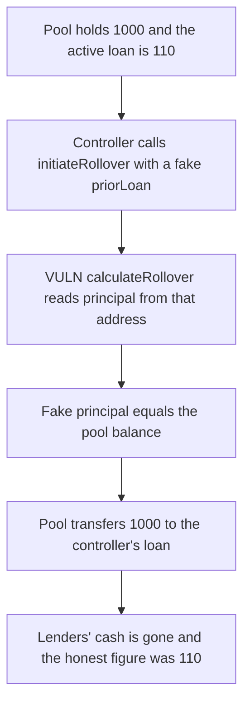

# OpenTrade: initiateRollover trusts an arbitrary prior loan

> **Vulnerability classes:** `vuln/input-validation/missing` · `vuln/logic/missing-validation`

<!-- non-defihacklabs -->
<!-- source-auditvault: https://github.com/Auditware/AuditVault/blob/main/findings/47890-loan-address-validation-ottersec-none-opentrade-pdf.md -->
<!-- date: 2023-09 -->

## Key info

| Field | Value |
|---|---|
| **Loss** | 1000 USDC moves from the pool to the controller's loan. The active loan was only 110 |
| **Vulnerable contract** | `Pool.initiateRollover` |
| **Attacker EOA** | `0x1111111111111111111111111111111111111111` |
| **Attack contract** | `Exploit` |
| **Attack tx** | `Exploit.run()` |
| **Chain / block / date** | Ethereum model · block 0 · 2023-09 |
| **Compiler** | solc 0.8.27, cancun, via IR |
| **Bug class** | priorLoan is not the active loan |

## TL;DR

`initiateRollover` is `onlyPoolController` and passes `priorLoan` into `calculateRollover` with no check. That function adds `principal()` and `interest()` from whatever address it was given. The active loan would report 110. The controller passes a contract whose `principal()` is the pool's token balance. The pool transfers 1000 USDC to the controller's new loan and is left empty.

## The vulnerable code

```solidity
function initiateRollover(address loan, address priorLoan) external onlyPoolController {
    (assetsFromPriorToNextLoan) = calculateRollover(priorLoan); // @> VULN: priorLoan is not required to be the active loan
    liquidity.transfer(loan, assetsFromPriorToNextLoan);
}
```

OtterSec's patch requires `priorLoan == activeLoan` before the call.

## Root cause

`calculateRollover` trusts the loan for the numbers that size a token transfer. The only caller gate is the pool controller. The controller is supposed to roll the active loan, not to choose the oracle for how much cash leaves the pool. Without the equality check, the controller picks both the number and the recipient.

## Preconditions

- The pool holds 1000 of the liquidity asset.
- The active loan's principal plus interest is 110.
- The caller is the pool controller and can deploy a contract with `principal()` and `interest()`.

## Attack walkthrough

1. Read the honest rollover: 110.
2. Call `initiateRollover(adminLoan, fakeLoan)`.
3. `fakeLoan.principal()` returns `token.balanceOf(pool)`, which is 1000. Interest is 0.
4. The pool transfers 1000 to `adminLoan`.
5. The pool balance is 0. The excess over the honest figure is 890.

## Diagrams



## Impact

Lenders' 1000 USDC is pulled out in one call. A rollover that passes the real active loan moves 110 and leaves 890 in the pool. The controller is a privileged role, and the missing check is what turns that role into an unbounded withdrawal.

## Remediation

Require `priorLoan == activeLoan` (and the destination loan to be the requested loan) before `calculateRollover`, as in the OtterSec patch.

## How to reproduce

```bash
cd 47890-loan-address-validation-ottersec-none-opentrade-pdf_exp
forge test -vv
```

## Sources

- AuditVault finding: https://github.com/Auditware/AuditVault/blob/main/findings/47890-loan-address-validation-ottersec-none-opentrade-pdf.md
- OpenTrade: https://www.open-trade.io/
- Fix noted in the finding: commit `e20b41a`
