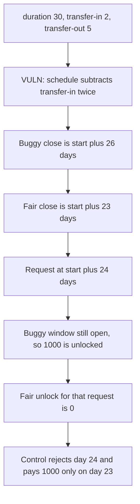

# OpenTrade: the early-redeem deadline subtracts the transfer-in window twice

> **Vulnerability classes:** vuln/logic/incorrect-order-of-operations · vuln/logic/wrong-condition

<!-- non-defihacklabs -->
<!-- source-auditvault: https://github.com/Auditware/AuditVault/blob/main/findings/47891-incorrect-timestamp-calculation-ottersec-none-opentrade-pdf.md -->
<!-- date: 2023-09 -->

## Key info

| | |
|---|---|
| **Protocol** | OpenTrade Loan |
| **Finding** | OtterSec, AuditVault 47891 |
| **Vulnerable code** | `calculateSchedule` / `earlyRedeemRequestClosingTimestamp` |
| **Harm** | A request on day 24 unlocks 1000. The fair close is day 23, so the fair unlock is 0. The corrected schedule pays 1000 only on day 23 and rejects day 24 |
| **Chain** | local synthetic |

## TL;DR

`calculateSchedule` sets `earlyRedeemRequestClosingTimestamp` to `accrualStart + (durationDays - transferIn - transferIn) days`. It should subtract `transferOut` the second time. With duration 30, transfer-in 2 and transfer-out 5, the stored deadline is start + 26 days. The corrected deadline is start + 23 days. A redeem request at start + 24 days is after the fair close and still inside the buggy window, so the loan transfers 1000 to the lender. The same request against the corrected timestamp reverts, and the lender's balance stays 0. A request exactly on day 23 is paid under the corrected formula.

## The vulnerable code

```solidity
function calculateSchedule() internal {
    earlyRedeemRequestClosingTimestamp =
        accrualStartTimestamp +
        (settings.durationDays -
        settings.transferInWindowDurationDays -
        settings.transferInWindowDurationDays) *
        (1 days);
}
```

The fix replaces the second `transferInWindowDurationDays` with `transferOutWindowDurationDays`.

## Root cause

The two window fields are not the same number. Subtracting the transfer-in window from itself drops the transfer-out window from the formula. The deadline moves later by `transferOut - transferIn` days, here 3 days. Early redeem is allowed through that later timestamp, so principal is released during a period that should already be closed.

## Preconditions

`durationDays` is 30, `transferInWindowDurationDays` is 2, `transferOutWindowDurationDays` is 5. `accrualStartTimestamp` is the stored constant 1700000000. The loan holds 1000 of the loan asset. The request time is `start + 24 days`, computed in the same call. `run()` does not warp. The block timestamp is never read.

## Attack walkthrough

1. `openSchedule` runs `calculateSchedule`.
2. The product is 26 days. `earlyRedeemRequestClosingTimestamp` is start + 26 days.
3. `fairClosing` is start + 23 days.
4. The request timestamp is start + 24 days. That is after the fair close, so the fair unlock is 0.
5. `requestEarlyRedeem` compares the request with the buggy close. Day 24 is allowed. The loan transfers 1000 to the lender.

The control loan writes the corrected product, 23 days. The day-24 request reverts with `early redeem closed` and the lender still has 0. The day-23 request is paid 1000.

## Diagrams



## Impact

The lender receives 1000 on day 24. Under the corrected deadline that request unlocks nothing. The loan gives up principal 1 day after early redeem should have closed, and the window stays open until day 26. Interest or a lock that keys off this timestamp is early by the same 3 days.

## How to reproduce

```bash
cd 47891-incorrect-timestamp-calculation-ottersec-none-opentrade-pdf_exp
forge test -vv
```

`run()` does not warp. Both deadlines are `accrualStartTimestamp` plus a day count from the formula.

## Sources

- AuditVault finding: https://github.com/Auditware/AuditVault/blob/main/findings/47891-incorrect-timestamp-calculation-ottersec-none-opentrade-pdf.md
- OtterSec OpenTrade review (4 September 2023): https://osec.io/reports/65c2a94b-060f-4e6c-9546-cbf0e468afd3
- Protocol: https://www.open-trade.io/
- Reviewed tree: https://github.com/tomniermann/ot-perimeter-protocol (`contracts/Loan.sol`, patch commit `6249748`)
