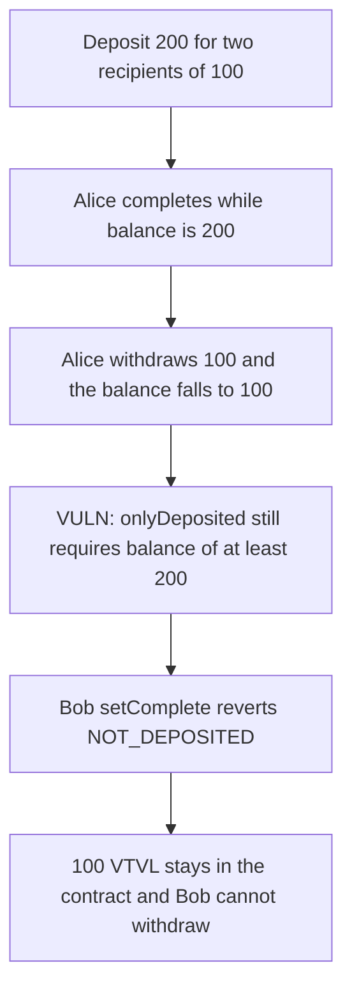

# VTVL — `onlyDeposited` locks the remaining milestone allocation

> **Vulnerability classes:** vuln/dos/frozen-funds · vuln/dos/lockup · vuln/logic/wrong-condition

> **Reproduction:** self-contained Foundry PoC, no fork and no cheatcodes in the exploit. Trace: [output.txt](output.txt).

<!-- non-defihacklabs -->
<!-- source-auditvault: https://github.com/Auditware/AuditVault/blob/main/findings/47910-locked-tokens-in-milestone-contract-ottersec-none-vtvl-pdf.md -->
<!-- date: 2023-04 -->

## Key info

| | |
|---|---|
| **Impact** | **HIGH** — after one recipient withdraws, 100 VTVL is stuck and the other recipient cannot complete or withdraw |
| **Protocol** | VTVL `BaseMilestone` |
| **Vulnerable code** | `onlyDeposited`: `balance >= allocation * recipients.length` |
| **Bug class** | Withdrawals ignored by a constant balance check |
| **Finding** | OtterSec — Robert Chen · #47910 |
| **Report** | [vtvl.io](https://vtvl.io/) |
| **Source** | [AuditVault](https://github.com/Auditware/AuditVault/blob/main/findings/47910-locked-tokens-in-milestone-contract-ottersec-none-vtvl-pdf.md) |
| **Compiler** | solc 0.8.27, cancun, via_ir |

## TL;DR

`onlyDeposited` lets a milestone be marked complete only when the contract's token balance is at least `allocation * recipients.length`. That product does not shrink when someone withdraws. With two recipients of 100 each, Alice completes and withdraws 100. The balance is then 100, the check still demands 200, and Bob's `setComplete` reverts. His 100 stays in the contract. Counting `totalWithdrawnAmount` lets Bob complete and withdraw that 100.

## The vulnerable code

```solidity
modifier onlyDeposited() {
    uint256 balance = tokenAddress.balanceOf(address(this));
    // @> VULN: live balance is compared to the original full allocation, which ignores withdrawals
    require(balance >= allocation * recipients.length, "NOT_DEPOSITED");
    // FIX: require(balance + totalWithdrawnAmount >= allocation * recipients.length, "NOT_DEPOSITED");
    _;
}
```

## Root cause

The threshold is a constant computed from the original recipient list. Withdrawals reduce `balanceOf` and do not reduce the threshold. Once any recipient is paid, the remaining balance is below `allocation * recipients.length` even though it still equals the unpaid allocations. `setComplete` is gated by that modifier, and `withdraw` requires complete, so the unpaid tokens cannot move.

## Preconditions

The contract holds exactly the sum of the allocations. At least one recipient completes and withdraws before another recipient is marked complete. No admin action and no time change are required.

## Attack walkthrough

1. Deposit 200 VTVL for Alice and Bob, 100 each (`100000000000000000000` per recipient).
2. `setComplete(Alice)` passes: balance 200 >= 200.
3. Alice withdraws 100. Balance is 100. `totalWithdrawnAmount` is 100.
4. `setComplete(Bob)` hits `onlyDeposited` and reverts `NOT_DEPOSITED` because 100 < 200.
5. The contract still holds 100 VTVL. Bob's balance is 0. Bob is not complete, so he cannot withdraw.

Control: `setCompleteFixed` requires `balance + totalWithdrawnAmount >= allocation * recipients.length`. After the same Alice withdrawal that sum is still 200. Bob completes and withdraws. The contract balance goes to 0 and Bob receives 100.

## Diagrams



## Impact

Bob cannot withdraw his 100 VTVL. Those tokens sit in the milestone contract. Depositing another 100 to push the balance back to 200 would itself become stuck under the same check after Bob withdraws, which is the extra loss the report describes. The fixed check releases the original 100 without a top-up.

## Remediation

Do not compare the live balance to the original full allocation. Subtract tokens already withdrawn, or compare the balance minus tokens reserved for still-incomplete milestones with the single milestone's allocation, and track `totalWithdrawnAmount` as the later patch does.

## Sources

- AuditVault finding: https://github.com/Auditware/AuditVault/blob/main/findings/47910-locked-tokens-in-milestone-contract-ottersec-none-vtvl-pdf.md
- Report page cited by the finding: https://vtvl.io/
- The quoted `onlyDeposited` modifier and the `totalWithdrawnAmount` fix are taken from that finding. The public page does not publish a month; 2023-04 is the dated OtterSec / VTVL engagement by the named reporter Robert Chen.
