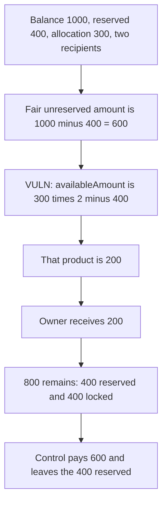

# VTVL: withdrawAdmin releases 200 when 600 is unreserved

> **Vulnerability classes:** vuln/logic/wrong-condition · vuln/dos/frozen-funds

<!-- non-defihacklabs -->
<!-- source-auditvault: https://github.com/Auditware/AuditVault/blob/main/findings/47911-inaccurate-withdrawable-token-amount-ottersec-none-vtvl-pdf.md -->
<!-- date: 2023-07 -->

## Key info

| | |
|---|---|
| **Protocol** | VTVL BaseMilestone |
| **Finding** | OtterSec, AuditVault 47911 |
| **Vulnerable code** | `withdrawAdmin` |
| **Harm** | The owner withdraws 200. The fair unreserved amount is 600. 400 stays locked next to the 400 reserved. The corrected withdraw pays 600 and leaves 400 |
| **Chain** | local synthetic |

## TL;DR

`withdrawAdmin` sets `availableAmount` to `allocation * recipients.length - numTokensReservedForVesting`. Allocation is 300 and there are two recipients, so the notional cap is 600. Reserved vesting is 400, so the function transfers 200. The contract's token balance is 1000, and 1000 - 400 = 600 is not reserved. The owner receives 200. 400 of unreserved tokens stays in the contract. The corrected function uses `balanceOf(address(this)) - numTokensReservedForVesting`, transfers 600, and leaves exactly the 400 that is reserved.

## The vulnerable code

```solidity
function withdrawAdmin() public onlyOwner {
    uint256 availableAmount = allocation * recipients.length -
        numTokensReservedForVesting;
    tokenAddress.safeTransfer(msg.sender, availableAmount);
    emit AdminWithdrawn(_msgSender(), availableAmount);
}
```

The fix replaces `allocation * recipients.length` with the contract's token balance.

## Root cause

The notional product `allocation * recipients.length` is not the number of tokens the contract holds, and it is not the number reserved. `numTokensReservedForVesting` is the only figure that tracks tokens actually set aside. Anything the contract holds above `allocation * recipients.length` can never appear in `availableAmount`, so it cannot be withdrawn. Here the balance is 400 above that product. Those 400 are not part of the 400 reserved either. They are stuck.

## Preconditions

The owner calls `withdrawAdmin`. `allocation` is 300. `recipients.length` is 2. `numTokensReservedForVesting` is 400. The contract holds 1000 of the vesting token. No other withdrawal has run.

## Attack walkthrough

1. 1000 is minted to the milestone.
2. `fairWithdrawable` reads `1000 - 400 = 600`.
3. `withdrawAdmin` computes `300 * 2 - 400 = 200`.
4. `safeTransfer` sends 200 to the owner.
5. The contract still holds 800. Of that, 400 is reserved and 400 is the locked surplus.

The control milestone is funded with the same 1000 and the same 400 reserved. Its withdraw uses the balance. The owner receives 600. The contract keeps 400.

## Diagrams



## Impact

The owner, who is supposed to be able to recover every token that is not reserved for vesting, is short 400. Those tokens are not assigned to a recipient. They sit in the contract with no withdraw path under this formula. Recipients' 400 reserved tokens are untouched. The loss is the owner's unreserved surplus, not the vested amount.

## How to reproduce

```bash
cd 47911-inaccurate-withdrawable-token-amount-ottersec-none-vtvl-pdf_exp
forge test -vv
```

`run()` does not warp.

## Sources

- AuditVault finding: https://github.com/Auditware/AuditVault/blob/main/findings/47911-inaccurate-withdrawable-token-amount-ottersec-none-vtvl-pdf.md
- OtterSec VTVL review (26 July 2023): https://osec.io/reports/94ef4919-b1c2-4ccf-bfda-24c7ba805505
- Protocol: https://vtvl.io/
- Reviewed tree: https://github.com/VTVL-co/vtvl-smart-contracts/tree/audit-ready-jul-23 (patches noted as commits `dbf1f5a` and `cdfa29d`)
