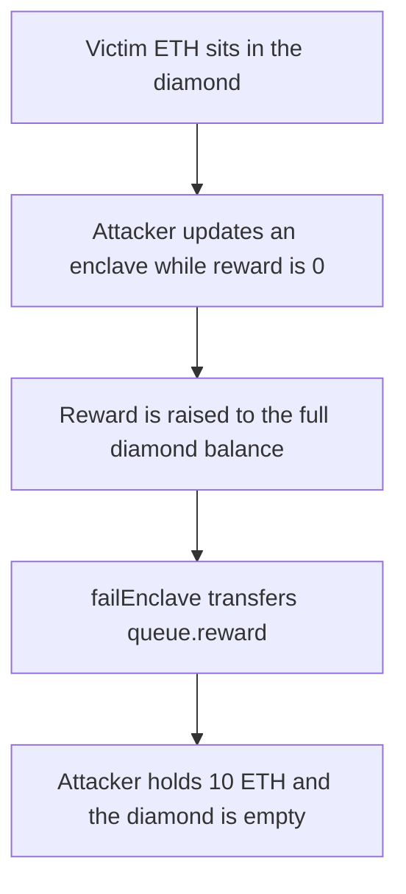

# Switchboard — raising queue.reward after a free update drains the diamond

> **Vulnerability classes:** `vuln/logic/reward-calculation` · `vuln/logic/missing-check`

> **Reproduction:** a self-contained Foundry PoC that compiles and runs offline
> with only `forge-std` — no fork and no RPC. Trace: [output.txt](output.txt).
> PoC: [test/47980-reward-manipulation-ottersec-none-switchboard-evm-pdf_exp.sol](test/47980-reward-manipulation-ottersec-none-switchboard-evm-pdf_exp.sol).

<!-- non-defihacklabs -->
<!-- source-auditvault: https://github.com/Auditware/AuditVault/blob/main/findings/47980-reward-manipulation-ottersec-none-switchboard-evm-pdf.md -->
<!-- date: 1970-01 -->

---

## Key info

| | |
|---|---|
| **Impact** | **HIGH** — the caller receives the diamond's **10 ETH**, which was the victim enclave's balance |
| **Protocol** | Switchboard EVM diamond, `failEnclave` / `setAttestationQueueConfig` |
| **Vulnerable code** | `payable(msg.sender).transfer(queue.reward)` with no cap at the enclave balance |
| **Bug class** | Queue reward is mutable between funding and payout |
| **Finding** | OtterSec — Switchboard EVM · id 47980 |
| **Report** | The finding's report URL does not name a month. Patched in commits `a58f237` and `a937a28`. |
| **Source** | [AuditVault finding](https://github.com/Auditware/AuditVault/blob/main/findings/47980-reward-manipulation-ottersec-none-switchboard-evm-pdf.md) |
| **Compiler** | solc 0.8.27, cancun, via IR |

---

## TL;DR

`updateEnclave` only requires `msg.value >= queue.reward`, then credits the enclave with `msg.value`. An attacker creates a queue whose reward is 0, posts an enclave for free, and marks it verified.

`setAttestationQueueConfig` then sets `queue.reward` to the diamond's whole ETH balance. That balance is someone else's enclave deposit. `failEnclave` pays `queue.reward` to `msg.sender` and does not look at `enclaveBalance`. The attacker receives 10 ETH. The diamond is empty.

The fixed payout reverts when `queue.reward` is larger than the enclave balance. The attacker's enclave was funded with 0, so the 10 ETH stays put.

The diamond is pre-funded with 10 ETH before `run()` (Forge `vm.deal`, Playground `fundWei`). That is the victim deposit. `run()` itself does the free update, the reward raise, and the payout.

## The vulnerable code

```solidity
if (queueReward > 0) {
    payable(msg.sender).transfer(queueReward); // @> VULN: pays the mutable reward, not the enclave balance
}
```

```diff
 uint256 owed = enclaveBalance[enclaveId];
+if (queueReward > owed) revert("reward exceeds enclave balance");
 if (owed > 0) payable(msg.sender).transfer(owed);
```

## Attack walkthrough

1. The diamond holds 10 ETH credited to the victim enclave. `queue.reward` is 0.
2. `updateEnclave` with value 0 succeeds. The attacker enclave balance stays 0.
3. `forceOverrideVerify` marks that enclave as a verifier.
4. `setAttestationQueueConfig` sets the reward to 10 ETH.
5. `failEnclave` transfers `queue.reward` to the caller. The attacker holds 10 ETH.

## Diagrams



## Impact

ETH that other users deposited into enclaves on the same diamond can be withdrawn by the owner of a zero-reward queue. The payout is whatever `queue.reward` currently says, which the attacker sets to `address(diamond).balance`.

## Sources

- [AuditVault 47980](https://github.com/Auditware/AuditVault/blob/main/findings/47980-reward-manipulation-ottersec-none-switchboard-evm-pdf.md)
- Finding text: OtterSec Switchboard EVM, fixed in commits `a58f237` and `a937a28`. No public month was available, so the date marker is undated.
- Blamed functions: `updateEnclave`, `setAttestationQueueConfig`, `failEnclave`, as quoted in the finding
