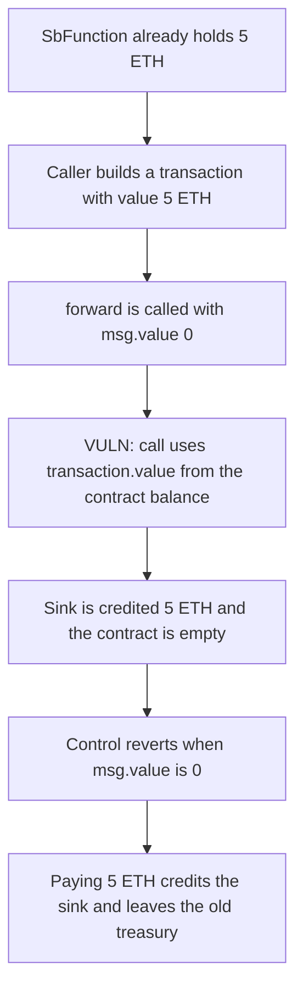

# Switchboard: forward spends 5 ETH the caller did not pay

> **Vulnerability classes:** vuln/logic/missing-check · vuln/dependency/unsafe-external-call

<!-- non-defihacklabs -->
<!-- source-auditvault: https://github.com/Auditware/AuditVault/blob/main/findings/47981-unchecked-fund-provision-ottersec-none-switchboard-evm-pdf.md -->
<!-- date: 2023-06 -->

## Key info

| | |
|---|---|
| **Protocol** | Switchboard SbFunction |
| **Finding** | OtterSec, AuditVault 47981 |
| **Vulnerable code** | `forward` value call |
| **Harm** | The sink is credited 5 ETH. The caller paid 0. The corrected forward reverts unless the caller pays 5 ETH, and that payment does not spend a pre-existing treasury |
| **Chain** | local synthetic |

## TL;DR

`SbFunction.forward` loops over caller-supplied transactions and calls `transaction.to` with `transaction.value`. It does not check `msg.value`. A contract that already holds 5 ETH can be told to send all of it. This call attaches 0. The sink receives 5 ETH and the contract balance becomes 0. The corrected `forward` reverts with `payment required` when `msg.value` is 0. When the caller does send 5 ETH, the sink is credited 5 ETH and a pre-existing 5 ETH treasury is still there.

## The vulnerable code

```solidity
function forward(Transaction[] memory transactions, bytes[] memory signatures) external payable {
    for (uint256 i = 0; i < transactions.length; i++) {
        Transaction memory transaction = transactions[i];
        (bool success, bytes memory returnData) = transaction.to.call{
            value: transaction.value
        }(abi.encodePacked(transaction.data, transaction.from));
    }
}
```

The report's fix is to pass `value: 0` so `forward` cannot move ETH. The control here instead requires `msg.value` to equal the sum of `transaction.value`, which is the check the missing code should have made before any value is forwarded.

## Root cause

`transaction.value` is taken from the calldata the caller wrote. It is not bounded by `msg.value` or by a separate pull of funds from that caller. The ETH sent by the call is the contract's own balance. Setting `transaction.value` to that balance and `transaction.to` to an attacker address drains it in one call.

## Preconditions

`SbFunction` holds 5 ETH before the call. That funding is not part of `run`. The forwarded transaction sets `value` to 5 ETH and `to` to the sink. `msg.value` is 0. One transaction is enough.

## Attack walkthrough

1. `run` reads `address(sb).balance` and requires it to be 5 ETH.
2. It builds one transaction: sink, value 5 ETH, empty calldata, empty signatures.
3. `forward` stores `msg.value`, which is 0.
4. The call sends 5 ETH to the sink. It succeeds.
5. The sink is credited 5 ETH. The contract balance is 0. `lastMsgValue` is 0.

The control contract starts with the same 5 ETH treasury. `forward` with `msg.value` 0 reverts `payment required`. The treasury is still 5 ETH and the sink is still 0. `forward` with `msg.value` 5 ETH credits the sink 5 ETH and the contract still holds its original 5 ETH.

## Diagrams



## Impact

Whoever can call `forward` can move the contract's ETH to an address they choose without paying for it. Here that is 5 ETH, the whole balance. The caller of this transaction paid 0. A call that is required to attach 5 ETH does not touch a pre-existing treasury.

## How to reproduce

```bash
cd 47981-unchecked-fund-provision-ottersec-none-switchboard-evm-pdf_exp
forge test -vv
```

The forge test deals 5 ETH to `SbFunction` before `run()`. `run()` does not warp and does not deal.

## Sources

- AuditVault finding: https://github.com/Auditware/AuditVault/blob/main/findings/47981-unchecked-fund-provision-ottersec-none-switchboard-evm-pdf.md
- OtterSec Switchboard_evm review (30 June 2023): https://osec.io/reports/598960a1-40c2-46f0-aaf5-7995393e9ba7
- Protocol: https://switchboard.xyz/
- Reviewed tree: https://github.com/switchboard-xyz/switchboard-evm (`contracts/src/Switchboard/sbFunction/SbFunction.sol`, patch commit `e833e48`)
