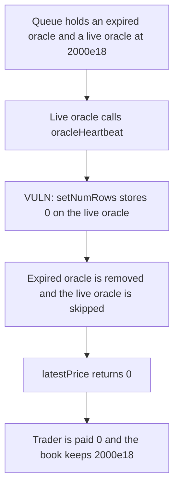

# Switchboard — garbage collection drops the live oracle

> **Vulnerability classes:** vuln/oracle/stale-price

<!-- non-defihacklabs -->
<!-- source-auditvault: https://github.com/Auditware/AuditVault/blob/main/findings/47982-incorrect-oracle-garbage-collection-ottersec-none-switchboar.md -->
<!-- date: 2023-06 -->

## Key info

| | |
|---|---|
| **Protocol** | Switchboard |
| **Finding** | OtterSec, AuditVault 47982 |
| **Vulnerable code** | `Oracle.oracleHeartbeat` → `OracleLib.setNumRows` |
| **Harm** | The price read returns 0. The trader is paid 0 instead of 2000e18. The book keeps 2000e18. |
| **Chain** | local synthetic |

## TL;DR

`oracleHeartbeat` garbage-collects an expired oracle, then calls `OracleLib.setNumRows(oracleId, 0)` on the live caller instead of `setNumRows(gcOracleId, 0)`. The live oracle stays in the queue with `numRows == 0`. The later read only accepts an oracle with `numRows == 1` and a fresh heartbeat, so it returns 0. Settlement pays 0. The fair price is 2000e18, so the trader is short 2000e18 and the book keeps that amount. The control zeroes the expired oracle, leaves the live `numRows` at 1, reads 2000e18, and pays 2000e18.

## The vulnerable code

```solidity
if ((OracleLib.oracles(gcOracleId).lastHeartbeat + queue.oracleTimeout) < block.timestamp) {
    emit OracleGC(gcOracleId, oracle.queueId);
    OracleLib.setNumRows(oracleId, 0);
    OracleQueueLib.swapRemove(oracle.queueId, gcIdx);
}
```

`setNumRows` is inlined by viaIR. The store that runs is:

```solidity
// @> VULN: heartbeat passes the live oracleId, so this store drops the fresh oracle
layout().oracles[id].numRows = n;
```

The fix is `OracleLib.setNumRows(gcOracleId, 0)`.

## Root cause

`numRows` is the count of queues an oracle belongs to. Other code assumes that count matches membership, and a read treats `numRows == 1` as "this oracle is the one live queue member." Garbage collection removes the expired oracle from the array, but it zeroes the heartbeat caller. The fresh oracle is dropped from the read. The expired oracle keeps `numRows == 1` after it has been removed.

## Preconditions

The queue is `[dead, live]` and `gcIdx` is 0. The dead oracle's `lastHeartbeat` is 0 and `oracleTimeout` is 0, so it is already expired at this block's timestamp. The live oracle's price is 2000e18 and its heartbeat is this block. The book holds 2000e18 of settlement tokens, which is the fair payout. No timestamp warp is required.

## Attack walkthrough

1. The dead oracle is enrolled at queue slot 0 with price 500e18 and `lastHeartbeat` 0.
2. The live oracle is enrolled with price 2000e18 and a heartbeat at `block.timestamp`.
3. 2000e18 settlement tokens are minted onto the book.
4. The live oracle calls `oracleHeartbeat`. The expiry check is true for the dead oracle.
5. `setNumRows` stores 0 on the live oracle. `swapRemove` deletes the dead oracle.
6. `latestPrice` skips the live oracle because `numRows` is 0 and returns 0.
7. `settle` sets `paid` to 0. The trader's balance stays 0. The book still holds 2000e18.

The control calls `setNumRows(gcOracleId, 0)`. The live oracle keeps `numRows == 1`, `latestPrice` returns 2000e18, and the trader receives 2000e18.

## Diagrams



## Impact

The trader who is owed the live price receives 0 instead of 2000e18. The book retains 2000e18. The same settlement on the fixed heartbeat pays the trader 2000e18 and leaves the book empty. The wrong amount is 2000e18.

## Remediation

Change `OracleLib.setNumRows(oracleId, 0)` to `OracleLib.setNumRows(gcOracleId, 0)` so garbage collection clears the expired oracle and the live oracle stays eligible.

## How to reproduce

```bash
cd 47982-incorrect-oracle-garbage-collection-ottersec-none-switchboar_exp
forge test -vv
```

## Sources

- AuditVault finding: https://github.com/Auditware/AuditVault/blob/main/findings/47982-incorrect-oracle-garbage-collection-ottersec-none-switchboar.md
- OtterSec report: https://switchboard.xyz/ (Switchboard EVM review, June 2023)
- Vulnerable function: `contracts/src/Switchboard/oracle/Oracle.sol` `oracleHeartbeat`, as quoted in the finding. Fixed in commit `e833e48`.
