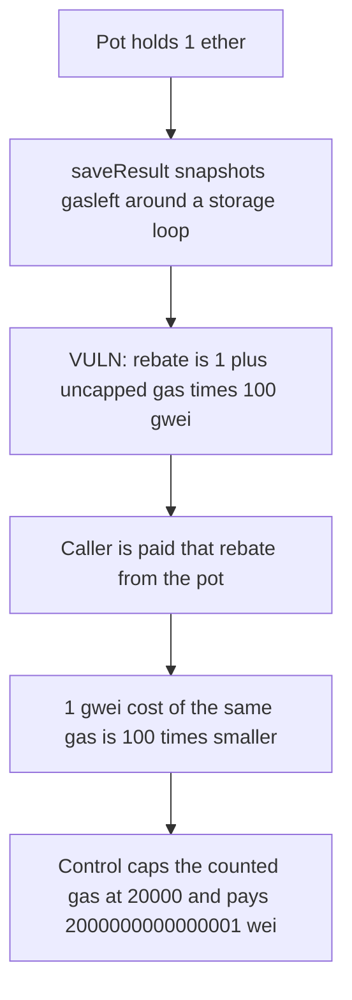

# Switchboard — uncapped gas rebate drains the pot

> **Vulnerability classes:** vuln/logic/fee-calculation · vuln/arithmetic/precision-loss

<!-- non-defihacklabs -->
<!-- source-auditvault: https://github.com/Auditware/AuditVault/blob/main/findings/47983-unbounded-gas-rebate-ottersec-none-switchboard-evm-pdf.md -->
<!-- date: 2023-06 -->

## Key info

| | |
|---|---|
| **Protocol** | Switchboard |
| **Finding** | OtterSec, AuditVault 47983 |
| **Vulnerable code** | `Aggregator.saveResult` |
| **Harm** | The caller is paid 1 + gasUsed * 100 gwei from the pot. That is 100 times the same gas at 1 gwei. |
| **Chain** | local synthetic |

## TL;DR

`saveResult` pays `reward + (remainingGas - gasleft()) * gasPrice` with no cap on the gas it counts. A block builder sets the gas price and does not pay it. This VM reports `tx.gasprice == 0`, so the formula uses a 100 gwei builder price. The fair cost of that gas is `gasUsed * 1 gwei`. The rebate is the 100 gwei figure plus a 1 wei reward, and it is transferred out of a 1 ether pot. The control counts at most 20000 gas and pays 2000000000000001 wei.

## The vulnerable code

```solidity
uint256 remainingGas = gasleft();
/* computation intensive work */
uint256 fullReward = reward + (remainingGas - gasleft()) * price;
if (balanceLeftForInterval >= fullReward && reward != 0) {
    balanceLeftForInterval -= fullReward;
    payable(msg.sender).transfer(fullReward);
}
```

`price` is `tx.gasprice`, or 100 gwei when `tx.gasprice` is 0. The audited expression is `(remainingGas - gasleft()) * tx.gasprice`. The fix caps the counted gas:

```solidity
uint256 spent = remainingGas - gasleft();
if (spent > MAX_REBATE_GAS) spent = MAX_REBATE_GAS;
uint256 fullReward = reward + spent * price;
```

## Root cause

The rebate trusts the caller's gas price and the amount of gas burned inside the snapshot. A builder can raise the price and burn extra gas in the measured window. Ordinary users pay that gas price themselves, so the rebate only makes them whole. A builder does not pay it, so the same formula is a withdrawal from the pot.

## Preconditions

The aggregator holds 1 ether and `balanceLeftForInterval` is 1 ether. `reward` is 1 wei, so the payment branch is taken. The measured work is 40 storage updates. `MAX_REBATE_GAS` on the control is 20000. No timestamp warp.

## Attack walkthrough

1. The caller deposits 1 ether into the aggregator.
2. `saveResult` snapshots `gasleft`, runs the storage loop, and reads `gasleft` again.
3. `fullReward` becomes `1 + gasUsed * 100 gwei`.
4. The aggregator transfers `fullReward` to the caller and subtracts it from the interval balance.

Forge logs `gasUsed` 36357, `rebateWei` 3635700000000001, and `gasSpentWei` 36357000000000. The playground prices the same loop at 32357 gas, so the caller receives 3235700000000001 wei against a 1 gwei cost of 32357000000000 wei. Both rebates are 100 times the 1 gwei cost and both leave the pot short by that rebate. The control pays 2000000000000001 wei.

## Diagrams



## Impact

The caller receives more wei than the gas costs at 1 gwei. In the playground that is 3235700000000001 wei received against 32357000000000 wei of gas cost, taken from the pot. The capped path pays 2000000000000001 wei for the same work.

## Remediation

Cap the gas counted in the rebate at a constant, as in the patched `saveResult`. A 20000 gas cap pays `1 + 20000 * 100 gwei` instead of the uncapped product.

## How to reproduce

```bash
cd 47983-unbounded-gas-rebate-ottersec-none-switchboard-evm-pdf_exp
forge test -vv
```

## Sources

- AuditVault finding: https://github.com/Auditware/AuditVault/blob/main/findings/47983-unbounded-gas-rebate-ottersec-none-switchboard-evm-pdf.md
- OtterSec report: https://switchboard.xyz/ (Switchboard EVM review, June 2023)
- Vulnerable function: `contracts/src/aggregator/Aggregator.sol` `saveResult`, as quoted in the finding. Patched in commits `ee13d95` and `168ec96`.
